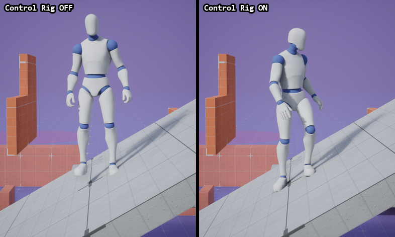
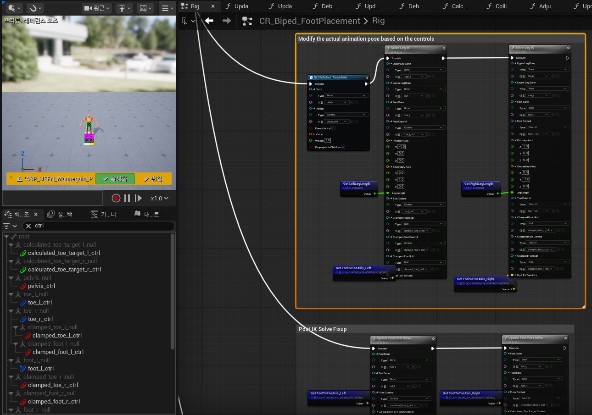
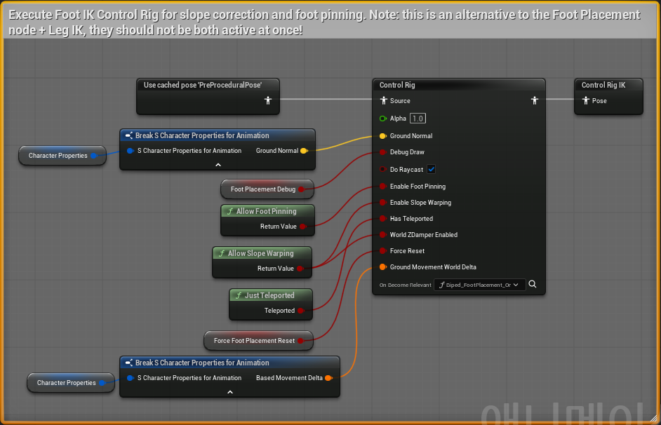
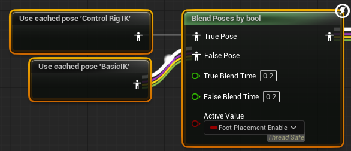
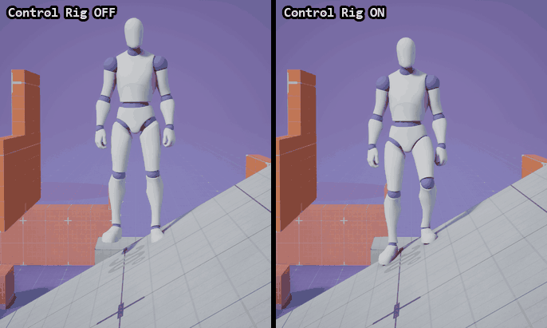
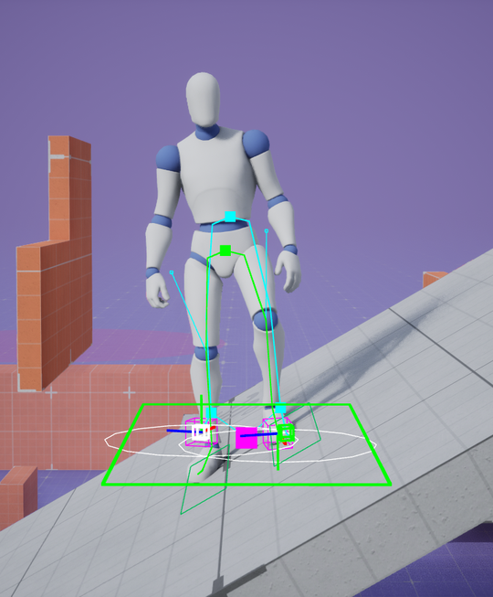
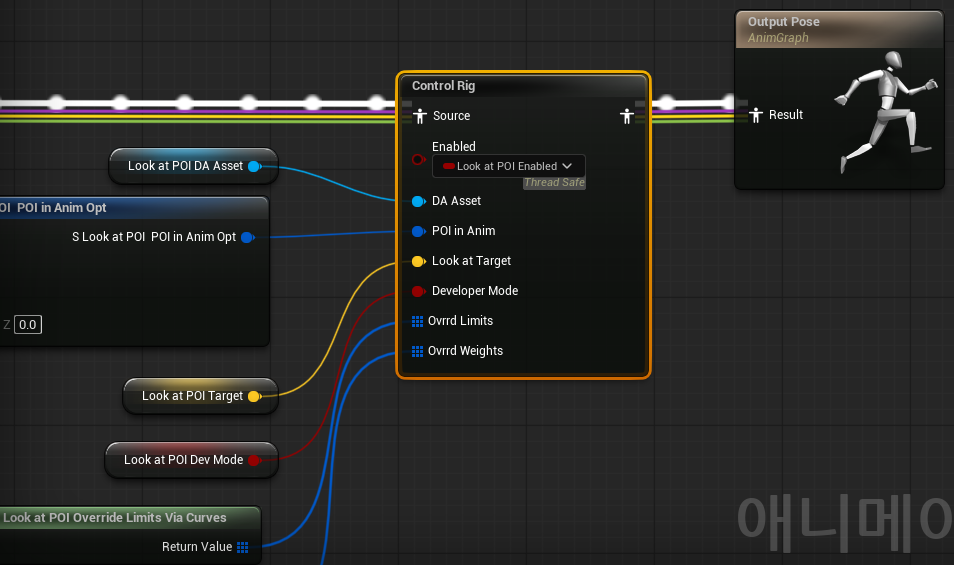
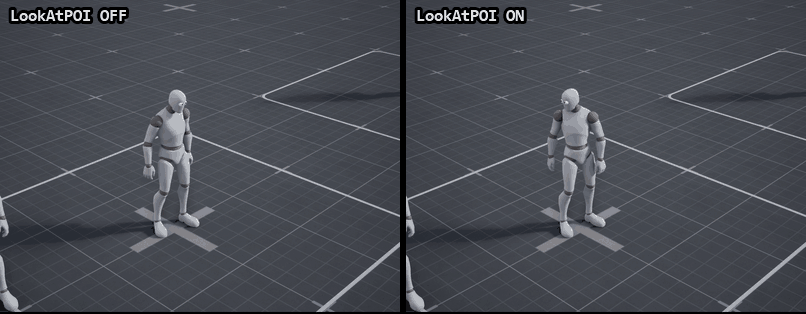

# Control Rig로 런타임에 포즈 고치기

<a id="contents"></a>

## 목차

1. [왜 필요한가](#what)
2. [준비 - 플러그인과 AnimBP 노드](#setup)
3. [Control Rig 에셋은 무엇으로 이루어져 있나](#asset)
4. [GASP에서는 어디서 돌고 있나](#gasp)
5. [리그 안에서 매 프레임 하는 일](#solve)
6. [직접 껐다 켜 보기 - 경사로에 세우기](#experiment)
7. [걸을 때도 맞춰 주나](#walk)
8. [리그의 디버그 선 보기](#debug)
9. [두 번째 예시 - 지나가는 캐릭터를 쳐다보는 NPC](#lookat)
10. [테스트하다 헤맨 부분](#stuck)
11. [막히기 쉬운 곳](#pitfalls)
12. [정리 - 내가 이해한 Control Rig](#summary)
13. [부록 - 다시 테스트하기](#reproduce)

---

이 문서는 Unreal Engine 5.8.3 기준이다. 테스트는 Epic의 Game Animation Sample(이하 GASP) 프로젝트에서 했고, 테스트에 쓴 스크립트는 `Scripts/ControlRig/` 에 있다. [Motion Warping](MotionWarping.md), [Motion Matching](MotionMatching.md) 문서와 같은 샘플을 썼다.

---

<a id="what"></a>

## 1. 왜 필요한가

애니메이션은 대부분 평평한 바닥에서 만든다. 대기 애니메이션이라면 두 발이 같은 높이에 나란히 서 있다. 이걸 그대로 경사로에 세우면 어떻게 될까.

아래는 GASP 캐릭터를 30° 경사로에 옆으로 세운 장면이다. 같은 대기 애니메이션이고, 왼쪽은 Control Rig를 끈 상태, 오른쪽은 켠 상태다.



끈 쪽은 위쪽 발이 경사면에 파묻히고, 아래쪽 발은 20cm 가까이 떠 있다. 켠 쪽은 골반을 낮추고 무릎을 굽혀서 두 발을 모두 경사면에 붙인다.

애니메이션 데이터를 바꾼 게 아니다. 애니메이션이 만든 포즈를 받아서, 그 프레임의 바닥 높이를 보고 본을 다시 계산했을 뿐이다. 이렇게 런타임에 본을 직접 계산하는 그래프가 Control Rig다.

처음에는 Control Rig를 시퀀서에서 애니메이션을 만들 때 쓰는 도구로만 알고 있었다. 실제로 그 용도도 크지만, GASP를 뜯어보니 게임 중에 AnimBP 안에서 매 프레임 돌고 있었다. 이 문서는 그 런타임 쪽을 정리한 것이다.

---

<a id="setup"></a>

## 2. 준비 - 플러그인과 AnimBP 노드

필요한 플러그인은 `ControlRig` 다. 5.8에서는 엔진 기본으로 켜져 있어서 `.uproject` 에 따로 적지 않아도 된다.

AnimBP에서는 `Control Rig` 노드로 리그를 실행한다. 노드가 하는 일은 단순하다. 엔진 소스(`AnimNode_ControlRigBase.cpp`)를 따라가 보면 매 프레임 이렇게 돈다.

```text
AnimBP의 Control Rig 노드 (매 프레임)
  1. 들어온 포즈를 리그의 본에 복사한다              UpdateInput
  2. 리그의 이벤트를 실행한다. 기본은 Forwards Solve
  3. 리그의 본을 다시 포즈로 복사해서 내보낸다       UpdateOutput

Construction Event는 처음 한 번, 그리고 계층이 바뀔 때만 실행한다.
```

리그에서 공개(Expose)한 변수는 노드의 입력 핀으로 나온다. AnimBP에서 계산한 값(바닥 법선, 디버그 여부 등)을 이 핀으로 리그에 넘긴다.

---

<a id="asset"></a>

## 3. Control Rig 에셋은 무엇으로 이루어져 있나

GASP의 발 디딤 리그 `CR_Biped_FootPlacement` 를 열어 보면 이렇게 생겼다.



왼쪽 아래 계층 패널은 이름에 `ctrl` 이 들어간 것만 걸러서 컨트롤(색 있는 아이콘)과 그 부모 널(회색)만 보이게 했다. 오른쪽 그래프는 Forwards Solve 중 "Modify the actual animation pose based on the controls" 블록이다. `pelvis_ctrl` 값을 `pelvis` 본에 넣고(`Set Relative Transform`), 다리마다 `Solve Leg IK` 함수를 한 번씩 부른다.

에셋 안에는 네 가지가 들어 있다. 숫자는 이 리그를 에디터 Python으로 읽은 값이다.

| 구성 요소 | 이 리그에서 | 하는 일 |
| --- | --- | --- |
| 계층(Hierarchy) | 본 88, 컨트롤 19, 널 17, 커브 2 | 리그가 다루는 요소들. 본은 스켈레톤에서 가져온다 |
| 이벤트 그래프 | Construction Event, Forwards Solve | 언제 무엇을 계산할지 |
| 변수 | 47개 | 프레임 사이에 값을 기억하거나 AnimBP에서 값을 받는다 |
| 로컬 함수 | 28개 | 다리 하나 분의 계산처럼 반복되는 부분을 묶어 둔 것 |

처음에 헷갈렸던 건 컨트롤과 널이다.

```text
본(Bone)       스켈레톤의 실제 뼈. 결과는 결국 여기에 써야 포즈가 바뀐다.
널(Null)       위치와 회전만 있는 빈 기준점. 계산 중간값을 담아 두는 용도로 많이 쓴다.
컨트롤(Control) 애니메이터가 잡고 움직이는 손잡이. 런타임 리그에서는 "목표" 를 담는 칸처럼 쓴다.
커브(Curve)    float 값. 이 리그는 발 접지 여부(contact_l, contact_r)를 커브로 받는다.
```

이 리그에서 컨트롤은 `foot_l_ctrl`, `pelvis_ctrl`, `floor_l_collision` 처럼 "발이 가야 할 곳", "골반이 가야 할 곳", "발밑 바닥" 을 담는다. 사람이 잡고 움직이는 게 아니라 그래프가 매 프레임 값을 써 넣고, 마지막에 IK가 그 값을 보고 본을 움직인다.

이벤트는 세 종류가 있다.

| 이벤트 | 언제 | 이 리그에서 |
| --- | --- | --- |
| Construction Event | 처음, 계층이 바뀔 때 | 다리 길이를 재고, 컨트롤을 발 위치에 맞춰 둔다 |
| Forwards Solve | 매 프레임 | 바닥을 찾고 발과 골반을 옮긴다 |
| Backwards Solve | 본 -> 컨트롤 역방향. 주로 시퀀서에서 애니메이션을 리그로 구울 때 | 없음 |

---

<a id="gasp"></a>

## 4. GASP에서는 어디서 돌고 있나

GASP에는 캐릭터가 두 종류 있다. CharacterMovement 기반의 `SandboxCharacter_CMC` 와 Mover 기반의 `SandboxCharacter_Mover` 다. 둘 다 발을 바닥에 맞추지만 방법이 다르다.

| 캐릭터 | AnimBP | 발 디딤 방식 |
| --- | --- | --- |
| `SandboxCharacter_CMC` | `SandboxCharacter_CMC_ABP` | C++ `Foot Placement` 노드 + `Leg IK` 노드 |
| `SandboxCharacter_Mover` | `SandboxCharacter_Mover_ABP` | Control Rig `CR_Biped_FootPlacement` |

처음에는 당연히 둘 다 Control Rig일 거라고 생각했는데, AnimBP를 열어 보니 CMC 쪽에는 Control Rig 노드가 아예 없었다. 같은 일을 엔진 C++ 노드로 할 수도 있고 Control Rig로 할 수도 있다는 걸 GASP가 둘 다 보여 주고 있는 셈이다. 이 문서는 Mover 쪽을 테스트했다.

Mover AnimBP의 `Procedural_Feet` 애님 레이어를 열면 Control Rig 노드가 있다.



노드 위 주석에 "Foot Placement 노드 + Leg IK의 대안이니 둘을 동시에 켜지 말라" 고 적혀 있다. 입력 핀은 리그에서 공개한 변수들이다.

| 입력 핀 | 들어가는 값 |
| --- | --- |
| Ground Normal | 이동 컴포넌트가 찾은 바닥 법선 |
| Do Raycast | 켬. 리그가 직접 발밑으로 트레이스한다 |
| Enable Foot Pinning | `AllowFootPinning()` 결과. 이동 모드가 지면일 때만 켜질 수 있다 |
| Enable Slope Warping | `AllowSlopeWarping()` |
| Debug Draw | `a.AnimNode.FootPlacement.Debug` |
| Has Teleported, Force Reset | 텔레포트 직후 리그 상태 초기화 |

같은 레이어 오른쪽에서 결과를 고른다.



```text
Blend Poses by bool (Foot Placement Enable)
    True  -> 'Control Rig IK' 캐시 포즈   CR_Biped_FootPlacement 결과
    False -> 'BasicIK' 캐시 포즈          Leg IK 노드만 거친 포즈
Blend Poses (E_MovementMode)
    지면 -> 위 결과,  슬라이드·Traversal·공중 -> BasicIK,  래그돌 -> 아무것도 안 한 포즈
```

`Foot Placement Enable` 은 AnimBP가 매 프레임 `a.AnimNode.FootPlacement.Enable` CVar에서 읽는다. 엔진의 C++ Foot Placement 노드가 쓰는 CVar를 그대로 빌려 쓰고 있었다. 기본값은 1이다. 그래서 이 CVar 하나로 Control Rig를 켰다 껐다 할 수 있다.

---

<a id="solve"></a>

## 5. 리그 안에서 매 프레임 하는 일

`CR_Biped_FootPlacement` 의 Forwards Solve는 Sequence 하나에 13단계가 달려 있다. 주석 블록 제목을 순서대로 옮기면 이렇다.

| 순서 | 주석 | 하는 일 |
| --- | --- | --- |
| 1 | Draw Leg Chain Before Adjustments | 고치기 전 다리를 하늘색으로 그린다 (디버그) |
| 2 | Handle Teleport | 텔레포트했으면 이전 프레임 값을 버린다 |
| 3 | Calculate the animated toe targets | 애니메이션 포즈의 발가락 위치를 저장해 둔다 |
| 4 | Update global root damper | 캐릭터 높이가 튀는 걸 부드럽게 따라간다 |
| 5 | Update ground collision controls | 발밑으로 트레이스해서 바닥을 찾는다 |
| 6 | Set collision to initial if slope warping is disabled | 경사 보정을 끄면 바닥을 평지로 되돌린다 |
| 7 | Update Smoothed Floor Controls | 찾은 바닥 쪽으로 0.05초에 걸쳐 따라간다 |
| 8 | Update the foot pinning logic | 디딘 발을 그 자리에 고정한다 |
| 9 | Update leg controls | 발과 발가락이 갈 곳을 정한다 |
| 10 | Modify the actual animation pose | 골반을 내리고 다리 IK를 푼다 |
| 11 | Post IK Solve Fixup | IK 뒤 발 회전을 다듬는다 |
| 12 | Store World Transform for next solve | 다음 프레임을 위해 저장 |
| 13 | Do debug draw post solve | 고친 다리를 초록색으로 그린다 (디버그) |

핵심만 줄이면 "바닥 찾기 -> 발 목표 정하기 -> 골반 내리기 -> IK" 다. 로컬 함수를 열어 보면서 중요하다고 생각한 부분을 적어 둔다.

### 바닥은 리그가 직접 찾는다

`Do Scene Query` 함수는 다리마다 Sphere Trace를 두 번 한다. 먼저 캡슐 중심에서 발 쪽으로 수평으로 쏴서 벽에 발이 박히지 않는지 보고, 그다음 발에서 아래로 쏴서 바닥을 찾는다. 찾은 바닥은 `floor_l_collision` 컨트롤에 위치와 법선으로 들어간다.

Control Rig 안에서 월드 트레이스를 할 수 있다는 게 처음엔 의외였다. 다만 리그 변수 `DoRaycast` 기본값은 꺼져 있고, AnimBP 노드에서 켜 주고 있었다.

### 발은 발가락 기준으로 놓고, 뒤꿈치는 경사에 따라 든다

`Update Leg Controls` 는 발목이 아니라 발가락(`ball`) 목표를 먼저 정한다. 애니메이션의 발가락 위치를 바닥 평면에 투영하고, 발목은 그 발가락을 향하도록 돌린다.

발이 향한 쪽이 오르막이면 뒤꿈치를 드는 쪽으로 섞는다. 경사가 15°일 때 섞기 시작해서 25°에서 다 든다(`HeelUpAngleDegrees_Start/End`). 이 각도를 구하는 `CalculateSlopeAngle` 주석에 "경사를 가로질러 걸으면 0" 이라고 적혀 있어서, 아래 테스트처럼 옆으로 선 경우에는 뒤꿈치를 들지 않는다.

### 골반은 두 다리가 닿을 수 있는 만큼 내린다

`Update Pelvis Control` 은 두 다리가 각자 원하는 골반 위치의 평균을 목표로 잡고, 0.2초(`Pelvis Smoothing Time`)에 걸쳐 따라간다. 그다음 `Clamp Pelvis Offset` 으로 다리가 다리 길이의 98%(`Hyper Extension Limit Factor`) 이상 펴지지 않게 자른다.

경사로에서 무릎이 굽는 건 결국 이 골반 이동 때문이다. 아래쪽 발이 닿으려면 골반이 내려와야 하고, 골반이 내려오면 위쪽 다리는 접힐 수밖에 없다.

### 마지막은 평범한 2본 IK다

`Solve Leg IK` 는 허벅지-종아리-발 세 본에 `Basic IK` 를 쓴다. 무릎 방향(Pole Vector)은 "허벅지에서 목표로 가는 선" 에 수직이 되도록 매번 계산한다. 리그가 복잡해 보여도 본을 실제로 움직이는 건 이 IK 하나였다.

---

<a id="experiment"></a>

## 6. 직접 껐다 켜 보기 - 경사로에 세우기

설명만 보고는 얼마나 차이가 나는지 감이 오지 않아서 숫자로 재 봤다. GASP 기본 맵에는 경사가 10°에서 40°까지 바뀌는 곡면 램프가 있다. 이 위에 Mover 캐릭터를 세웠다. 레벨은 저장하지 않았다.

| 항목 | 값 |
| --- | --- |
| 캐릭터 | `SandboxCharacter_Mover` (`DDCvar.PawnClass 1`) |
| 위치 | 램프의 경사 0° / 10° / 20° / 30° / 40° 지점, 램프 폭의 가운데 |
| 방향 | 경사를 옆으로 보고 섬. 왼발이 위쪽, 오른발이 아래쪽 |
| 끄고 켜기 | `a.AnimNode.FootPlacement.Enable 1` / `0` |
| 측정 | 1초 동안 매 틱, 발 본 바로 아래로 트레이스해서 바닥까지 높이 |

발 높이는 발볼 본(`ball_l`, `ball_r`) 기준이다. 이 본은 신발 바닥보다 3cm쯤 위에 있어서, 평지에서 3cm 안팎이면 바닥에 딱 붙어 있는 것이다.

| 경사 | OFF 위쪽 발 | OFF 아래쪽 발 | ON 위쪽 발 | ON 아래쪽 발 | ON에서 골반이 내려간 양 |
| --- | --- | --- | --- | --- | --- |
| 0° | 3.4cm | 3.3cm | 3.0cm | 3.2cm | 0.2cm |
| 10° | 2.4cm | 8.6cm | 3.1cm | 3.4cm | 4.1cm |
| 20° | 0.8cm | 13.9cm | 3.1cm | 3.5cm | 8.5cm |
| 30° | **-0.5cm** | **19.7cm** | 3.1cm | 3.5cm | 13.9cm |
| 40° | **-2.3cm** | **27.4cm** | 3.2cm | 4.0cm | 20.4cm |

```text
발 높이     발볼 본에서 바로 아래 바닥까지. 음수면 본이 바닥 아래로 들어간 것.
골반       ON과 OFF의 (pelvis 본 높이 - 캡슐 중심 높이) 차이.
```

OFF는 경사가 커질수록 아래쪽 발이 그대로 뜬다. 40°에서는 27cm 떠 있었다. 위쪽 발은 반대로 바닥 아래로 들어간다. 애니메이션은 두 발을 같은 높이에 두는데, 바닥은 한쪽이 높으니 당연한 결과다.

ON은 경사와 상관없이 두 발 모두 3~4cm로 평지와 거의 같았다. 대신 골반이 40°에서 20cm 내려간다. 사진에서 무릎이 많이 굽어 보이는 게 이 때문이다.

---

<a id="walk"></a>

## 7. 걸을 때도 맞춰 주나

서 있을 때만 맞추는 거라면 쓸모가 반쪽이다. 30° 구간을 옆으로 가로질러 걷게 해서 다시 비교했다. GIF는 0.5배 속도다.



| 상태 | 디딘 발의 발볼 높이 평균 | 최소 | 최대 |
| --- | --- | --- | --- |
| OFF | 7.1cm | -0.7cm | 13.0cm |
| ON | 3.8cm | 2.8cm | 5.5cm |

```text
디딘 발    매 틱 두 발 중 낮은 쪽. 걷는 1.6초 동안(0.6 ~ 2.2초) 평균.
```

OFF는 아래쪽 발을 디딜 때마다 발이 떠서 허공을 걷는 것처럼 보이고, 위쪽 발을 디딜 때는 경사면에 들어간다. ON은 디딜 때마다 바닥에 붙는다. 걷는 동안에도 매 프레임 바닥을 다시 찾고 있다는 걸 확인할 수 있었다.

---

<a id="debug"></a>

## 8. 리그의 디버그 선 보기

리그에는 디버그 그리기가 들어 있는데, PIE에서 `a.AnimNode.FootPlacement.Debug 1` 만 켜서는 아무것도 안 나왔다. 소스를 보니 게임 중에는 조건이 두 개 더 있었다.

| CVar | 기본값 | 역할 |
| --- | --- | --- |
| `a.AnimNode.FootPlacement.Debug` | 0 | GASP AnimBP가 리그의 `DebugDraw` 변수로 넘긴다 |
| `ControlRig.EnableDrawInterfaceInGame` | 0 | 게임 중에도 리그가 그리기 명령을 기록한다 |
| `a.AnimNode.ControlRig.Debug` | 0 | Control Rig 노드가 기록된 명령을 화면에 그린다 |

셋 다 켜면 이렇게 나온다. 30° 경사, ON 상태다.



하늘색이 리그에 들어오기 전 애니메이션 다리, 초록색이 리그가 고친 다리다. 리그 주석에도 "Color: Cyan", "green" 으로 적혀 있다. 골반 위치(작은 사각형)가 하늘색에서 초록색으로 내려가 있고, 다리 선도 그만큼 굽어 있다.

발밑에 그려진 것들은 디버그 함수를 열어서 확인했다.

| 표시 | 그리는 함수 | 의미 |
| --- | --- | --- |
| 발마다 비스듬히 누운 짙은 초록 판 | `DebugDrawGroundCollision` | 리그가 찾아서 따라간 바닥(`smoothed_floor_l/r_ctrl`) |
| 수평으로 놓인 큰 초록 사각형 | `DebugDrawSlopeAnim` | 애니메이션이 가정한 바닥 기울기(`animated_slope_angle_ctrl`) |
| 흰 원 | `DebugDrawFootPins` | 발 고정 범위. 반지름이 `MaxFootPinRadius`(40cm) |

큰 초록 사각형은 수평인데 발밑의 판은 30° 기울어 있다. 애니메이션이 생각한 바닥과 실제 바닥의 차이가 그대로 보이는 셈이고, 리그가 메우는 게 바로 이 차이다.

리그 에디터 미리보기에서 보던 그림이 게임 중 실제 캐릭터 위에 그대로 나오니까, 리그가 어느 단계에서 무엇을 바꿨는지 보기 편했다.

---

<a id="lookat"></a>

## 9. 두 번째 예시 - 지나가는 캐릭터를 쳐다보는 NPC

발 디딤은 "바닥에 맞추는" 리그였다. 다른 용도도 하나 보고 싶어서 GASP의 따로 떨어진 예제(`IsolatedExamples`)에 있는 `LookAtPOI` 를 테스트했다. POI는 Point of Interest, 관심 지점이다. NPC가 목표 지점을 쳐다보게 만드는 리그 `CR_AdjustToPOI` 와 테스트 레벨 `LookAtPOI_Level` 이 들어 있다.

### 구조는 발 디딤과 같다

NPC의 AnimBP(`ABP_LookAtPOI_Char`)를 보면 대기 루프 애니메이션 뒤에 Control Rig 노드 하나가 붙어 있다.



| 입력 핀 | 들어가는 값 |
| --- | --- |
| Enabled | `Look at POI Enabled`. 꺼져 있으면 리그를 건너뛴다 |
| DA Asset | 어떤 부위를 얼마나 돌릴지 적은 데이터 에셋 |
| Look at Target | 쳐다볼 월드 위치. 샘플 컨트롤러가 매 틱 넣는다 |
| POI in Anim | 본 이름 `poi` 가 들어 있다. 애니메이션 쪽에서 목표를 줄 때 쓰는 옵션으로 보인다 |
| Ovrrd Limits, Ovrrd Weights | 애니메이션 커브로 한계·가중치를 덮어쓴다 |
| Developer Mode | 데이터 에셋의 개발자 모드 값. 이번에는 끈 채로 테스트했다 |

애니메이션이 만든 포즈를 받아서 그 프레임의 목표에 맞게 본을 다시 계산한다는 점은 발 디딤과 똑같다. 바닥 대신 목표 위치를 보고 있을 뿐이다.

### 어떤 본을 얼마나 돌릴지는 데이터 에셋에 있다

리그 안에 각도가 박혀 있는 게 아니라 데이터 에셋(`PDA_LookAtPOI`)으로 빼 두었다. 대기 루프용 `DA_LookAtPOI__Loops` 를 읽어 보면 신체 부위가 네 개 있고, 부모-자식으로 이어져 있다.

| 부위 | 부모 | 본 | 좌우 한계 | 위아래 한계 | 스프링 강도 |
| --- | --- | --- | --- | --- | --- |
| Hips | - | `pelvis` | ±15° | -4° ~ 2° | 0.4 |
| Torso | Hips | `spine_01` ~ `spine_05` (가중치 0.2 ~ 1.0) | 35° | -15° ~ 10° | 0.5 |
| Head | Torso | `neck_01`(0.3), `neck_02`(0.6), `head` | 65° | -35° ~ 50° | 1.1 |
| Eyes | Head | 본 없음. 커브 `face__l/r_eye_h/v` | 90° | - | 8.0 |

골반은 조금, 상체는 그보다 더, 머리는 많이 돌고, 남는 각도는 눈이 맡는 구조다. 스프링 강도가 위로 갈수록 커서 눈이 제일 빨리, 골반이 제일 늦게 따라간다. 이 외에 `Foot Fix` 설정이 있어서 골반이 돌아도 발은 다리 IK로 제자리에 붙여 둔다.

`CR_AdjustToPOI` 는 5.8에서 `ControlRigRuntimeAsset` 클래스로 저장돼 있어서, 발 디딤 리그처럼 Python으로 그래프를 읽을 수는 없었다. 그래서 이 예제는 데이터 에셋과 결과 포즈만 봤다.

### 테스트 - NPC 둘레를 걸어 보기

PIE에서 플레이어 캐릭터(`SandboxCharacter_CMC`)가 NPC 주위로 반지름 220cm 반원을 걷게 했다. NPC 오른쪽 100°에서 출발해서 정면을 지나 왼쪽 100°까지, 걷기 속도(약 190cm/s)로 3.8초 걸린다. GIF는 실제 속도다. ON은 샘플 컨트롤러(`PC_LookAtPOI`)의 `Zone Was Selected` 로 이 NPC를 고르고, 매 틱 목표를 걷는 캐릭터의 머리 위치로 넣었다. OFF는 아무것도 고르지 않았다.



OFF는 대기 애니메이션 그대로 정면만 본다. ON은 걷는 캐릭터를 따라 골반, 상체, 머리가 차례로 돌아간다.

| 걷는 캐릭터 위치 | ON 골반 | ON 상체 끝(`spine_05`) | ON 머리 | OFF 머리 |
| --- | --- | --- | --- | --- |
| 90° | 15° | 50° | 92° | -7° |
| 60° | 17° | 52° | 72° | -3° |
| 30° | 15° | 47° | 38° | -4° |
| 0° | 13° | 23° | 10° | -3° |
| -30° | 1° | -7° | -17° | -1° |
| -60° | -14° | -37° | -49° | -2° |
| -90° | -17° | -52° | -83° | -7° |
| 끝(-104°)에서 2초 뒤 | -11° | -46° | -101° | 3° |

```text
각도      NPC 정면 기준 좌우 회전. 양수가 NPC 오른쪽. 본마다 부모 회전이 누적된 값이다.
위치      걷는 동안 그 각도를 지나간 순간의 기록.
```

### 감으로 맞추던 걸 숫자로 나눠 둔 것

처음에는 "머리를 목표 쪽으로 돌린다" 정도로 생각했는데, 숫자로 보니 몸 전체가 나눠서 돌고 있었다. 한 본만 돌리면 목이 꺾여 보이는데, 골반 15°, 상체 35°, 머리 65° 식으로 나눠 두니까 사람이 고개를 돌리는 것처럼 보인다.

스프링 때문에 바로 따라가지 않고 조금 늦게 따라가는 것도 표에서 보인다. 걷는 캐릭터가 이미 정면을 지났는데 상체는 아직 반대쪽에 남아 있는 식이다. 사람도 시선이 먼저 가고 몸이 나중에 따라오니까, 이 지연이 자연스러움을 만드는 것 같다.

---

<a id="stuck"></a>

## 10. 테스트하다 헤맨 부분

### Mover 캐릭터가 순간이동을 무시했다

처음에는 PIE에서 캐릭터를 경사로로 옮길 때 `TeleportTo` 를 썼다. 첫 번째는 되는데 두 번째부터는 잠깐 옮겨졌다가 원래 자리로 돌아갔다. 직접 스폰한 Mover 캐릭터는 아예 바닥으로 떨어지지도 않았다.

Mover는 캐릭터 위치를 자기 시뮬레이션 상태로 들고 있어서, 액터 위치만 바꾸면 다음 틱에 그 상태로 덮어쓰는 것 같았다. GASP 캐릭터에는 이걸 위한 `CustomTeleport` 함수가 따로 있었다. 위치를 옮긴 뒤 Mover 이동 모드를 Falling으로 바꾸고, 바라볼 방향(`OrientationIntent`)도 같이 넣어 준다. 이걸 쓰니 몇 번을 옮겨도 잘 됐다.

### 걷기 입력이 안 들어갔다

CMC 캐릭터에서는 `AddMovementInput` 으로 테스트 입력을 넣었는데 Mover 캐릭터는 꿈쩍도 안 했다. Mover 캐릭터는 `ProduceInput` 에서 Enhanced Input의 `IA_Move` 값을 직접 읽는다. 그래서 `EnhancedInputLocalPlayerSubsystem.InjectInputVectorForAction` 으로 매 틱 `IA_Move` 를 넣었다. 키보드를 누른 것과 같은 경로라 결과도 같다.

### 램프 입구에서 캐릭터가 사라졌다

평지에서 램프 쪽으로 걸어가게 했더니 0.7초 만에 캐릭터가 램프 꼭대기로 옮겨졌다. 램프 입구 바닥에 `Teleporter_Sender` 가 있었다. 맵을 둘러볼 때 편하라고 둔 것인데, 테스트할 때는 피해서 램프 위에서만 움직였다.

### 디버그 선이 안 나왔다

[8절](#debug)에 적은 대로 CVar 세 개가 필요했다. 리그 에디터에서는 바로 보이니까 PIE에서도 보일 거라고 생각했는데, 게임 중에는 성능 때문에 기본으로 꺼져 있다.

### LookAtPOI 목표를 넣을 수가 없었다

처음에는 NPC AnimBP의 `LookAtPOI Target`, `LookAtPOI Enabled` 변수를 Python에서 바로 바꾸려고 했다. 그런데 "인스턴스에서 편집할 수 없는 프로퍼티" 라는 에러가 났다. 블루프린트 변수의 인스턴스 편집 옵션이 꺼져 있으면 에디터 스크립트에서도 값을 못 넣는다.

그래서 샘플이 원래 쓰는 길을 따라갔다. `PC_LookAtPOI` 의 `Zone Was Selected` 이벤트에 NPC와 목표 기즈모를 넘기면, 컨트롤러가 시선을 켜고 매 틱 기즈모 위치를 AnimBP에 넣어 준다. 다만 기즈모 위치를 그대로 쓰지 않고 기즈모 앞쪽으로 50cm 떨어진 점을 넣고 있어서, 그만큼 빼서 기즈모를 옮겼다. 기록에는 AnimBP가 실제로 받은 목표 위치를 같이 남겼다.

---

<a id="pitfalls"></a>

## 11. 막히기 쉬운 곳

### 리그가 아무것도 안 하는 것 같을 때

AnimBP의 Control Rig 노드가 실제로 평가되고 있는지부터 본다. GASP처럼 Blend 노드 뒤에 있으면 다른 쪽 포즈가 선택됐을 때는 리그가 돌지 않는다. 노드의 `Alpha` 가 0이거나, LOD 설정으로 꺼져 있는 경우도 있다.

리그에서 공개한 변수가 노드 핀에 제대로 연결됐는지도 본다. `CR_Biped_FootPlacement` 는 `DoRaycast` 기본값이 꺼져 있어서, 핀에서 켜 주지 않으면 바닥을 찾지 않는다.

### 같은 일을 두 번 할 때

C++ `Foot Placement` 노드와 발 디딤 Control Rig를 둘 다 켜면 서로의 결과 위에 또 보정을 한다. GASP 주석대로 둘 중 하나만 쓴다.

### 텔레포트 직후 다리가 튈 때

이 리그는 이전 프레임의 바닥과 골반 위치를 기억해 두고 부드럽게 따라간다. 순간이동하면 그 기억이 엉뚱한 곳을 가리키기 때문에, GASP는 `Has Teleported` 와 `Force Reset` 핀으로 리셋을 알려 준다. 리그에 상태를 저장한다면 리셋 경로도 같이 만들어야 한다.

### 디버그가 안 보일 때

게임 중 그리기는 `ControlRig.EnableDrawInterfaceInGame` 과 `a.AnimNode.ControlRig.Debug` 를 둘 다 켜야 보인다.

---

<a id="summary"></a>

## 12. 정리 - 내가 이해한 Control Rig

```text
계층          본 + 널 + 컨트롤 + 커브. 본만 결과에 쓰이고 나머지는 계산용 칸이다.
Construction  처음 한 번. 길이를 재고 기준점을 잡는다.
Forwards Solve 매 프레임. 들어온 포즈를 받아 본을 다시 계산한다.
AnimBP 노드    포즈를 리그에 넣고, 이벤트를 돌리고, 결과를 포즈로 꺼낸다.
```

Control Rig는

> AnimBP 안에서, 애니메이션이 만든 포즈를 받아 그 프레임의 상황에 맞게 본을 다시 계산하는 그래프

정도로 이해하고 있다.

이번 테스트에서 같은 대기 애니메이션을 40° 경사에 세웠을 때, 끄면 아래쪽 발이 27cm 떴고 켜면 4cm로 평지와 거의 같았다. 애니메이션은 그대로고, 리그가 바닥을 찾아서 골반을 20cm 내리고 다리를 다시 접었을 뿐이다.

Motion Warping이 Root Motion 경로를, Motion Matching이 재생할 애니메이션을 상황에 맞췄다면, Control Rig는 이미 정해진 포즈를 마지막에 상황에 맞춘다. GASP의 이동 파이프라인을 세 문서에 걸쳐 따라와 보니 "고르고, 경로를 맞추고, 포즈를 맞춘다" 는 순서로 나뉘어 있었다.

---

<a id="reproduce"></a>

## 13. 부록 - 다시 테스트하기

테스트에 쓴 스크립트는 [Scripts/ControlRig](../../Scripts/ControlRig/README.md)에 있다. PIE에서 Mover 캐릭터를 경사로에 옮기고, CVar로 리그를 켜고 끄면서 발 높이를 기록하고, 찍은 프레임으로 이미지와 GIF를 만드는 것까지 들어 있다. 에디터 조작은 Unreal MCP로 자동화했다.

시선 테스트는 `LookAtPOI_Level` 을 열어서 했다. 레벨을 바꿀 때는 저장하지 않은 변경이 없는지 먼저 확인하고, 끝나면 기본 맵으로 되돌린다.

| 파일 | 내용 |
| --- | --- |
| [foot_placement_summary.json](Evidence/ControlRig/foot_placement_summary.json) | 경사별 발 높이, 골반 높이, 걷기 중 디딘 발 높이 |
| [rig_structure.json](Evidence/ControlRig/rig_structure.json) | `CR_Biped_FootPlacement` 의 컨트롤·널, 변수, 그래프별 주석 |
| [lookat_summary.json](Evidence/ControlRig/lookat_summary.json) | 걷는 캐릭터 위치별 골반·상체·머리 회전 |
| [lookat_data_asset.json](Evidence/ControlRig/lookat_data_asset.json) | `DA_LookAtPOI__Loops` 의 신체 부위 설정 |

GASP의 원본 맵, 블루프린트, 리그, 데이터 에셋은 수정하거나 저장하지 않았다.

### 참고

- [Control Rig in Unreal Engine](https://dev.epicgames.com/documentation/en-us/unreal-engine/control-rig-in-unreal-engine) - 공식 문서
- [Game Animation Sample Project](https://dev.epicgames.com/documentation/en-us/unreal-engine/game-animation-sample-project-in-unreal-engine) - 공식 문서
- 엔진 소스 `Engine/Plugins/Animation/ControlRig/Source/ControlRig/`
  - `Private/AnimNode_ControlRigBase.cpp` - 포즈 입출력, 이벤트 실행, `a.AnimNode.ControlRig.Debug`
  - `Private/ControlRig.cpp` - `ControlRig.EnableDrawInterfaceInGame`
  - `Public/Units/Execution/RigUnit_BeginExecution.h` - Forwards Solve 이벤트
  - `Public/Units/Execution/RigUnit_PrepareForExecution.h` - Construction 이벤트
- 엔진 소스 `Engine/Plugins/Animation/AnimationWarping/Source/Runtime/Private/BoneControllers/AnimNode_FootPlacement.cpp` - `a.AnimNode.FootPlacement.Enable`

---

[목차로 돌아가기](#contents) · [메인 README의 Unreal Engine 목차로 돌아가기](../../README.md#unreal-engine)
