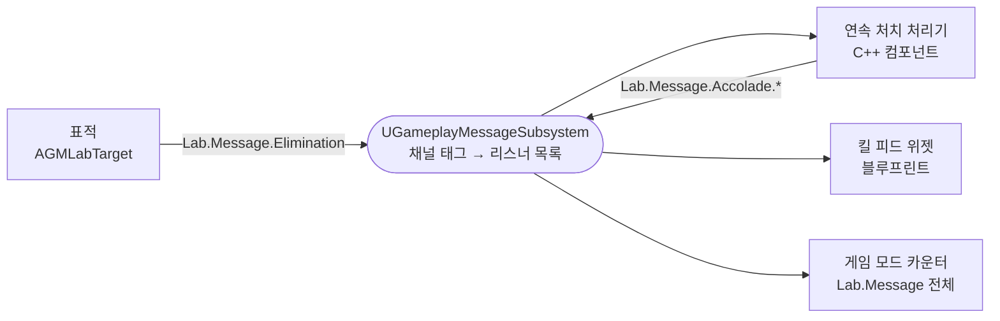
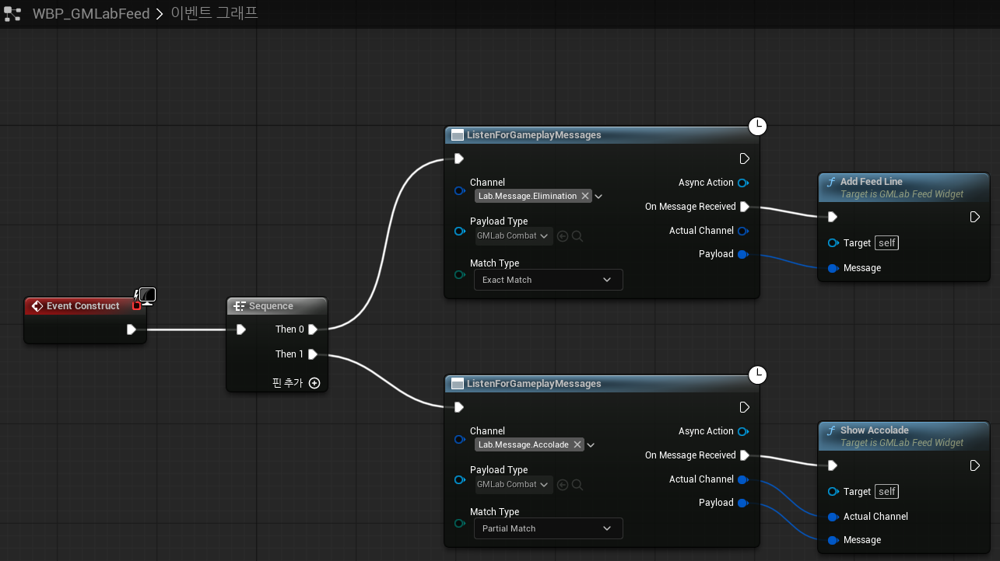
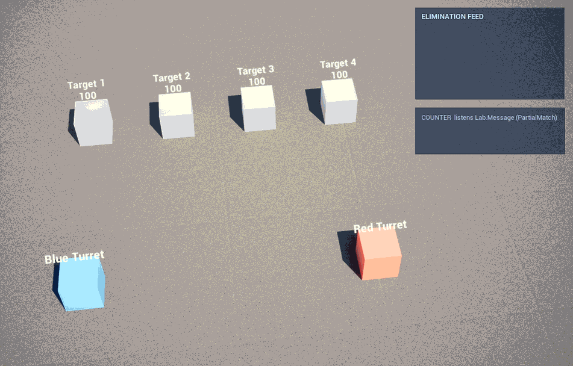
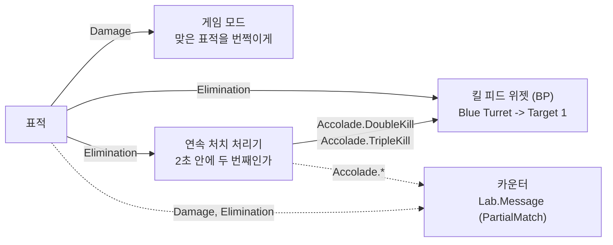
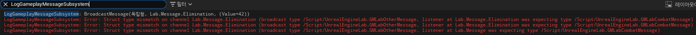
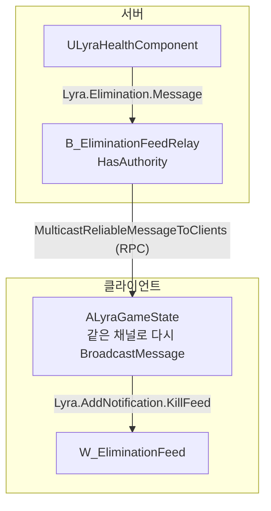

# Lyra의 GameplayMessage로 시스템끼리 메시지 주고받기

<a id="contents"></a>

## 목차

1. [GameplayMessage가 뭔가 - 무슨 패턴인가](#what)
2. [직접 호출, 델리게이트, 인터페이스와 뭐가 다른가](#vs-others)
3. [준비 - Lyra에서 플러그인 가져오기](#setup)
4. [메시지 정하기 - 채널 태그와 구조체](#message)
5. [C++에서 보내고 받기](#cpp)
6. [블루프린트에서 받기 - Listen for Gameplay Messages](#blueprint)
7. [돌려 보기 - 킬 피드와 연속 처치](#run)
8. [동작 확인 - 언제, 누구에게, 어떤 타입으로](#behavior)
9. [비용 - 멀티캐스트 델리게이트와 비교](#cost)
10. [Lyra에서는 어떻게 쓰나](#lyra)
11. [장단점](#pros-cons)
12. [만들면서 헤맨 부분](#stuck)
13. [정리](#summary)
14. [부록](#reproduce)

---

이 문서는 Unreal Engine 5.8.3 기준이다. GameplayMessage는 엔진에 들어 있는 기능이 아니라 Lyra 샘플 프로젝트에 들어 있는 플러그인(`GameplayMessageRouter`)이라서, Lyra에서 복사해 와서 썼다.

---

<a id="what"></a>

## 1. GameplayMessage가 뭔가 - 무슨 패턴인가

Lyra에서 처치 알림, 연속 처치 칭호, 퀵바, 인벤토리 변화 같은 걸 따라가다 보면 `BroadcastMessage` 와 `RegisterListener` 가 계속 나온다. 이게 `UGameplayMessageSubsystem` 이다. 플러그인 설명은 이렇다.

> A subsystem that allows registering for and sending messages between unconnected gameplay objects.

서로 연결되지 않은 게임플레이 객체끼리 메시지를 주고받게 해 주는 서브시스템이다. `UGameInstanceSubsystem` 이라서 게임 인스턴스마다 하나 있고, 어디서든 `UGameplayMessageSubsystem::Get(this)` 로 꺼낸다.

보내는 쪽과 받는 쪽이 미리 맞춰 두는 건 두 가지뿐이다.

| 맞춰 둘 것 | 예 |
| --- | --- |
| 채널 | 게임플레이 태그. `Lab.Message.Elimination` |
| 페이로드 | USTRUCT 하나. `FGMLabCombatMessage { Verb, Instigator, Target, Magnitude }` |

이번에 만든 예제로 그리면 이렇다. 표적은 쓰러지면 채널에 메시지를 던질 뿐이고, 누가 듣는지 모른다.



패턴으로 보면 **발행-구독(Publish-Subscribe)**, 게임 쪽에서 흔히 부르는 이름으로는 **이벤트 버스(Event Bus)** 다.

- **옵저버 패턴과 차이**: 옵저버는 구독자가 대상(Subject)을 직접 찾아서 붙는다. 델리게이트에 `AddUObject` 하려면 그 델리게이트를 가진 객체를 알아야 한다. 발행-구독은 가운데에 브로커가 있어서, 양쪽은 채널 이름만 안다.
- **중재자(Mediator) 패턴과 닮은 점**: 객체끼리 직접 참조하지 않고 가운데 하나를 거친다. 다만 중재자는 보통 누가 누구에게 무엇을 시킬지 아는 조율자고, GameplayMessage 서브시스템은 내용을 모르는 우체국에 가깝다. 채널에 맞는 리스너에게 전달만 한다.
- **채널이 태그라는 점**이 이 구현만의 특징이다. 태그는 계층이 있어서 `Lab.Message` 를 구독하면서 "아래 채널도 전부 받겠다"(PartialMatch)고 할 수 있다.

---

<a id="vs-others"></a>

## 2. 직접 호출, 델리게이트, 인터페이스와 뭐가 다른가

[아키텍처와 의존성](../CS/ArchitectureDependencies.md)에서 정리한 통신 방법들과 같은 상황(표적이 쓰러졌다 → 킬 피드에 한 줄 추가)으로 비교하면 이렇다.

| 방법 | 모양 | 걸리는 점 |
| --- | --- | --- |
| 직접 호출 | 표적이 `Feed->AddLine(...)` 을 부른다 | 표적이 피드 위젯 타입과 인스턴스를 알아야 한다. 칭호, 점수, 사운드가 늘면 표적 코드가 계속 늘어난다 |
| 델리게이트 | 표적이 `OnEliminated` 를 들고, 피드가 표적을 찾아서 붙는다 | 표적은 피드를 몰라도 되지만 피드는 표적을 알아야 한다. 표적이 넷이면 넷에 붙고, 새로 생기면 또 붙어야 한다 |
| 인터페이스 | 표적이 `IEliminationListener` 를 구현한 대상 목록을 받아 하나씩 부른다 | 목록을 누가 채워 줄지가 다시 문제다 |
| GameplayMessage | 표적은 채널에 보낸다. 피드는 채널을 듣는다 | 서로의 타입도 존재도 모른다 |

델리게이트([3장 "소유 객체가 사건을 알릴 때"](../CS/ArchitectureDependencies.md#child-to-owner))는 HealthComponent와 그 소유 액터처럼 서로 아는 게 자연스러운 사이에 맞다. GameplayMessage는 받는 쪽이 보내는 쪽을 찾기 어렵거나 찾게 만들고 싶지 않을 때 쓴다. UI가 월드의 모든 표적을 찾아서 델리게이트에 붙는 건 이상하고, 처치 이벤트에 반응하는 시스템이 게임 모드마다 다르면 표적 코드가 그걸 다 알 수도 없다.

---

<a id="setup"></a>

## 3. 준비 - Lyra에서 플러그인 가져오기

Lyra 프로젝트의 `Plugins/GameplayMessageRouter` 폴더를 내 프로젝트의 `Plugins/` 로 그대로 복사했다. `.uplugin` 을 보면 이렇다.

```text
FriendlyName       Gameplay Message Subsystem
IsBetaVersion      true
EnabledByDefault   true
Modules            GameplayMessageRuntime (Runtime)        서브시스템, 비동기 리슨 액션
                   GameplayMessageNodes   (UncookedOnly)   블루프린트 노드 (Listen for Gameplay Messages)
```

`EnabledByDefault` 라서 복사만 해도 켜지지만, `.uproject` 에도 적어 두었다.

```json
{
    "Name": "GameplayMessageRouter",
    "Enabled": true
}
```

C++에서 쓰려면 모듈 의존성을 넣는다. 채널이 게임플레이 태그라서 `GameplayTags` 모듈도 필요한데, 이 프로젝트에는 이미 있어서 한 줄만 넣었다.

```csharp
PublicDependencyModuleNames.Add("GameplayMessageRuntime");
```

예제 코드는 `Source/UnrealEngineLab/GameplayMessageLab/` 에 있다.

```text
GMLabMessages          채널 태그와 메시지 구조체
GMLabActors            표적(Damage, Elimination을 보낸다)과 포탑
GMLabStreakProcessor   Elimination을 듣고 Accolade를 보내는 연속 처치 처리기
GMLabFeedWidget        킬 피드 위젯의 부모 클래스. 메시지를 받는 쪽은 블루프린트(WBP_GMLabFeed)다
GMLabGameMode          포탑이 표적을 쏘게 하고, 실험용 리스너와 측정 함수를 가진다
```

---

<a id="message"></a>

## 4. 메시지 정하기 - 채널 태그와 구조체

채널은 네이티브 게임플레이 태그로 만들었다.

```cpp
// GMLabMessages.cpp
UE_DEFINE_GAMEPLAY_TAG_COMMENT(TAG_GMLab_Message, "Lab.Message", "GameplayMessage 실험 채널의 부모");
UE_DEFINE_GAMEPLAY_TAG_COMMENT(TAG_GMLab_Message_Damage, "Lab.Message.Damage", "표적이 맞았다");
UE_DEFINE_GAMEPLAY_TAG_COMMENT(TAG_GMLab_Message_Elimination, "Lab.Message.Elimination", "표적이 쓰러졌다");
// ... Accolade, Accolade.DoubleKill, Accolade.TripleKill, Test
```

```text
Lab.Message
├─ Damage
├─ Elimination
├─ Accolade
│  ├─ DoubleKill
│  └─ TripleKill
└─ Test            (8장 실험용)
```

페이로드는 Lyra의 `FLyraVerbMessage` 를 줄인 모양으로 만들었다. "누가(Instigator) 무엇을 했다(Verb) 누구에게(Target) 얼마나(Magnitude)" 형식이다. 메시지 종류마다 구조체를 따로 만들 수도 있지만, Lyra는 처치·데미지·어시스트·칭호를 이 구조체 하나로 보낸다.

```cpp
USTRUCT(BlueprintType)
struct FGMLabCombatMessage
{
	GENERATED_BODY()

	UPROPERTY(BlueprintReadWrite, Category = "GMLab")
	FGameplayTag Verb;

	UPROPERTY(BlueprintReadWrite, Category = "GMLab")
	TObjectPtr<AActor> Instigator = nullptr;

	UPROPERTY(BlueprintReadWrite, Category = "GMLab")
	TObjectPtr<AActor> Target = nullptr;

	/** 데미지 양, 또는 연속 처치 수 */
	UPROPERTY(BlueprintReadWrite, Category = "GMLab")
	float Magnitude = 0.f;
};
```

블루프린트에서도 받으려면 `BlueprintType` 이어야 한다.

---

<a id="cpp"></a>

## 5. C++에서 보내고 받기

### 보내기

표적이 맞으면 Damage를, 체력이 0이 되면 Elimination을 보낸다. 표적 코드에는 피드도, 칭호도, 점수도 안 나온다.

```cpp
void AGMLabTarget::ApplyHit(AActor* Shooter, float Damage)
{
	// ... 체력 계산
	UGameplayMessageSubsystem& Messages = UGameplayMessageSubsystem::Get(this);
	FGMLabCombatMessage Message;
	Message.Verb = TAG_GMLab_Message_Damage;
	Message.Instigator = Shooter;
	Message.Target = this;
	Message.Magnitude = Damage;
	Messages.BroadcastMessage(Message.Verb, Message);

	if (!IsAlive())
	{
		Message.Verb = TAG_GMLab_Message_Elimination;
		Messages.BroadcastMessage(Message.Verb, Message);
		// ... 숨기고 1.2초 뒤 다시 나타난다
	}
}
```

`BroadcastMessage` 는 템플릿이라 구조체 타입을 따로 넘기지 않아도 된다. 안에서 `TBaseStructure<FMessageStructType>::Get()` 으로 타입을 같이 보낸다.

### 받기

연속 처치 처리기는 Lyra ShooterCore의 `ElimChainProcessor` 와 같은 역할을 하는 액터 컴포넌트다. Elimination을 듣다가 같은 포탑이 2초 안에 또 쓰러뜨리면 Accolade를 보낸다. **듣는 쪽이면서 보내는 쪽**이다.

```cpp
void UGMLabStreakProcessor::BeginPlay()
{
	Super::BeginPlay();
	ListenerHandle = UGameplayMessageSubsystem::Get(this).RegisterListener(TAG_GMLab_Message_Elimination, this, &ThisClass::OnElimination);
}

void UGMLabStreakProcessor::EndPlay(const EEndPlayReason::Type EndPlayReason)
{
	ListenerHandle.Unregister();
	Super::EndPlay(EndPlayReason);
}

void UGMLabStreakProcessor::OnElimination(FGameplayTag Channel, const FGMLabCombatMessage& Message)
{
	// ... 포탑별 연속 처치 수를 센다
	if (Accolade.IsValid())   // 2번째면 Accolade.DoubleKill, 3번째부터 Accolade.TripleKill
	{
		FGMLabCombatMessage AccoladeMessage;
		AccoladeMessage.Verb = Accolade;
		AccoladeMessage.Instigator = Message.Instigator;
		AccoladeMessage.Magnitude = Chain.Count;
		UGameplayMessageSubsystem::Get(this).BroadcastMessage(AccoladeMessage.Verb, AccoladeMessage);
	}
}
```

`RegisterListener` 는 세 가지 모양이 있다.

```text
RegisterListener<T>(Channel, 람다, MatchType)          람다로 받는다. 람다가 잡은 객체 수명은 직접 챙긴다
RegisterListener(Channel, Object, &Class::Function)   멤버 함수로 받는다. Object를 약한 참조로 들고 있다가 사라졌으면 안 부른다
RegisterListener(Channel, FGameplayMessageListenerParams<T>)   MatchType과 콜백을 구조체로 넘긴다
```

멤버 함수 버전은 MatchType을 받지 않아서 ExactMatch만 된다. 부모 채널 아래를 전부 들으려면 세 번째 모양을 쓴다. 게임 모드의 카운터가 이렇게 `Lab.Message` 아래를 다 받는다.

```cpp
FGameplayMessageListenerParams<FGMLabCombatMessage> CountParams;
CountParams.MatchType = EGameplayMessageMatch::PartialMatch;
CountParams.SetMessageReceivedCallback(this, &ThisClass::CountMessage);
CountHandle = Messages.RegisterListener(TAG_GMLab_Message, CountParams);
```

돌려받은 `FGameplayMessageListenerHandle` 로 등록을 푼다. 멤버 함수 버전은 객체가 사라지면 콜백을 안 부르기는 하지만, 목록에서 빠지지는 않으니 `EndPlay` 에서 `Unregister()` 를 부르는 게 맞다. Lyra의 처리기 부모 클래스 `UGameplayMessageProcessor` 도 `EndPlay` 에서 모아 둔 핸들을 전부 푼다.

---

<a id="blueprint"></a>

## 6. 블루프린트에서 받기 - Listen for Gameplay Messages

킬 피드는 위젯 블루프린트(`WBP_GMLabFeed`)에서 받았다. 부모 클래스(`UGMLabFeedWidget`)에는 줄을 추가하는 `AddFeedLine` 과 칭호를 띄우는 `ShowAccolade` 만 있고, 메시지를 듣는 건 그래프에 있다.



팔레트에서 "Listen for Gameplay Messages"로 찾으면 나오는 비동기 노드다(이 에디터에서는 노드 제목이 함수 이름 `ListenForGameplayMessages` 로 보였다). 입력 셋, 출력 셋이다.

```text
Channel              들을 채널 태그
Payload Type         받을 구조체. 고르면 오른쪽 Payload 핀이 그 타입으로 바뀐다
Match Type           Exact Match / Partial Match
On Message Received  메시지가 올 때마다 실행된다 (등록은 노드가 실행될 때 한 번)
Actual Channel       실제로 보낸 채널. Partial Match일 때 어떤 하위 채널인지 알 수 있다
Payload              받은 구조체
```

위쪽 노드는 `Lab.Message.Elimination` 을 Exact로 듣고 피드에 한 줄을 넣는다. 아래쪽 노드는 `Lab.Message.Accolade` 를 Partial로 들어서 DoubleKill, TripleKill을 노드 하나로 받는다. 어떤 칭호인지는 `Actual Channel` 로 구분한다.

```cpp
void UGMLabFeedWidget::ShowAccolade(FGameplayTag ActualChannel, const FGMLabCombatMessage& Message)
{
	const FString Title = ActualChannel.MatchesTagExact(TAG_GMLab_Message_Accolade_TripleKill) ? TEXT("TRIPLE KILL") : TEXT("DOUBLE KILL");
	// ...
}
```

보내는 쪽 노드는 `Broadcast Message` 다. Channel과 아무 구조체나 꽂을 수 있는 Message 핀이 있다. Lyra의 `B_EliminationFeedRelay` 같은 블루프린트가 이 노드를 쓴다.

---

<a id="run"></a>

## 7. 돌려 보기 - 킬 피드와 연속 처치

PIE에서 포탑 두 개가 정해진 순서로 0.6초마다 한 발씩 쏜다. 한 발에 50이라 두 발 맞으면 표적이 쓰러지고, 1.2초 뒤 다시 나타난다. 오른쪽 위가 블루프린트 킬 피드 위젯, 그 아래가 게임 모드가 `Lab.Message` 를 PartialMatch로 듣고 채널별로 센 숫자다(Canvas로 그렸다).



한 번 맞을 때마다 일어나는 일은 이렇다.



실선은 각자 정확한 채널을 듣는 리스너, 점선은 부모 채널 하나로 전부 받는 카운터다. 칭호는 킬 피드 위젯에서 DOUBLE KILL, TRIPLE KILL로 뜬다.

파랑이 표적 1, 2, 3을 1.2초 간격으로 쓰러뜨려서 DOUBLE KILL, TRIPLE KILL이 차례로 뜨고, 빨강이 표적 4와 1을 쓰러뜨려 DOUBLE KILL이 한 번 더 뜬다. 13발을 다 쏜 뒤 숫자는 이랬다.

| 채널 | 보낸 쪽 | 횟수 |
| --- | --- | --- |
| `Lab.Message.Damage` | 표적 | 13 |
| `Lab.Message.Elimination` | 표적 | 6 |
| `Lab.Message.Accolade.DoubleKill` | 연속 처치 처리기 | 2 |
| `Lab.Message.Accolade.TripleKill` | 연속 처치 처리기 | 1 |

킬 피드 위젯은 줄을 6번 추가했고 칭호를 3번 띄웠다. Elimination 6번, Accolade 3번과 정확히 같다.

여기서 눈여겨본 건 표적 코드다. 표적은 메시지를 두 종류 보내는 것 말고는 아무것도 모른다. 칭호 처리기, 킬 피드, 카운터, 번쩍임 중 무엇을 빼거나 하나 더 붙여도 표적 쪽에는 바꿀 코드가 없다. 킬 피드는 블루프린트에서 듣기 때문에 C++ 쪽에는 피드를 위한 연결 코드도 없다.

---

<a id="behavior"></a>

## 8. 동작 확인 - 언제, 누구에게, 어떤 타입으로

확인해 본 건 셋이다. 언제 불리는지, 부모 채널을 들으면 어디까지 오는지, 타입이 틀리면 어떻게 되는지.

### 8-1. 보내는 즉시, 같은 프레임 안에서 불린다

`Lab.Message.Test` 채널에 리스너 넷을 붙이고 한 번 보냈다. 보내기 전후와 각 리스너 안에서 `GFrameCounter` 를 남겼다.

```text
A  Lab.Message.Test  Exact
B  Lab.Message.Test  Exact
C  Lab.Message       Partial
D  Lab.Message       Exact
```

```text
frame 9093  before BroadcastMessage
frame 9093  listener A (Lab.Message.Test, Exact)
frame 9093  listener B (Lab.Message.Test, Exact)
frame 9093  listener C (Lab.Message, Partial)
frame 9093  after BroadcastMessage
```

`BroadcastMessage` 는 큐에 넣고 나중에 처리하는 게 아니라, 그 자리에서 리스너를 전부 부르고 돌아온다. 그래서 `after` 가 리스너들 뒤에 찍혔다. 연속 처치 처리기가 Elimination 콜백 안에서 Accolade를 보내는 것도 같은 호출 스택 안에서 일어난다. 처치 메시지 하나를 보내는 호출이 돌아오기 전에 칭호 메시지 처리까지 끝난다.

이 실험에서는 등록한 순서(A, B)대로 불렸지만, 헤더 주석에 "같은 채널의 리스너가 여럿이면 호출 순서는 보장하지 않고 바뀔 수 있다"고 적혀 있다. 순서에 기대는 코드는 만들면 안 된다.

### 8-2. 부모 채널은 PartialMatch만 받는다

위 결과에서 C는 불리고 D는 안 불렸다. 둘 다 `Lab.Message` 를 들었는데 차이는 Match Type뿐이다. 소스를 보면 보낸 채널에서 시작해서 부모 태그로 한 칸씩 올라가며 리스너를 찾는다.

```cpp
// GameplayMessageSubsystem.cpp, BroadcastMessageInternal (줄임)
bool bOnInitialTag = true;
for (FGameplayTag Tag = Channel; Tag.IsValid(); Tag = Tag.RequestDirectParent())
{
	// 이 태그에 등록된 리스너 중
	// 보낸 채널과 같은 태그면 전부, 부모 태그면 PartialMatch로 등록한 것만 부른다
	bOnInitialTag = false;
}
```

`Lab.Message.Test` 로 보내면 `Lab.Message.Test` → `Lab.Message` → `Lab` 순서로 올라간다. 7장의 카운터가 `Lab.Message` 하나만 PartialMatch로 듣고 Damage, Elimination, Accolade.DoubleKill까지 다 센 게 이 덕분이다.

### 8-3. 구조체 타입이 다르면 에러 로그만 남고 전달되지 않는다

Elimination 채널에 엉뚱한 구조체(`FGMLabOtherMessage { int32 Value }`)를 보내 봤다. `GameplayMessageSubsystem.LogMessages 1` 을 켜 두면 보낸 메시지도 로그에 찍힌다.



```text
LogGameplayMessageSubsystem: BroadcastMessage(독립형, Lab.Message.Elimination, (Value=42))
LogGameplayMessageSubsystem: Error: Struct type mismatch on channel Lab.Message.Elimination (broadcast type /Script/UnrealEngineLab.GMLabOtherMessage, listener at Lab.Message.Elimination was expecting type /Script/UnrealEngineLab.GMLabCombatMessage)
  ... Elimination 리스너가 둘(연속 처치 처리기, 킬 피드 위젯)이라 두 줄
  ... 마지막 줄은 listener at Lab.Message (카운터)
```

크래시는 없고, 리스너 셋 모두 안 불렸다. 피드 줄 수와 카운터의 Elimination 숫자도 보내기 전과 같았다(6 → 6). 컴파일 에러로 잡히는 게 아니라 실행 중에 로그로만 나온다는 점은 기억해 둘 만하다. 채널마다 어떤 구조체를 쓰는지는 사람이 맞춰야 한다.

C++ 리스너는 받는 타입이 보낸 타입의 부모면 받는다(`StructType->IsChildOf(ListenerStructType)`). 블루프린트 비동기 노드는 소스를 보면 한 번 더 확인해서 타입이 정확히 같을 때만 `On Message Received` 를 실행한다. 이 차이는 직접 확인하지는 않았다.

---

<a id="cost"></a>

## 9. 비용 - 멀티캐스트 델리게이트와 비교

가운데에서 태그로 찾아 주는 단계가 있으니 델리게이트와 비교해서 재 봤다. 같은 구조체를 리스너 N개에게 보내는 일을 GameplayMessage와 `TMulticastDelegate` 로 각각 반복하고, 한 번 보내는 데 걸린 평균 시간을 구했다. 에디터 PIE(Development)에서 세 번씩 재서 가운데 값을 적었다.

| 리스너 수 | 반복 | GameplayMessage | 멀티캐스트 델리게이트 | 배수 |
| --- | --- | --- | --- | --- |
| 1 | 100,000 | 0.205µs | 0.029µs | 7.1배 |
| 10 | 100,000 | 0.716µs | 0.050µs | 14.3배 |
| 100 | 10,000 | 5.548µs | 0.253µs | 22.0배 |

모든 경우에 받은 횟수는 `반복 × 리스너 수` 로 같았다. GameplayMessage는 리스너 하나 늘 때마다 약 0.054µs씩 늘었고, 델리게이트는 약 0.002µs씩 늘었다.

소스를 보면 한 번 보낼 때 이런 일을 한다. 차이는 여기서 나는 것으로 보인다.

```text
1. 보낸 채널부터 부모 태그까지 올라가며 TMap에서 리스너 목록을 찾는다
2. 콜백 도중 등록/해제가 일어나도 안전하도록 그 채널의 리스너 배열을 복사한다
3. 리스너마다 구조체 타입을 확인한다 (IsChildOf)
4. 타입이 지워진 콜백을 부르고, 그 안에서 다시 원래 콜백을 부른다
```

느리다고 해도 리스너 100개에 한 번 보내는 게 6µs쯤이다. 처치, 아이템 획득, 퀵바 변경처럼 1초에 몇 번 일어나는 일에는 신경 쓸 필요가 없는 크기다. 다만 총알 하나하나가 매 틱 위치를 보낸다든지, 수백 개 액터가 매 프레임 보내는 데 쓰면 이 차이가 쌓인다. 그런 건 델리게이트나 직접 호출이 맞다.

---

<a id="lyra"></a>

## 10. Lyra에서는 어떻게 쓰나

Lyra 소스에서 `BroadcastMessage` 와 `RegisterListener` 를 찾아보면 이런 채널들이 나온다.

| 채널 | 보내는 쪽 | 받는 쪽 |
| --- | --- | --- |
| `Lyra.Damage.Message` | `ULyraHealthSet` (데미지 적용) | `AssistProcessor`, `ULyraDamageLogDebuggerComponent` |
| `Lyra.Elimination.Message` | `ULyraHealthComponent` (체력이 0이 될 때) | `ElimChainProcessor`, `ElimStreakProcessor`, `AssistProcessor`, `B_EliminationFeedRelay` |
| `Lyra.QuickBar.Message.SlotsChanged`, `ActiveIndexChanged` | `ULyraQuickBarComponent` | `W_QuickBarSlot` |
| `Lyra.Inventory.Message.StackChanged` | `ULyraInventoryManagerComponent` | `W_InventoryGrid`, `W_ItemAcquiredList` (ShooterExplorer) |
| `Ability.UserFacingSimpleActivateFail.Message` | `ULyraGameplayAbility` (발동 실패) | `W_AbilityFailureFeedback` |

블루프린트 받는 쪽은 에셋 파일 안에 들어 있는 노드와 태그 이름으로 찾았다(`K2Node_AsyncAction_ListenForGameplayMessages` 와 해당 태그가 같이 들어 있는 에셋).

눈에 띈 점이 두 가지 있었다.

**게임 피처 플러그인이 코어의 메시지를 듣는다.** `Lyra.Elimination.Message` 를 보내는 `ULyraHealthComponent` 는 `LyraGame` 모듈에 있고, 그걸 듣는 처리기들(`ElimChainProcessor`, `ElimStreakProcessor`, `AssistProcessor`)은 `ShooterCore` 게임 피처 플러그인에 있다. 코어 코드는 ShooterCore가 있는지 모른다. 게임 피처를 끄면 처리기가 없어질 뿐 코어는 그대로 돈다. 이번 예제의 연속 처치 처리기도 이 구조를 따라 만들었다.

**메시지는 네트워크로 가지 않는다.** 서브시스템은 게임 인스턴스마다 하나라서, 서버에서 보낸 메시지는 서버 안에서만 돈다. 처치 메시지는 서버의 `ULyraHealthComponent` 가 보내니 클라이언트의 킬 피드는 그냥은 못 받는다. Lyra는 이걸 RPC로 한 번 넘겨 준다.

```cpp
// LyraGameState.h
// (use only for client notifications like eliminations, server join messages, etc... that can handle being lost)
UFUNCTION(NetMulticast, Unreliable, BlueprintCallable, Category = "Lyra|GameState")
void MulticastMessageToClients(const FLyraVerbMessage Message);

// LyraGameState.cpp
void ALyraGameState::MulticastMessageToClients_Implementation(const FLyraVerbMessage Message)
{
	if (GetNetMode() == NM_Client)
	{
		UGameplayMessageSubsystem::Get(this).BroadcastMessage(Message.Verb, Message);
	}
}
```

받은 메시지를 클라이언트에서 같은 채널로 다시 보내는 것뿐이다. 같은 일을 하는 Reliable 버전과, 한 플레이어에게만 보내는 `ALyraPlayerState::ClientBroadcastMessage` 도 있다. `B_EliminationFeedRelay` 에셋에는 `HasAuthority`, `Lyra.Elimination.Message` 리슨 노드, `MulticastReliableMessageToClients`, `Lyra.AddNotification.KillFeed` 태그가 같이 들어 있고, 킬 피드 위젯 `W_EliminationFeed` 는 `Lyra.AddNotification.KillFeed` 를 듣는다. 에셋 안의 이름들로 보면 서버에서 처치를 듣고, RPC로 클라이언트에 넘긴 뒤 킬 피드가 받는 흐름이다.



---

<a id="pros-cons"></a>

## 11. 장단점

해 보고 느낀 것 위주로 적었다.

**장점**

- 보내는 쪽이 받는 쪽을 모른다. 표적 코드에는 칭호 처리기, 킬 피드, 카운터가 한 번도 나오지 않는다.
- 받는 쪽도 보내는 쪽을 모른다. 표적이 몇 개든, 새로 생기든, 리스너는 채널 하나만 들으면 됐다. 델리게이트였다면 표적이 생길 때마다 붙여야 했다.
- C++와 블루프린트가 같은 채널을 쓴다. C++가 보낸 메시지를 위젯 블루프린트가 노드 하나로 받았다.
- 태그 계층을 쓸 수 있다. `Lab.Message.Accolade` 하나만 Partial로 들어도 칭호가 늘어날 때마다 따로 등록할 필요가 없다.
- 디버깅 스위치가 있다. `GameplayMessageSubsystem.LogMessages 1` 이면 모든 브로드캐스트가 채널과 내용까지 로그에 찍힌다.

**단점**

- 엔진 기능이 아니다. Lyra에서 복사해 와야 하고, 베타 플러그인이다. 엔진 업데이트 때 Lyra 쪽 변경을 직접 따라가야 한다.
- 흐름이 안 보인다. 함수 호출이면 "정의로 이동"하면 되는데, 여기서는 채널 태그로 검색해야 누가 듣는지 알 수 있다. 블루프린트 리스너는 코드 검색에도 안 걸린다.
- 타입 실수를 컴파일러가 못 잡는다. 8-3처럼 실행 중 에러 로그로만 나온다.
- 같은 채널 리스너의 호출 순서가 보장되지 않는다.
- 동기라서 리스너가 무거우면 보내는 쪽이 그만큼 멈춘다. 리스너 안에서 또 보내면 호출이 겹겹이 쌓인다.
- 네트워크를 타지 않는다. 서버 이벤트를 클라이언트 UI에 보이려면 Lyra처럼 RPC 중계가 따로 필요하다.
- 델리게이트보다 7~22배 느렸다(9장). 이벤트 단위에서는 상관없지만 매 틱 쓰는 용도는 아니다.
- 블루프린트 리스너는 위젯이 사라져도 바로 풀리지 않는다. 소스 주석에 "BP 객체가 사라지면 다음 메시지가 올 때 정리한다"고 되어 있다. 바로 풀고 싶으면 노드의 `Async Action` 출력을 변수로 들고 있다가 `Cancel` 을 부른다.

그래서 이렇게 나눠 쓰면 될 것 같다.

| 상황 | 먼저 고려할 방식 |
| --- | --- |
| 서로 아는 게 자연스러운 가까운 사이 (컴포넌트와 소유 액터) | 직접 호출, 델리게이트 |
| 매 틱, 많은 객체가 보내는 이벤트 | 직접 호출, 델리게이트 |
| 보내는 쪽이 받는 쪽을 몰라야 할 때 (킬 피드, 칭호, 알림 UI, 퀘스트·업적 집계) | GameplayMessage |
| 게임 피처 플러그인이 코어 게임의 이벤트에 반응할 때 | GameplayMessage |

엔진 5.8에는 Experimental로 `AsyncMessageSystem` 플러그인도 들어 있다. 헤더 설명으로는 메시지 처리를 틱 그룹과 스레드 작업에 맞춰 예약하는 방식이라, 즉시 부르는 GameplayMessage와는 성격이 다르다. 이번에는 써 보지 않았다.

---

<a id="stuck"></a>

## 12. 만들면서 헤맨 부분

### `Instigator` 라는 인자 이름이 빌드를 막았다

표적의 `ApplyHit(AActor* Instigator, float Damage)` 를 `UFUNCTION` 으로 만들었더니 UHT가 멈췄다.

```text
Error: Function parameter: 'Instigator' cannot be defined in 'ApplyHit' as it is already defined in scope 'AActor' (shadowing is not allowed)
```

`AActor` 에 이미 `Instigator` 멤버가 있어서다. Lyra 메시지 구조체를 따라 하다 보면 이 이름을 자주 쓰게 되는데, 액터의 `UFUNCTION` 인자로는 못 쓴다. `Shooter` 로 바꿨다.

### 킬 피드 위젯이 화면 밖에 그려졌다

피드를 오른쪽 위에 붙이려고 `SetAnchorsInViewport` 로 앵커를 (1, 0)에 두고 `SetPositionInViewport` 로 위치를 줬는데, 위젯이 화면 왼쪽 바깥으로 나갔다. 엔진 소스(`GameViewportSubsystem.cpp`)를 보니 `SetWidgetSlotPosition` 과 `SetWidgetSlotDesiredSize` 가 둘 다 앵커를 (0, 0)으로 되돌린다. 위치와 크기를 먼저 정하고 앵커와 정렬을 마지막에 정하니 제자리에 왔다.

```cpp
Feed->SetPositionInViewport(FVector2D(-24.f, 24.f), false);
Feed->SetDesiredSizeInViewport(FVector2D(440.f, 270.f));
Feed->SetAnchorsInViewport(FAnchors(1.f, 0.f));     // 맨 뒤에
Feed->SetAlignmentInViewport(FVector2D(1.f, 0.f));
```

### 위젯 블루프린트를 열어 둔 채로 찍으니 위젯이 안 나왔다

GIF용 프레임은 `Shot showui` 로 찍는다([MVVM 문서](MVVM.md#stuck)에서 쓴 방법). 그런데 `WBP_GMLabFeed` 에디터 탭을 열어 둔 채로 PIE를 돌렸더니 프레임이 에디터 창 전체(1920×1040)가 아니라 뷰포트 크기(1358×870)로 나왔고, Canvas로 그린 카운터만 있고 UMG 킬 피드는 빠졌다. 위젯 블루프린트 탭을 닫고 다시 찍으니 에디터 창 전체가 찍히고 피드도 나왔다.

---

<a id="summary"></a>

## 13. 정리

| 항목 | 내용 |
| --- | --- |
| GameplayMessage | Lyra의 GameplayMessageRouter 플러그인. 게임 인스턴스 서브시스템 하나가 메시지를 중계한다 |
| 패턴 | 발행-구독(이벤트 버스). 양쪽은 채널 태그와 페이로드 구조체만 공유한다 |
| 보내기 | `BroadcastMessage(채널, 구조체)`. 그 자리에서 리스너를 전부 부르고 돌아온다 |
| 받기 | C++ `RegisterListener` → 핸들로 `Unregister` / 블루프린트 Listen for Gameplay Messages |
| 채널 계층 | 부모 태그를 PartialMatch로 들으면 하위 채널을 전부 받는다. `ActualChannel` 로 구분 |
| 조심할 것 | 타입 불일치는 로그로만, 순서 보장 없음, 네트워크 안 탐, 델리게이트보다 느림 |

겉으로는 델리게이트를 전역으로 하나 만든 것처럼 보인다. 직접 붙여 보니 차이는 누가 누구를 찾아가느냐에 있었다. 델리게이트는 받는 쪽이 보내는 쪽을 찾아가서 붙어야 하는데, GameplayMessage는 둘 다 채널만 바라본다. 그래서 칭호 처리기나 킬 피드를 붙이거나 떼도 표적 코드는 바뀔 게 없고, Lyra가 코어 게임과 ShooterCore 게임 피처를 이걸로 떼어 놓은 이유도 이해가 됐다. 대신 흐름이 코드에서 안 보이고 타입도 사람이 맞춰야 해서, 서로 알아도 되는 사이까지 메시지로 바꾸는 건 손해라고 느꼈다.

---

<a id="reproduce"></a>

## 14. 부록

에셋은 `Content/GameplayMessageLab/` 에 있다.

```text
UI/WBP_GMLabFeed              킬 피드. 부모는 UGMLabFeedWidget, 그래프에 Listen for Gameplay Messages 두 개
Maps/L_GameplayMessageLab     게임 모드가 AGMLabGameMode인 맵. 열고 플레이하면 위 화면이 뜬다
```

플러그인은 `Plugins/GameplayMessageRouter/` 에 Lyra에서 복사한 그대로 두었다. 위젯 그래프의 노드는 에디터 Python에서 C++ 헬퍼(`Source/UnrealEngineLabEditor/GameplayMessageLab/`)를 불러 놓았다. 비동기 노드 클래스가 모듈 밖으로 공개되어 있지 않아서 클래스 이름으로 찾은 뒤 `InitializeProxyFromFunction` 으로 초기화했다.

위젯과 맵을 만든 스크립트, 측정과 GIF를 만든 스크립트는 [Scripts/GameplayMessageLab](../../Scripts/GameplayMessageLab/README.md)에 있다. 측정 요약은 [summary.json](Evidence/GameplayMessage/summary.json)에 남겨 두었다.

### 참고

- [Lyra Sample Game](https://dev.epicgames.com/documentation/en-us/unreal-engine/lyra-sample-game-in-unreal-engine) - Lyra 공식 문서
- Lyra 프로젝트 `Plugins/GameplayMessageRouter/Source/`
  - `GameplayMessageRuntime/Public/GameFramework/GameplayMessageSubsystem.h` - `BroadcastMessage`, `RegisterListener`, 호출 순서 주석
  - `GameplayMessageRuntime/Private/GameFramework/GameplayMessageSubsystem.cpp` - 부모 태그로 올라가는 전달, 타입 확인, 로그
  - `GameplayMessageRuntime/Public/GameFramework/GameplayMessageTypes2.h` - `EGameplayMessageMatch`, `FGameplayMessageListenerParams`
  - `GameplayMessageRuntime/Private/GameFramework/AsyncAction_ListenForGameplayMessage.cpp` - 블루프린트 리슨 노드의 수명
- Lyra 프로젝트 `Source/LyraGame/`
  - `Messages/LyraVerbMessage.h` - `FLyraVerbMessage`
  - `Character/LyraHealthComponent.cpp` - `Lyra.Elimination.Message` 보내기
  - `GameModes/LyraGameState.cpp`, `Player/LyraPlayerState.cpp` - 클라이언트로 중계
- Lyra 프로젝트 `Plugins/GameFeatures/ShooterCore/Source/ShooterCoreRuntime/Private/MessageProcessors/` - 처치 메시지를 듣는 처리기들
- 엔진 `Engine/Plugins/Experimental/AsyncMessageSystem/` - 엔진 쪽 Experimental 메시지 시스템
- 이 저장소의 [아키텍처와 의존성](../CS/ArchitectureDependencies.md), [UMG Viewmodel(MVVM)로 UI 만들기](MVVM.md)

---

[목차로 돌아가기](#contents) · [메인 README의 Unreal Engine 목차로 돌아가기](../../README.md#unreal-engine)
