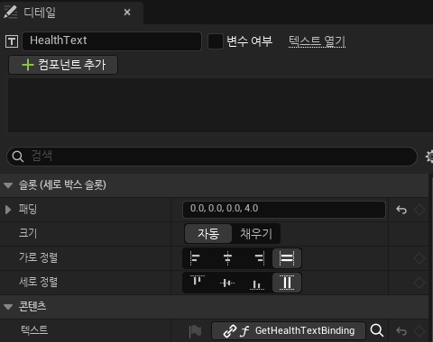
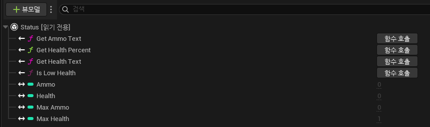
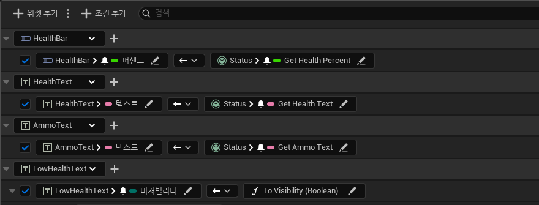
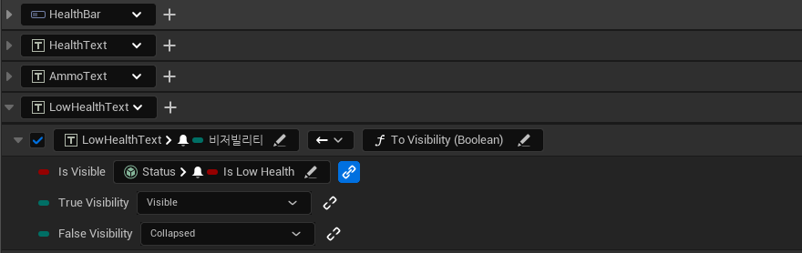
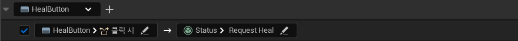
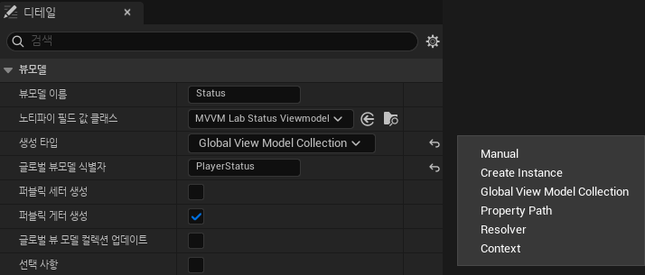
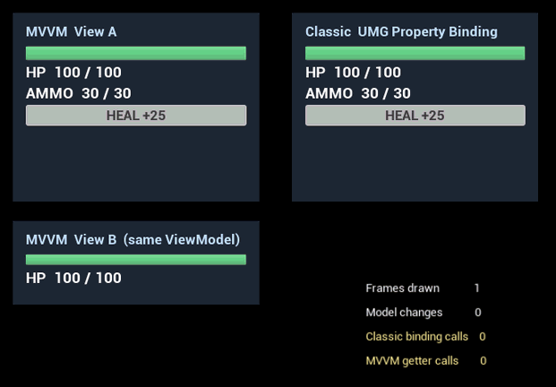

# UMG Viewmodel(MVVM)로 UI 만들기

<a id="contents"></a>

## 목차

1. [MVVM이 뭔가 - 무슨 패턴인가](#what)
2. [기존 UMG 방식과 뭐가 다른가](#vs-classic)
3. [준비 - 플러그인과 모듈](#setup)
4. [ViewModel 만들기 - FieldNotify](#viewmodel)
5. [위젯에 연결하기 - Viewmodels와 View Bindings](#bindings)
6. [ViewModel을 어디서 가져오나 - 생성 타입](#creation)
7. [돌려 보기 - ViewModel 하나, View 둘](#run)
8. [몇 번 도는지 세어 봤다](#count)
9. [장단점](#pros-cons)
10. [만들면서 헤맨 부분](#stuck)
11. [정리](#summary)
12. [부록](#reproduce)

---

이 문서는 Unreal Engine 5.8.3 기준이다. MVVM은 엔진에 들어 있는 UMG Viewmodel 플러그인(5.8에서 베타)으로 쓴다.

---

<a id="what"></a>

## 1. MVVM이 뭔가 - 무슨 패턴인가

MVVM(Model-View-ViewModel)은 UI 코드를 세 역할로 나누는 아키텍처 패턴이다. 마이크로소프트가 WPF를 만들면서 쓰기 시작했고, 지금은 웹·모바일 UI 프레임워크에서도 흔히 쓴다.

```text
Model       게임 데이터와 규칙. 체력, 탄약, 인벤토리. UI가 있는지 모른다.
ViewModel   화면에 보여 줄 값. "HP 72 / 100", 체력 비율, 경고를 띄울지. 위젯을 모른다.
View        위젯. ViewModel 값을 그대로 보여 주고, 버튼 같은 입력을 ViewModel에 넘긴다.
```

의존 방향이 한쪽으로만 흐르는 게 핵심이다. View는 ViewModel을 알고, ViewModel은 Model을 안다. 반대 방향은 모른다. 그럼 값이 바뀐 걸 View는 어떻게 알까. ViewModel이 "이 필드가 바뀌었다"고 알리고, View가 그 알림을 구독한다. 이번에 만든 예제로 그리면 이렇다.

```text
          명령 (RequestHeal -> Heal)                 이벤트 바인딩 (버튼 클릭)
  Model  <---------------------------  ViewModel  <-----------------------------  View
         --------------------------->             ----------------------------->
          변경 알림 (델리게이트)                       필드 변경 알림 (FieldNotify) -> 바인딩이 위젯 속성을 고친다
```

그래서 MVVM 안에는 패턴 몇 개가 섞여 있다.

- **옵저버 패턴**: ViewModel이 필드가 바뀔 때 알림을 쏘고, 바인딩이 구독한다. 언리얼에서는 `INotifyFieldValueChanged`(FieldNotify)가 이 역할이다. WPF의 `INotifyPropertyChanged` 와 같은 자리다. Model에서 ViewModel로 가는 알림은 평범한 델리게이트로 했다([아키텍처와 의존성](../CS/ArchitectureDependencies.md#child-to-owner)의 "소유 객체가 사건을 알릴 때"와 같은 모양).
- **데이터 바인딩**: "이 위젯 속성은 저 ViewModel 필드를 따른다"를 코드가 아니라 선언으로 적는다. 언리얼에서는 위젯 블루프린트의 View Bindings 패널이다.
- **커맨드**: View의 입력(버튼 클릭)을 ViewModel의 함수 호출로 바꾼다. 이번 예제의 `RequestHeal` 이다.

비슷한 패턴인 MVC는 Controller가 입력을 받아 Model과 View를 고치고, MVP는 Presenter가 View 인터페이스를 직접 호출해서 화면을 고친다. MVVM은 ViewModel이 View를 호출하지 않는다는 점이 다르다. ViewModel은 값만 바꾸고, 그 값을 따라가는 건 바인딩이 한다.

---

<a id="vs-classic"></a>

## 2. 기존 UMG 방식과 뭐가 다른가

UMG에서 화면에 게임 값을 띄우는 방법은 보통 셋 중 하나다.

```text
속성 바인딩      디테일 패널에서 Text 옆 "바인딩"을 눌러 함수에 묶는다.
                위젯이 그려질 때마다 그 함수가 불린다. 값이 바뀌었든 아니든.
직접 갱신        위젯이 게임 쪽 이벤트를 구독하거나 Tick에서 값을 읽어 SetText를 부른다.
                위젯이 게임 코드를 알고, 갱신 코드가 위젯마다 흩어진다.
MVVM            ViewModel이 바뀐 필드만 알리고, 위젯은 View Bindings에 적힌 대로 따라간다.
                위젯 쪽에는 코드가 없다.
```

비교하려고 같은 모양의 상태 창을 속성 바인딩으로도 하나 만들었다. 체력 텍스트의 디테일 패널을 보면 `텍스트` 가 `GetHealthTextBinding` 함수에 묶여 있다. 이 함수는 위젯이 직접 들고 있는 Model을 읽는다.



```cpp
// MVVMLabClassicStatusWidget.cpp - 속성 바인딩 함수
FText UMVVMLabClassicStatusWidget::GetHealthTextBinding() const
{
	++BindingCallCount;
	return Model ? FText::FromString(FString::Printf(TEXT("HP  %d / %d"), Model->GetHealth(), Model->GetMaxHealth())) : FText::GetEmpty();
}
```

간단하고 바로 된다. 대신 위젯이 Model 타입을 알아야 하고, 체력 비율·텍스트·경고 표시 같은 계산이 위젯 안에 들어간다. 그리고 이 함수가 언제 불리는지는 [8장](#count)에서 세어 봤다.

---

<a id="setup"></a>

## 3. 준비 - 플러그인과 모듈

플러그인 이름은 `ModelViewViewModel`, 에디터에 보이는 이름은 UMG Viewmodel이다. 기본으로 꺼져 있다.

```json
{
    "Name": "ModelViewViewModel",
    "Enabled": true
}
```

C++로 ViewModel을 만들려면 모듈 의존성도 넣는다. FieldNotify 매크로가 `FieldNotification` 모듈에 있다.

```csharp
PublicDependencyModuleNames.AddRange(new string[] { "FieldNotification", "ModelViewViewModel" });
```

예제 코드는 `Source/UnrealEngineLab/MVVMLab/` 에 있다.

```text
MVVMLabPlayerModel           Model. 체력, 탄약. 바뀌면 OnChanged 델리게이트
MVVMLabStatusViewModel       ViewModel. FieldNotify 필드와 RequestHeal 명령
MVVMLabClassicStatusWidget   비교용. 속성 바인딩 함수를 가진 위젯 부모 클래스
MVVMLabGameMode              Model과 ViewModel을 만들고 위젯 세 개를 띄운다
```

---

<a id="viewmodel"></a>

## 4. ViewModel 만들기 - FieldNotify

ViewModel은 `UMVVMViewModelBase` 를 상속한다. 위젯이 구독할 필드에 `FieldNotify` 를 붙인다. 속성은 `Setter`, `Getter` 를 같이 달고, 함수는 인자 없는 const `BlueprintPure` 함수에 붙인다.

```cpp
// MVVMLabStatusViewModel.h (일부 생략)
UCLASS(BlueprintType, DisplayName = "MVVM Lab Status Viewmodel")
class UMVVMLabStatusViewModel : public UMVVMViewModelBase
{
public:
	UFUNCTION(BlueprintPure, FieldNotify, Category = "MVVMLab")
	float GetHealthPercent() const;

	UFUNCTION(BlueprintPure, FieldNotify, Category = "MVVMLab")
	FText GetHealthText() const;

	UFUNCTION(BlueprintPure, FieldNotify, Category = "MVVMLab")
	bool IsLowHealth() const;

	/** 위젯 버튼이 부르는 명령. ViewModel이 Model에 전달한다. */
	UFUNCTION(BlueprintCallable, Category = "MVVMLab")
	void RequestHeal();

private:
	UPROPERTY(BlueprintReadWrite, FieldNotify, Setter, Getter, Category = "MVVMLab", meta = (AllowPrivateAccess))
	int32 Health = 0;
	// MaxHealth, Ammo, MaxAmmo도 같은 모양
};
```

값을 바꿀 때는 `UE_MVVM_SET_PROPERTY_VALUE` 를 쓴다. 값이 실제로 바뀌었을 때만 대입하고 알림을 쏘고 true를 돌려준다.

```cpp
// MVVMLabStatusViewModel.cpp
void UMVVMLabStatusViewModel::SetHealth(int32 NewHealth)
{
	if (UE_MVVM_SET_PROPERTY_VALUE(Health, NewHealth))
	{
		BroadcastHealthDerived();
	}
}

void UMVVMLabStatusViewModel::BroadcastHealthDerived()
{
	// 함수 필드는 스스로 바뀐 걸 모르니, 재료가 바뀔 때 직접 알려 줘야 한다.
	UE_MVVM_BROADCAST_FIELD_VALUE_CHANGED(GetHealthPercent);
	UE_MVVM_BROADCAST_FIELD_VALUE_CHANGED(GetHealthText);
	UE_MVVM_BROADCAST_FIELD_VALUE_CHANGED(IsLowHealth);
}
```

`GetHealthPercent` 같은 함수 필드는 엔진이 언제 값이 바뀌는지 모른다. 재료인 `Health` 가 바뀔 때 직접 알려 줘야 한다. 이걸 빠뜨리면 바인딩은 멀쩡히 걸려 있는데 화면이 안 바뀐다.

Model과는 델리게이트로 붙는다. Model이 바뀌면 ViewModel이 값을 가져와 자기 setter를 부르고, 같은 값이면 setter 안에서 아무것도 알리지 않는다.

```cpp
// 이전 Model 구독 해제와 null 검사는 생략
void UMVVMLabStatusViewModel::SetModel(UMVVMLabPlayerModel* InModel)
{
	Model = InModel;
	InModel->OnChanged.AddUObject(this, &UMVVMLabStatusViewModel::HandleModelChanged);
	HandleModelChanged(InModel);
}

void UMVVMLabStatusViewModel::HandleModelChanged(const UMVVMLabPlayerModel* InModel)
{
	SetMaxHealth(InModel->GetMaxHealth());
	SetHealth(InModel->GetHealth());
	SetMaxAmmo(InModel->GetMaxAmmo());
	SetAmmo(InModel->GetAmmo());
}
```

컴파일하고 위젯 블루프린트의 Viewmodels 패널에 추가하면 필드가 이렇게 보인다. `←` 는 읽기만 되는 함수 필드, `↔` 는 읽고 쓸 수 있는 속성 필드다.



---

<a id="bindings"></a>

## 5. 위젯에 연결하기 - Viewmodels와 View Bindings

위젯 블루프린트에서 하는 일은 두 가지다.

```text
1. 창 > 뷰모델           Viewmodels 패널에서 "+ 뷰모델"로 ViewModel 클래스를 추가하고 이름을 붙인다 (Status)
2. 하단 "뷰 바인딩"      View Bindings 패널에서 위젯 속성과 ViewModel 필드를 한 줄씩 잇는다
```

상태 창 위젯(`WBP_StatusMVVM`)의 View Bindings다. 왼쪽이 위젯 속성, 가운데 화살표가 방향, 오른쪽이 ViewModel 필드다. 줄마다 오른쪽 끝에는 실행 모드를 고르는 칸이 있고, 기본값은 `Auto` 다([8장](#count)).



화살표 드롭다운은 바인딩 모드다. 소스(`MVVMBindingMode.h`)의 이름으로 적으면 이렇다.

```text
OneWayToDestination   ViewModel -> 위젯. 가장 많이 쓴다. 이번 바인딩은 전부 이것
OneTimeToDestination  처음 한 번만
TwoWay                양쪽. 슬라이더, 체크박스처럼 위젯이 값을 바꾸는 경우
OneWayToSource        위젯 -> ViewModel
```

타입이 다르면 변환 함수를 낀다. `IsLowHealth` 는 bool이고 `Visibility` 는 `ESlateVisibility` 라서, 플러그인에 들어 있는 `To Visibility (Boolean)` 을 썼다. 참이면 Visible, 거짓이면 Collapsed다.



버튼은 이벤트 줄로 잇는다. HEAL 버튼의 클릭 이벤트가 오면 ViewModel의 `RequestHeal` 을 부른다. 위젯 그래프에 노드를 하나도 안 만들었다.



정리하면 `WBP_StatusMVVM` 에는 바인딩 4줄과 이벤트 1줄이 있고, 이벤트 그래프는 비어 있다. 같은 ViewModel을 보는 작은 창(`WBP_StatusMini`)에는 체력 바와 체력 텍스트 2줄만 있다.

---

<a id="creation"></a>

## 6. ViewModel을 어디서 가져오나 - 생성 타입

위젯이 ViewModel 인스턴스를 어디서 얻을지는 Viewmodels 패널에서 ViewModel을 고르면 나오는 디테일의 `생성 타입` 으로 정한다.



선택지는 여섯 개다. 설명은 소스(`MVVMBlueprintViewModelContext.h`) 주석을 옮겼다.

| 생성 타입 | 인스턴스를 얻는 방법 |
| --- | --- |
| Manual | 나중에 코드로 넣는다 (`SetViewModel`) |
| Create Instance | 위젯이 만들어질 때 새로 만든다. 기본값 |
| Global View Model Collection | 게임 쪽에서 MVVM 서브시스템에 이름으로 올려 둔 것을 찾아온다 |
| Property Path | 위젯의 함수나 속성 경로를 따라가서 찾는다 |
| Resolver | Resolver 객체가 찾아 준다 |
| Context | 로컬 컨텍스트 제공자에서 받는다. 직접 넣을 수도 있다 |

여러 위젯이 같은 ViewModel을 봐야 해서 Global View Model Collection을 골랐다. 게임 모드가 ViewModel을 만들어 `PlayerStatus` 라는 이름으로 올려 두고, 위젯 두 개는 각자 그 이름으로 찾아온다. 위젯을 띄우는 코드는 ViewModel을 넘겨주지 않는다.

```cpp
// MVVMLabGameMode.cpp - BeginPlay (null 검사와 위치·크기 인자는 생략)
Model = NewObject<UMVVMLabPlayerModel>(this);
ViewModel = NewObject<UMVVMLabStatusViewModel>(this);
ViewModel->SetModel(Model);

FMVVMViewModelContext Context;
Context.ContextClass = UMVVMLabStatusViewModel::StaticClass();
Context.ContextName = TEXT("PlayerStatus");
GetGameInstance()->GetSubsystem<UMVVMGameSubsystem>()->GetViewModelCollection()->AddViewModelInstance(Context, ViewModel);

ShowWidget(MVVMWidgetClass, ...);     // WBP_StatusMVVM
ShowWidget(MiniWidgetClass, ...);     // WBP_StatusMini. 같은 ViewModel을 스스로 찾는다
```

---

<a id="run"></a>

## 7. 돌려 보기 - ViewModel 하나, View 둘

PIE에서 데미지와 사격을 차례로 넣고, 체력이 30% 밑으로 내려간 뒤 MVVM 창의 HEAL 버튼을 눌렀다. 왼쪽 위가 MVVM 창, 왼쪽 아래가 같은 ViewModel을 보는 작은 창, 오른쪽이 속성 바인딩으로 만든 창이다. 오른쪽 아래 숫자는 위젯과 상관없이 Canvas로 그린 호출 횟수다.



세 창 모두 같은 Model을 보고 있어서 숫자는 늘 같이 바뀐다. 차이는 뒤에서 일어난다.

- MVVM 창 두 개는 ViewModel이 알릴 때만 바뀐다. 작은 창(View B)에는 코드가 한 줄도 없는데, 같은 ViewModel을 Global Collection에서 찾아와서 따라 바뀐다.
- HEAL 버튼을 누르면 이벤트 바인딩이 `RequestHeal` 을 부르고, ViewModel이 Model의 `Heal` 을 부른다. Model이 바뀌면 다시 ViewModel을 거쳐 두 창이 바뀐다. 이때 체력이 28에서 53이 됐다.
- 오른쪽 창은 Model을 직접 읽기 때문에 결과는 같지만, 아래 `Classic binding calls` 가 매 프레임 올라간다.

GIF를 찍는 동안에는 스크린샷이 위젯을 한 번 더 그려서 기존 방식 호출이 프레임당 4번보다 조금 많게 나온다. 정확한 숫자는 캡처를 끄고 따로 쟀다.

---

<a id="count"></a>

## 8. 몇 번 도는지 세어 봤다

바인딩 함수가 몇 번 불리는지 직접 세어 보고 싶었다. 기존 방식 위젯의 바인딩 함수 4개와 ViewModel의 FieldNotify 함수 4개에 각각 호출 카운터를 넣고, PIE를 30fps로 고정해서 쟀다. 처음 10초는 아무것도 바꾸지 않았고, 다음 10초 동안 데미지 4번, 사격 7번, 재장전 1번, 회복 1번을 넣었다.

| 구간 | 그린 프레임 | Model 변경 | 기존 방식 바인딩 호출 | MVVM 함수 호출 |
| --- | --- | --- | --- | --- |
| 아무 변화 없음 10초 | 297 | 0 | 1,188 | 0 |
| 변화 13번 10초 | 300 | 13 | 1,200 | 33 |

기존 방식은 값이 바뀌든 말든 프레임마다 정확히 4번(바인딩 4개)씩 불렸다. MVVM은 아무것도 안 바뀌는 동안 한 번도 안 불렸고, 13번 바뀌는 동안 33번 불렸다. 33은 계산이 딱 맞는다.

```text
체력 변경 5번 (데미지 4 + 회복 1)  x  체력에 묶인 바인딩 5개 (View A 3개 + View B 2개)  = 25
탄약 변경 8번 (사격 7 + 재장전 1)  x  탄약에 묶인 바인딩 1개                          =  8
                                                                                       33
```

바인딩이 몇 개든, 그 필드가 바뀔 때만, 그 필드에 묶인 바인딩만 돈다.

한 가지 더 해 봤다. 한 프레임 안에 회복을 세 번 연달아 넣었더니(28 → 53 → 78 → 100) MVVM 함수가 15번(3번 x 5개) 불렸다. 기본 실행 모드 `Auto` 는 하나의 필드에서 오는 바인딩을 바로(Immediate) 실행해서, 같은 프레임에 여러 번 바뀌면 그만큼 다 돈다. 실행 모드는 소스(`MVVMExecutionMode.h`)에 이렇게 적혀 있다.

```text
Immediate   소스 값이 바뀌는 즉시 실행
Delayed     소스 값이 바뀌면 그 프레임 끝, 그리기 전에 실행
Tick        매 프레임 끝에 항상 실행
Auto        여러 필드에서 오는 바인딩이면 Delayed, 아니면 Immediate (기본값)
```

Delayed로 바꾸면 한 프레임에 여러 번 바뀌어도 끝에서 한 번만 돌 것으로 보이는데, 이번에는 확인하지 않았다.

이 예제에서는 함수 하나가 문자열 하나 만드는 정도라 프레임마다 4번 불려도 티가 안 난다. 다만 위젯이 수십 개고 바인딩 함수가 무거워지면(인벤토리 칸마다 아이콘·개수·쿨타임 계산) 기존 방식은 화면에 떠 있는 동안 계속 그 비용을 낸다. MVVM은 바뀐 칸만 계산한다.

---

<a id="pros-cons"></a>

## 9. 장단점

해 보고 느낀 것 위주로 적었다.

**장점**

- 바뀔 때만 돈다. 위의 표처럼 아무 변화가 없으면 0번이다.
- 위젯과 게임 코드가 떨어진다. 위젯은 Model을 모르고 ViewModel은 위젯을 모른다. 같은 ViewModel에 창을 하나 더 붙일 때 데이터를 연결하는 코드가 필요 없었다(View B). 위젯을 띄우기만 하면 됐다.
- 위젯에 그래프 코드가 없다. 변환(`To Visibility`)과 버튼 입력(`RequestHeal`)까지 View Bindings에 선언으로 들어가서, 위젯 블루프린트를 열면 무엇이 무엇에 묶였는지 한눈에 보인다.
- ViewModel은 그냥 UObject라 위젯 없이도 테스트할 수 있다. Model 값을 넣고 `GetHealthText()` 결과만 보면 된다.

**단점**

- 아직 베타 플러그인이다. 에디터 서브시스템 헤더만 봐도 5.3, 5.4, 5.5에 바뀐 함수가 `UE_DEPRECATED` 로 남아 있다.
- 손이 많이 간다. 필드마다 Getter/Setter를 쓰고, 계산된 필드는 재료가 바뀔 때마다 알림을 직접 보내야 한다. 하나라도 빠뜨리면 화면이 안 바뀌는데 에러도 안 난다.
- 추적이 간접적이다. 값이 안 바뀔 때 Model 알림, ViewModel setter, FieldNotify 알림, 바인딩, ViewModel 인스턴스 연결(생성 타입) 중 어디가 문제인지 따라가야 한다.
- 작은 UI에는 과하다. 숫자 하나 띄우는 디버그 위젯이면 속성 바인딩이 훨씬 빠르게 끝난다.
- 기본 실행 모드에서는 한 프레임에 같은 값이 여러 번 바뀌면 그만큼 다 돈다.

그래서 이렇게 나눠 쓰면 될 것 같다.

```text
속성 바인딩    프로토타입, 디버그 위젯, 화면 하나에 값 몇 개
MVVM          HUD, 인벤토리, 상점처럼 데이터가 많고 여러 화면이 같은 데이터를 보는 UI
              UI 디자이너와 게임플레이 프로그래머가 나눠서 작업하는 경우
```

---

<a id="stuck"></a>

## 10. 만들면서 헤맨 부분

### 위젯 글자가 스크린샷에 안 나왔다

PIE 화면을 `Shot` 으로 찍었더니 3D 장면만 나오고 UMG 위젯은 하나도 없었다. UMG는 뷰포트 위에 Slate로 그려져서 `Shot` 에는 안 들어간다. `Shot showui` 로 찍으면 에디터 창 전체가 찍히고 위젯도 나온다. 문서의 GIF는 이렇게 찍고 뷰포트 부분만 잘랐다.

### 바인딩을 Python으로 못 걸었다

상태 창을 세 개 만들면서 같은 배치와 바인딩을 손으로 반복하기 싫어서 에디터 Python으로 만들려고 했다. Viewmodels 패널에 ViewModel을 추가하는 `AddViewModel` 과 빈 바인딩 줄을 만드는 `AddBinding` 은 Python에서 불리는데, 그 줄의 소스·대상 경로를 정하는 `SetSourcePathForBinding`, `SetDestinationPathForBinding` 은 `UFUNCTION` 이 아니라 C++에서만 부를 수 있었다. `AddBinding` 이 돌려주는 참조도 Python에서는 복사본이 된다. 결국 경로를 채우는 부분만 작은 에디터 모듈(`Source/UnrealEngineLabEditor/MVVMLab/`)에 C++로 감싸서 Python에서 불렀다.

---

<a id="summary"></a>

## 11. 정리

```text
Model         게임 데이터. 바뀌면 델리게이트로 알린다.
ViewModel     화면용 값. FieldNotify로 바뀐 필드만 알린다. 위젯을 모른다.
View          위젯. View Bindings에 "이 속성은 저 필드를 따른다"고 적는다. 코드가 없다.
생성 타입      위젯이 ViewModel을 얻는 방법. 여러 위젯이 공유하면 Global View Model Collection.
기존 방식과 차이  속성 바인딩은 매 프레임 묻고(polling), MVVM은 바뀔 때 알려 준다(push).
```

해 보기 전에는 MVVM을 "바인딩을 예쁘게 정리하는 방법" 정도로 생각했다. 직접 세어 보니 핵심은 호출 방향이 뒤집힌다는 데 있었다. 기존 속성 바인딩은 위젯이 매 프레임 값을 물어보고, MVVM은 값이 바뀔 때 ViewModel이 알려 준다. 그 덕에 아무것도 안 바뀌면 0번 돌고, 같은 ViewModel에 창을 몇 개 붙여도 위젯 쪽 코드는 늘지 않았다. 대신 알림을 빠짐없이 보내는 책임이 ViewModel을 쓰는 사람에게 넘어온다.

---

<a id="reproduce"></a>

## 12. 부록

에셋은 `Content/MVVMLab/` 에 있다.

```text
UI/WBP_StatusMVVM      MVVM 창. 바인딩 4줄 + 이벤트 1줄
UI/WBP_StatusMini      같은 ViewModel을 보는 작은 창. 바인딩 2줄
UI/WBP_StatusClassic   속성 바인딩 4개
Maps/L_MVVMLab         게임 모드가 AMVVMLabGameMode인 빈 맵. 열고 플레이하면 위 화면이 뜬다
```

위젯과 맵을 만든 스크립트, 측정과 GIF를 만든 스크립트는 [Scripts/MVVMLab](../../Scripts/MVVMLab/README.md)에 있다. 측정 요약은 [summary.json](Evidence/MVVM/summary.json)에 남겨 두었다.

### 참고

- [UMG Viewmodel for Unreal Engine](https://dev.epicgames.com/documentation/en-us/unreal-engine/umg-viewmodel-for-unreal-engine) - 공식 문서. 5.8에서도 Beta 기능으로 안내한다
- 엔진 소스 `Engine/Plugins/Runtime/ModelViewViewModel/Source/`
  - `ModelViewViewModel/Public/MVVMViewModelBase.h` - `UMVVMViewModelBase`, `UE_MVVM_SET_PROPERTY_VALUE`
  - `ModelViewViewModel/Public/Types/MVVMBindingMode.h`, `MVVMExecutionMode.h` - 바인딩 모드, 실행 모드
  - `ModelViewViewModel/Public/Bindings/MVVMConversionLibrary.h` - `To Visibility (Boolean)`
  - `ModelViewViewModelBlueprint/Public/MVVMBlueprintViewModelContext.h` - 생성 타입
  - `ModelViewViewModelEditor/Public/MVVMEditorSubsystem.h` - 에디터에서 ViewModel·바인딩 추가
- 이 저장소의 [아키텍처와 의존성](../CS/ArchitectureDependencies.md)

---

[목차로 돌아가기](#contents) · [메인 README의 Unreal Engine 목차로 돌아가기](../../README.md#unreal-engine)
