# Motion Matching으로 이동 애니메이션 고르기

<a id="contents"></a>

## 목차

1. [왜 필요한가](#what)
2. [준비 - 플러그인과 구성 요소](#setup)
3. [무엇을 비교하는가 - Schema](#schema)
4. [어디서 찾는가 - Database](#database)
5. [어떤 DB를 뒤질지는 Chooser가 정한다](#chooser)
6. [비용은 어떻게 계산하나](#cost)
7. [직접 돌려 보기 - 출발, 반전, 정지](#run)
8. [지금 애니메이션을 계속 이어 간다](#continuing)
9. [점프는 어떻게 찾나](#jump)
10. [데이터를 줄이면](#density)
11. [상태 머신 모드와 비교하면](#state-machine)
12. [테스트하다 헤맨 부분](#stuck)
13. [막히기 쉬운 곳](#pitfalls)
14. [정리 - 내가 이해한 Motion Matching](#summary)
15. [부록 - 다시 테스트하기](#reproduce)

---

이 문서는 Unreal Engine 5.8.3 기준이다. 테스트는 Epic의 Game Animation Sample(이하 GASP) 프로젝트에서 했고, 테스트에 쓴 스크립트는 `Scripts/MotionMatching/` 에 있다. [Motion Warping 문서](MotionWarping.md)와 같은 캐릭터, 같은 맵을 썼다. 점프([9절](#jump))만 이 저장소의 [파쿠르 타임어택](ParkourTimeAttack.md)에 가져온 Mover 캐릭터로 확인했다.

---

<a id="what"></a>

## 1. 왜 필요한가

이동 애니메이션을 상태 머신으로 만들면 상태가 금방 늘어난다. 대기, 출발, 달리기, 정지, 반전, 제자리 회전... 여기에 걷기·달리기·전력질주가 곱해지고, 상태마다 들어가고 나오는 조건을 직접 정해야 한다. 조건이 하나 어긋나면 발이 미끄러지거나 동작이 툭 끊긴다.

Motion Matching은 접근이 반대다. 상태와 전환 조건을 일일이 만드는 대신, 지금 캐릭터의 포즈와 앞으로 갈 경로를 보고 애니메이션 데이터 전체에서 가장 비슷한 프레임을 찾아 그 자리부터 재생한다. 이걸 매 프레임 반복한다.

처음에는 "매 프레임 검색하면 애니메이션이 계속 바뀌어서 덜컥거리지 않나?"라고 생각했다. 직접 돌려 보니 반대였다. 지금 재생 중인 애니메이션이 계속 제일 잘 맞으면 그냥 그대로 간다. 아래는 정해진 입력으로 출발 → 달리기 → 180° 반전 → 정지를 시킨 장면인데, 5초 동안 재생된 애니메이션은 네 개뿐이었다.

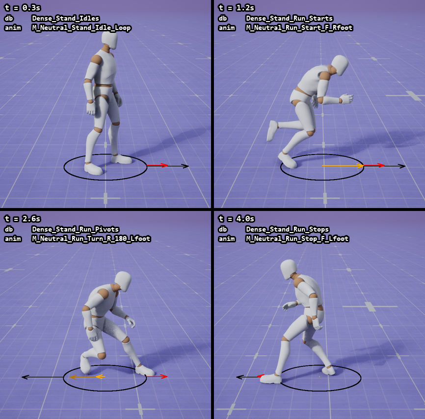

---

<a id="setup"></a>

## 2. 준비 - 플러그인과 구성 요소

필요한 플러그인은 `PoseSearch` 다. GASP는 데이터베이스를 고르는 데 `Chooser` 도 같이 쓴다.

```json
{
    "Name": "PoseSearch",
    "Enabled": true
},
{
    "Name": "Chooser",
    "Enabled": true
}
```

구성 요소는 세 가지로 보면 된다.

| 에셋 / 노드 | 하는 일 |
| --- | --- |
| Pose Search Schema | 무엇을 비교할지 정한다. 궤적 몇 지점, 어떤 본의 위치·속도 |
| Pose Search Database | 어디서 찾을지 정한다. 애니메이션 묶음 + Schema |
| Motion Matching 노드 | AnimBP에서 매 프레임 검색하고, 찾은 포즈로 블렌드한다 |

GASP AnimBP의 AnimGraph에서는 이렇게 생겼다.

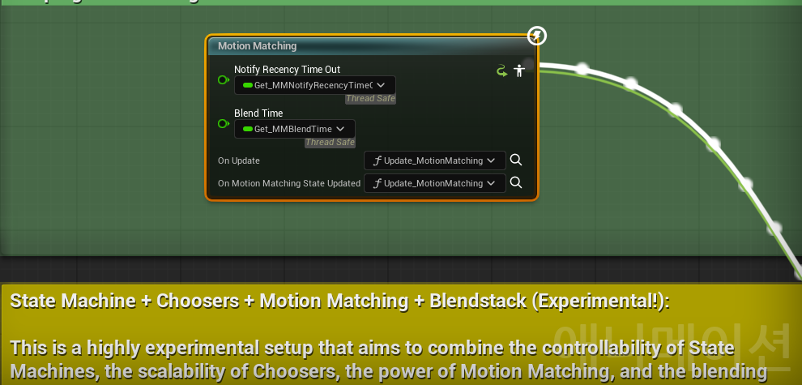

`On Update` 에서 `Update_MotionMatching` 을 불러 검색할 DB 목록을 넣고, 선택이 끝나면 `Update_MotionMatching_PostSelection` 에서 고른 DB와 애니메이션을 변수(`CurrentSelectedDatabase`, `CurrentSelectedAnim`)에 저장한다. 이번 테스트는 이 변수들을 매 틱 기록했다. 아래 노란 주석은 뒤에서 비교할 상태 머신 모드다.

---

<a id="schema"></a>

## 3. 무엇을 비교하는가 - Schema

GASP의 기본 Schema는 `PSS_Default` 다. 채널이 두 개 있다.

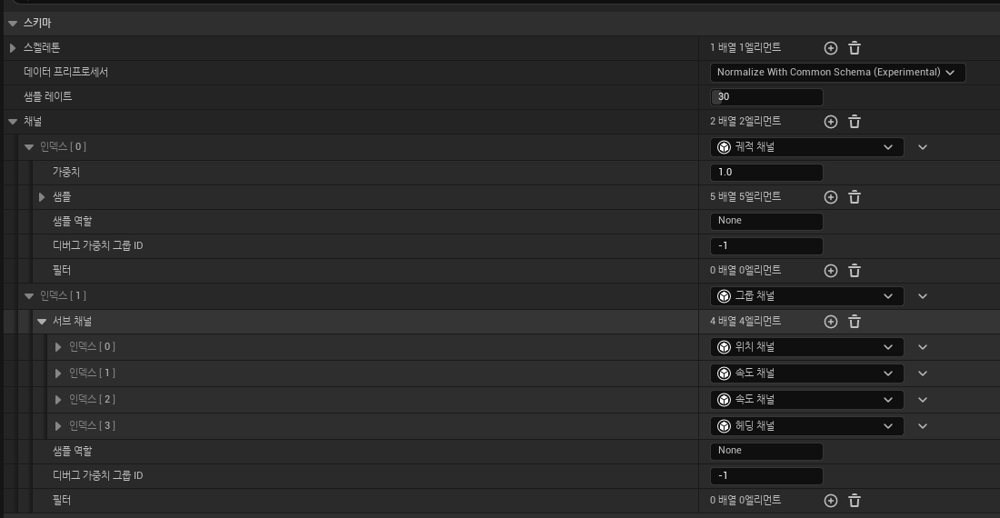

궤적 채널은 캐릭터가 지나온 길과 앞으로 갈 길을 몇 지점에서 비교한다.

| 시점 | 비교하는 것 | 가중치 |
| --- | --- | --- |
| 0.05초 전 | 위치 | 0.3 |
| 지금 | 속도, 몸 방향 | 1.0 |
| 0.35초 뒤 | 위치, 몸 방향 | 1.0 |
| 0.7초 뒤 | 위치, 속도, 몸 방향 | 1.0 |
| 1.0초 뒤 | 속도 방향 | 1.5 |

전부 수평(XY) 기준이고, 1초 뒤의 진행 방향에 가장 큰 가중치를 준다. 앞으로 어디로 갈지를 꽤 중요하게 보는 셈이다.

그룹 채널은 지금 포즈를 비교한다. 생각보다 적은 걸 본다.

| 본 | 비교하는 것 | 가중치 |
| --- | --- | --- |
| `foot_l` | 위치 | 1.0 |
| `foot_l`, `foot_r` | 속도 | 각 0.3 |
| `pelvis` | 방향 | 0.1 |

처음에는 손, 머리까지 다 비교할 줄 알았는데 발과 골반만 본다. 이동 애니메이션은 발이 어디를 디디고 있는지가 제일 중요해서, 이 정도만 맞아도 이어지는 동작이 자연스럽다고 이해했다.

샘플링은 30Hz다. 데이터베이스의 애니메이션을 1/30초 간격으로 잘라서 각 프레임의 이 값들을 미리 계산해 둔다.

---

<a id="database"></a>

## 4. 어디서 찾는가 - Database

GASP는 데이터베이스를 동작별로 잘게 나눴다. 달리기만 해도 출발(`Run_Starts`), 루프(`Run_Loops`), 반전(`Run_Pivots`), 정지(`Run_Stops`)가 따로 있고, 걷기·전력질주·웅크리기도 각각 같은 식이다.

반전 DB를 열어 보면 이렇다.

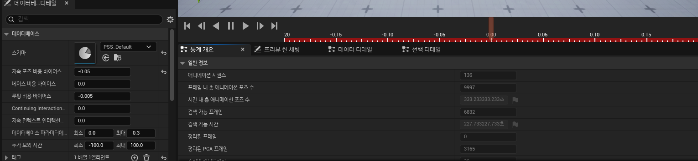

왼쪽 아래가 DB 설정이고, 오른쪽이 통계 탭이다. 이 DB 하나에 애니메이션 136개, 9,997프레임(약 333초)이 들어 있고, 그중 검색 대상 프레임은 6,832개다. 반전만으로 5분 넘는 분량이다.

설정에서는 비용 보정값 두 개를 봐야 한다.

| 설정 | 값 | 의미 |
| --- | --- | --- |
| 지속 포즈 비용 바이어스 (`ContinuingPoseCostBias`) | -0.05 | 지금 애니메이션을 이어 가는 쪽을 유리하게 |
| 루핑 비용 바이어스 (`LoopingCostBias`) | -0.005 | 루프 애니메이션을 조금 유리하게 |

엔진 기본값은 각각 -0.01, -0.005인데, 반전 DB는 이어가기 보정을 5배로 키워 두었다. 반전 동작을 한번 시작하면 중간에 다른 걸로 갈아타지 않게 하려는 것 같다.

같은 DB가 Dense, Sparse, Extreme Sparse 세 단계로 준비돼 있다. 통계 탭에서 읽은 값이다.

| DB | Dense | Sparse | Extreme Sparse |
| --- | --- | --- | --- |
| `Run_Starts` | 28개 / 1,199프레임 | 14개 / 296프레임 | 6개 / 170프레임 |
| `Run_Loops` | 20개 / 1,170프레임 | 11개 / 667프레임 | 6개 / 422프레임 |
| `Run_Pivots` | 136개 / 6,832프레임 | 34개 / 1,130프레임 | **없음** |

(애니메이션 수 / 검색 대상 프레임 수)

Extreme Sparse에는 반전 DB가 아예 없다. 이게 [10절](#density)의 결과로 그대로 이어진다.

---

<a id="chooser"></a>

## 5. 어떤 DB를 뒤질지는 Chooser가 정한다

처음엔 Motion Matching이 데이터 전체에서 알아서 고르는 줄 알았다. GASP를 뜯어보니 매 프레임 검색할 DB 목록은 Chooser가 먼저 거른다.

맨 위 Chooser는 데이터 밀도만 고른다. `DDCvar.MMDatabaseLOD` 가 0이면 Dense, 1이면 Sparse, 2면 Extreme Sparse다.

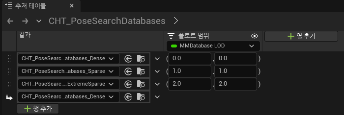

Dense 표는 이동 모드, 자세, 이동 상태, 걸음(Gait)으로 행을 나눈다.

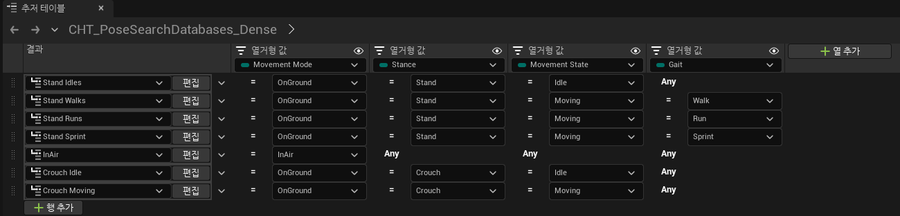

달리기 행(Stand Runs)을 열면 `IsStarting`, `IsPivoting`, `JustLanded` 같은 조건으로 DB를 또 거른다.

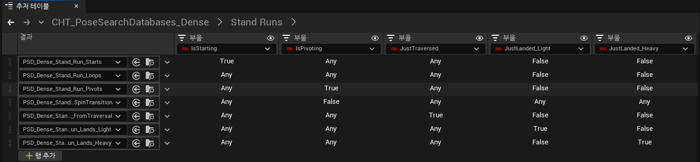

결국 GASP의 Motion Matching도 조건이 전혀 없는 건 아니다. AnimBP가 계산한 `IsPivoting` 같은 값으로 후보 DB를 정하고, 그 안에서 어느 애니메이션의 어느 프레임을 쓸지를 Motion Matching이 정한다. GASP AnimGraph의 주석에도 Chooser로 관련 있는 데이터만 남기면 선택을 제어하기 쉽고 비용도 줄어든다고 적혀 있다.

상태 머신과 다른 점은 조건이 "어느 상태로 갈지"를 정하는 게 아니라 "어느 데이터 묶음에서 찾을지"를 정한다는 것이다. 묶음 안에서 무엇을, 어디서부터 재생할지는 조건으로 적지 않는다.

---

<a id="cost"></a>

## 6. 비용은 어떻게 계산하나

검색은 결국 "가장 싼 프레임 찾기"다. 소스를 보면 비용 계산 자체는 단순하다.

```cpp
// PoseSearchIndex.inl - 실제 검색에서 쓰는 버전
const VectorRegister4Float Diff = VectorSubtract(*VA, *VB);          // DB 프레임 값 - 쿼리 값
const VectorRegister4Float WeightedDiff = VectorMultiply(Diff, *VW); // x 가중치의 제곱근
// WeightedDiff를 제곱해서 모두 더한다
```

Schema의 채널 값들을 한 줄로 늘어놓은 특징 벡터를 만든다. 지금 캐릭터에서 만든 쿼리 벡터와 DB의 각 프레임 벡터를 빼고, 가중치의 제곱근을 곱한 다음 제곱해서 더한다. 결국 "가중치 x 차이²"의 합이다. 값들은 Schema의 데이터 프리프로세서 설정대로 미리 정규화해 둔다.

최종 비용은 여기에 보정값을 더한 것이다.

```text
비용 = 가중치 x 차이²의 합
     + 프레임별 보정 (베이스 비용 바이어스, 루핑 비용 바이어스)
     + 이어가기 보정 (지금 애니메이션의 다음 프레임일 때만, 반전 DB는 -0.05)
```

DB가 커지면 매 프레임 전부 비교할 수 없으니, GASP의 DB는 PCA로 차원을 줄인 KD-Tree(`PCAKDTree`)로 검색한다.

---

<a id="run"></a>

## 7. 직접 돌려 보기 - 출발, 반전, 정지

PIE에서 `SandboxCharacter_CMC` 를 빈 바닥에 세우고, 매 틱 정해진 입력을 넣었다.

```text
0.0 ~ 0.5초    입력 없음 (대기)
0.5 ~ 2.3초    +X 방향으로 달리기
2.3 ~ 3.6초    -X 방향으로 반전
3.6초 ~        입력 없음 (정지)
```

카메라는 캐릭터를 옆에서 따라간다. 왼쪽 위 글자는 그 프레임에 AnimBP 변수에 기록된 DB와 애니메이션이다.

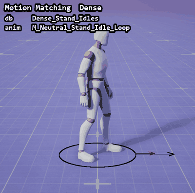

발밑의 도형은 GASP 자체 디버그(`DDCvar.DrawCharacterDebugShapes 1`)다. 주황 화살표가 지금 속도, 갈색이 궤적이 예측한 미래 속도, 빨강이 메시가 보는 방향이다. 반전 순간을 보면 갈색은 이미 왼쪽인데 빨강은 아직 오른쪽이다. 지금 포즈와 앞으로 갈 궤적이 이렇게 어긋날 때 반전 애니메이션이 제일 싸게 나온다.

실제로 골라진 순서는 이렇다.

| 시간 | 입력 | 고른 DB | 고른 애니메이션 |
| --- | --- | --- | --- |
| 0.00 ~ 0.55초 | 없음 | `Stand_Idles` | `M_Neutral_Stand_Idle_Loop` |
| 0.55 ~ 2.32초 | +X | `Stand_Run_Starts` | `M_Neutral_Run_Start_F_Rfoot` |
| 2.32 ~ 3.62초 | -X | `Stand_Run_Pivots` | `M_Neutral_Run_Turn_R_180_Lfoot` |
| 3.62초 ~ | 없음 | `Stand_Run_Stops` | `M_Neutral_Run_Stop_F_Lfoot` |

달리기 루프(`Run_Loops`)는 한 번도 골라지지 않았다. 출발 애니메이션 하나가 1.8초 동안 그대로 이어졌다.

---

<a id="continuing"></a>

## 8. 지금 애니메이션을 계속 이어 간다

위 표가 이상해서 매 프레임 Chooser가 넘겨준 후보 DB(`ValidDatabases`)도 같이 기록해 봤다.

| 시간 | 후보 DB | 재생 중인 애니메이션 |
| --- | --- | --- |
| 0.51초 | `Run_Starts`, `Run_Loops` | `Run_Start_F_Rfoot` 시작 |
| 1.00초 | `Run_Loops` | 여전히 `Run_Start_F_Rfoot` |
| 2.31초 | `Run_Loops`, `Run_Pivots` | `Run_Turn_R_180_Lfoot` 시작 |
| 2.49초 | `Run_Loops` | 여전히 `Run_Turn_R_180_Lfoot` |
| 3.61초 | `Walk_Stops`, `Run_Stops` | `Run_Stop_F_Lfoot` 시작 |
| 3.84초 | `Stand_Idles` | 여전히 `Run_Stop_F_Lfoot` |

1초부터는 후보에 출발 DB가 없는데도 출발 애니메이션이 계속 재생된다. 반전 DB도 0.18초만 후보였는데 반전 애니메이션은 1.3초 동안 이어진다.

소스를 보니 검색할 때 지금 결과의 다음 프레임(이어가기 포즈)을 먼저 비교하고, 그다음 후보 DB들을 검색해서 가장 싼 걸 고른다.

```cpp
// PoseSearchLibrary.cpp - UpdateMotionMatchingState
const bool bSearchContinuingPose = !bForceInterrupt && bCanAdvance;

if (bSearchContinuingPose)
{
    CurrentResultDatabase->SearchContinuingPose(SearchContext, SearchResults);
}
for (const TObjectPtr<const UPoseSearchDatabase>& Database : Databases)
{
    Database->Search(SearchContext, SearchResults);
}
SearchResult = SearchResults.GetBestResult();
```

이어가기 포즈는 후보 DB 목록과 상관없이 비교 대상에 들어간다. 여기에 이어가기 보정(-0.05)까지 붙으니, 지금 애니메이션이 크게 어긋나지 않는 한 계속 이어진다. 처음에 걱정했던 "매 프레임 바뀌어서 덜컥거리는" 일이 안 생기는 이유가 이거였다.

끊고 싶을 때는 Interrupt Mode를 쓴다.

| Interrupt Mode | 이어가기 포즈 |
| --- | --- |
| `DoNotInterrupt` | 항상 비교한다 |
| `InterruptOnDatabaseChange` | 지금 DB가 후보 목록에 없으면 버린다 |
| `ForceInterrupt` | 항상 버린다 |

GASP의 `Get_MMInterruptMode` 는 평소엔 `DoNotInterrupt` 이고, 이동 모드·이동 상태·자세가 바뀐 프레임에만 `InterruptOnDatabaseChange` 를 쓴다. 그래서 달리는 동안에는 출발 애니메이션이 이어지다가, 입력을 놓아 이동 상태가 바뀌는 순간 정지 DB로 바로 넘어간다.

---

<a id="jump"></a>

## 9. 점프는 어떻게 찾나

위 테스트는 땅에서만 했다. 공중에서는 어떻게 고르는지 궁금해서, [파쿠르 타임어택](ParkourTimeAttack.md)에 가져온 GASP의 Mover 캐릭터(`SandboxCharacter_Mover`)로 평지에서 점프를 한 번 해 봤다. Mover 캐릭터는 CMC 캐릭터와 달리 Relaxed 데이터 세트(`CHT_PoseSearchDatabases_Relaxed`, `PSD_Relaxed_*`)를 쓰고, `DDCvar.LocomotionSetupMover` 를 0으로 바꿔서 Motion Matching 노드로 고르게 했다.

이번에는 엔진의 `a.AnimNode.MotionMatching.DebugDrawInfo 1` 을 켰다. 캐릭터 옆에 지금 고른 DB(Current Database), 재생 중인 애니메이션(Current Asset), 다음 검색 대상(Databases to search), 섞이고 있는 애니메이션(Blend Stack)이 노란 글자로 뜬다. [12절](#stuck)에서 화면 캡처에 안 잡힌다고 했던 그 글자인데, `Shot showui` 로 찍으니 나왔다.

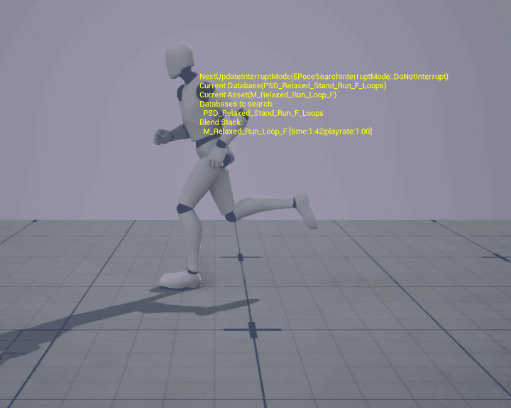

```text
3.85초  점프 입력
3.95초  공중   PSD_Relaxed_Stand_WalkAndRun_Jump   -> M_Relaxed_Jump_F_Start_Run_Rfoot
4.81초  착지   PSD_Relaxed_Stand_Run_Lands_Light   -> M_Relaxed_Jump_F_Land_Run_Light_Lfoot
```

후보 DB는 이번에도 Chooser가 정한다. 점프를 누르면 Mover가 공중 모드로 바뀌고, 맨 위 표의 InAir 행으로 내려간다. InAir 표는 수평 속도(`Speed2D`) 하나로 DB를 고른다.

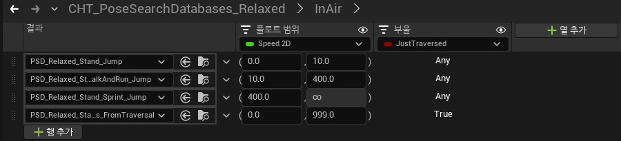

10cm/s 미만이면 제자리 점프(`Stand_Jump`), 400cm/s 미만이면 `WalkAndRun_Jump`, 그 이상이면 `Sprint_Jump` 다. 마지막 줄은 장애물을 넘은 직후(`JustTraversed`)용이다. 달리던 속도가 375cm/s라 `WalkAndRun_Jump` 가 골라졌다. 이 DB는 이어가기 보정(`ContinuingPoseCostBias`)이 -1.0으로, [4절](#database)의 반전 DB(-0.05)보다 훨씬 크다. 공중에서 한번 고른 동작을 쉽게 바꾸지 않게 해 둔 것 같다.

DB 안에서 무엇을 틀지는 궤적이 정한다. `WalkAndRun_Jump` 에는 점프 시작(`Jump_F_Start_Run/Walk`), 턱에서 걸어 내려가기(`Jump_F_Off_Run/Walk`), 낙하 루프(`Jump_Loop_Fall`)가 같이 들어 있다. 그리고 점프 DB의 Schema는 궤적을 높이까지 넣어 3D로 비교한다.

| Schema | 궤적 샘플 | 비교하는 것 |
| --- | --- | --- |
| `PSS_Relaxed_Loops` (달리기 루프) | -0.125, 0, 0.33, 0.8, 1.35초 | 위치, 속도 (수평 XY) |
| `PSS_Relaxed_Jump` (점프, 착지) | -0.2, 0, 0.25, 0.5, 1.0초 | 위치, 속도 방향 (높이 포함 3D) |

궤적은 AnimBP가 `MoverTrajectoryPredictor` 로 Mover에게 앞으로 1.5초(0.1초 x 15)를 예측시켜 만드는데, 공중에서는 중력까지 넣어 예측한다. 점프를 누른 순간은 위로 솟는 궤적이라 `Jump_F_Start_Run_Rfoot` 가 골라졌다. 파쿠르 코스에서 100cm 벽 위를 그냥 걸어 내려올 때는 바로 떨어지는 궤적이라, 같은 DB에서 `Jump_F_Off_Run_Lfoot` 가 골라졌다. 같은 공중 DB 안에서도 위로 가는지 아래로 가는지로 동작이 갈린다.

착지는 AnimBP의 `JustLanded_Light` / `JustLanded_Heavy` 로 갈린다. 지금은 지면이고 직전 프레임은 공중일 때 참이 되고, 직전 수직 속도가 -500cm/s보다 빠르게 떨어졌으면 Heavy, 아니면 Light다. Chooser의 달리기 표는 이 값이 참인 프레임에만 착지 DB(`Run_Lands_Light` / `Run_Lands_Heavy`)를 남기고, 달리기 루프 DB는 그 프레임에서 뺀다. 착지 DB도 `PSS_Relaxed_Jump` 를 쓴다.

GIF에서 착지 직후 검색 대상이 바로 `Run_F_Loops` 로 돌아가는데도 착지 애니메이션이 계속 나온다. [8절](#continuing)에서 본 이어가기 포즈다. 착지한 그 한 프레임에 착지 애니메이션을 고르고, 그다음부터는 착지 동작이 달리기로 이어지는 동안 그대로 간다.

---

<a id="density"></a>

## 10. 데이터를 줄이면

같은 입력을 `DDCvar.MMDatabaseLOD` 만 바꿔서 돌렸다. 반전 구간을 0.5배 속도로 나란히 놓았다.

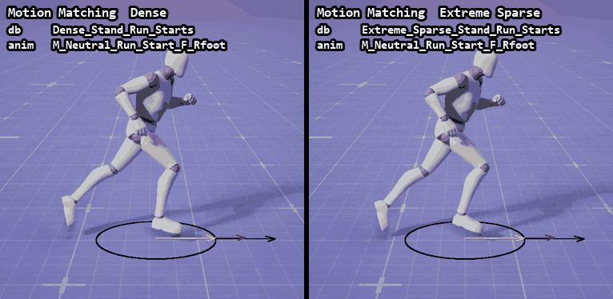

Dense는 발을 디디고 몸을 기울여서 돈다. Extreme Sparse는 반전 DB가 없으니 뒤로 달리기(`Run_Loop_B`), 뒤로 출발(`Run_Start_B`), 옆으로 달리기(`Run_Loop_RL`), 앞으로 달리기(`Run_Loop_F`)를 차례로 이어 붙여서 방향을 바꾼다. 데이터에 없는 동작은 만들어 내지 못하고, 그나마 비슷한 걸 계속 갈아 끼우는 것이다.

숫자로도 차이가 난다. 반전 구간(2.3~3.6초)에서 발이 바닥에 닿아 있는 동안 수평으로 미끄러진 속도를 쟀다. 각 조건을 세 번씩 돌린 평균이다.

| 데이터 | 반전 구간에 쓴 애니메이션 | 애니메이션 교체 횟수 | 발 미끄러짐 (왼발 / 오른발) |
| --- | --- | --- | --- |
| Dense | `Run_Turn_R_180_Lfoot` | 1 | 68 / 67 cm/s |
| Sparse | `Run_Turn_R_180_Rfoot` | 1 | 74 / 51 cm/s |
| Extreme Sparse | `Run_Loop_B` 외 3개 | 4 | **238 / 147 cm/s** |

```text
발 미끄러짐   ball_l / ball_r 본이 가장 낮은 높이에서 4cm 안에 있는 동안의 수평 속도 평균.
             반전 구간 2.3 ~ 3.6초. 세 번 측정의 편차는 1.3cm/s 이내.
```

Sparse는 반전 DB의 검색 프레임이 Dense의 1/6 정도인데도 이 경로에서는 차이가 거의 없었다. 반대로 Extreme Sparse는 반전 DB가 통째로 없어서 발 미끄러짐이 3배 가까이 됐다.

개인적으로 이 테스트에서 제일 와닿은 부분이다. Motion Matching의 품질은 알고리즘보다 데이터에 달려 있다. 필요한 동작이 데이터에 있으면 조금 줄여도 버티지만, 아예 없으면 아무리 잘 골라도 미끄러진다.

---

<a id="state-machine"></a>

## 11. 상태 머신 모드와 비교하면

GASP에는 같은 캐릭터를 상태 머신으로 움직이는 실험 모드도 있다. `DDCVar.LocomotionSetupCMC 1` 로 켠다.

같은 입력으로 돌려 보니 결과 애니메이션이 Dense Motion Matching과 똑같았다.

| 시간 | 상태 머신 상태 | 재생한 애니메이션 |
| --- | --- | --- |
| 0.00 ~ 0.55초 | `IDLE_LOOP` | `M_Neutral_Stand_Idle_Loop` |
| 0.55 ~ 2.35초 | `TRANSITION_TO_LOCOMOTION_LOOP` | `M_Neutral_Run_Start_F_Rfoot` |
| 2.35 ~ 3.63초 | `TRANSITION_TO_LOCOMOTION_LOOP` (재진입) | `M_Neutral_Run_Turn_R_180_Lfoot` |
| 3.63초 ~ | `TRANSITION_TO_IDLE_LOOP` | `M_Neutral_Run_Stop_F_Lfoot` |

반전 구간 발 미끄러짐도 63cm/s로 Dense와 비슷했다.

처음엔 의외였는데, 상태에 들어갈 때 부르는 `SetBlendStackAnimFromChooser` 를 열어 보니 이해가 됐다. 상태 머신도 상태마다 Chooser(`CHT_CMCCharacterAnimations`)로 후보를 고른 다음 `MotionMatch` 함수로 애니메이션과 시작 프레임을 찾는다. AnimGraph 주석에도 "상태 머신 + Chooser + Motion Matching + Blend Stack" 실험이라고 적혀 있다.

그래서 두 방식의 차이는 결과보다 "언제 검색하느냐"에 있다.

```text
Motion Matching 노드   매 업데이트마다 검색한다. 이어가기 포즈가 이기면 그대로 간다.
상태 머신 모드          상태에 들어갈 때만 검색한다. 상태 안에서는 고른 애니메이션을 재생한다.
```

이 정도로 단순한 경로에서는 둘이 같은 답을 냈다. 상태 머신 쪽은 상태와 전환 규칙을 직접 만들어야 하고, Motion Matching 쪽은 그 자리를 비용 계산이 대신한다.

---

<a id="stuck"></a>

## 12. 테스트하다 헤맨 부분

### 반전했는데 뒤로 달렸다

처음 돌렸을 때 반전 입력을 넣으면 반전 애니메이션이 0.2초만 나오고 뒤로 달리기(`Run_Loop_B`)로 바뀌었다. 캐릭터 방향(yaw)이 내내 0°였다.

GASP 캐릭터는 처음에 스트레이프 모드(`RotationMode = Strafe`)라서, 몸은 컨트롤러 방향을 보고 이동만 반대로 한다. 입력 상태의 `WantsToStrafe` 를 끄니 이동 방향을 바라보는 모드로 바뀌고 반전 애니메이션이 끝까지 이어졌다. 같은 입력이어도 회전 모드에 따라 궤적의 "몸 방향" 값이 달라져서 전혀 다른 애니메이션이 골라진다.

### 엔진 디버그 그리기가 안 나왔다

`a.AnimNode.MotionMatching.DebugDrawQuery`, `DebugDrawCurResult` 를 켜도 화면에 아무것도 나오지 않았다. 5.8 소스를 보면 CVar 정의만 남아 있고 노드 코드에서는 쓰이지 않는다. `DebugDrawInfo` 는 DB와 애니메이션 이름을 월드 텍스트로 띄우지만 화면 캡처에는 잡히지 않았다. 그래서 GASP의 `DDCvar.DrawCharacterDebugShapes` 로 화살표를 띄우고, DB와 애니메이션 이름은 AnimBP 변수에서 직접 읽었다. 나중에 알고 보니 이 글자는 디버그 캔버스에 그려져서 그냥 `Shot` 에는 안 찍히고, `Shot showui` 로 찍어야 나온다. [9절](#jump)의 점프 GIF는 그렇게 찍었다.

### 상태 머신 모드가 안 켜졌다

`DDCVar.ExperimentalStateMachine.Enable 1` 만으로는 켜지지 않았다. AnimBP의 `Update_CVarDrivenVariables` 를 보면 `UseExperimentalStateMachine` 을 두 번 설정하는데, 마지막에 `DDCVar.LocomotionSetupCMC` 값으로 다시 덮어쓴다. 이 CVar를 1로 줘야 켜진다.

---

<a id="pitfalls"></a>

## 13. 막히기 쉬운 곳

### 원하는 애니메이션이 안 골라질 때

후보 DB에 그 애니메이션이 들어 있는지부터 본다. GASP처럼 Chooser로 DB를 거르면, 조건(`IsPivoting` 등)이 맞지 않는 순간에는 아예 검색 대상이 아니다.

데이터에 그 동작이 있는지도 본다. Extreme Sparse처럼 반전 DB가 없으면 다른 동작을 이어 붙인다.

### 바뀌어야 할 때 안 바뀔 때

이어가기 포즈가 이기고 있는 것이다. 이어가기 보정(`ContinuingPoseCostBias`)이 너무 크지 않은지, 상태가 바뀌는 순간 Interrupt Mode로 끊어 주고 있는지 본다.

### 너무 자주 바뀌고 덜컥거릴 때

반대로 이어가기 보정을 조금 키우거나, 블렌드 시간(`BlendTime`)을 본다. GASP는 `Get_MMBlendTime` 에서 이동 모드에 따라 0.15~0.5초를 고른다. 같은 포즈를 짧은 시간 안에 다시 고르지 않게 하는 `PoseReselectHistory`(엔진 기본값 0.3초)도 있다.

### 결과가 회전 모드에 따라 다를 때

궤적에는 몸 방향이 들어간다. 스트레이프와 이동 방향 바라보기는 같은 입력이어도 쿼리가 달라서 전혀 다른 애니메이션이 골라질 수 있다.

---

<a id="summary"></a>

## 14. 정리 - 내가 이해한 Motion Matching

```text
Schema        무엇을 비교할지. GASP는 궤적 5지점 + 발·골반 몇 개.
Database      어디서 찾을지. 동작별로 나눈 애니메이션 묶음.
Chooser       어떤 묶음을 뒤질지. 상태 조건으로 후보 DB를 거른다.
비용          특징 벡터 차이의 제곱합 + 보정값. 가장 싼 프레임을 고른다.
이어가기       지금 애니메이션의 다음 프레임은 항상 후보다. 보정까지 붙어서 쉽게 안 바뀐다.
```

Motion Matching은

> 지금 포즈와 앞으로 갈 경로를 데이터와 비교해서, 가장 비슷한 프레임부터 이어 재생하는 방식

정도로 이해하고 있다.

이번 테스트에서 5초 동안 애니메이션이 바뀐 건 세 번뿐이었다. 매 프레임 검색하지만, 대부분은 "지금 것을 계속 재생하는 게 제일 싸다"는 결론이 나온다. 바뀌는 순간은 출발, 반전, 정지처럼 지금 포즈와 앞으로 갈 궤적이 크게 어긋날 때였다.

그리고 결과를 좌우하는 건 결국 데이터였다. Dense를 Sparse로 줄여도 버텼지만, 반전 데이터를 빼자 발 미끄러짐이 3배 가까이 늘었다. 상태 머신을 줄이는 대신 데이터를 잘 나누고 채우는 일이 Motion Matching의 핵심 작업이라고 생각한다.

---

<a id="reproduce"></a>

## 15. 부록 - 다시 테스트하기

테스트에 쓴 스크립트는 [Scripts/MotionMatching](../../Scripts/MotionMatching/README.md)에 있다. PIE에서 캐릭터를 세우고, 매 틱 정해진 입력을 넣으면서 AnimBP 변수와 발 위치를 기록하고, 찍은 프레임으로 GIF를 만드는 것까지 들어 있다. 에디터 조작은 Unreal MCP로 자동화했다.

측정 요약은 [summary.json](Evidence/MotionMatching/summary.json), Schema 값은 [schema.json](Evidence/MotionMatching/schema.json), DB 통계는 [database_stats.json](Evidence/MotionMatching/database_stats.json)에 남겨 두었다. GASP의 원본 맵, 블루프린트, 애니메이션은 수정하거나 저장하지 않았다.

점프 장면([9절](#jump))은 이 저장소 프로젝트에서 찍었다. 녹화와 GIF 만들기는 [Scripts/ParkourCourse](../../Scripts/ParkourCourse/README.md)의 `run_tests.py`(`debug_mm_jump`), `export_captures.py` 에 있다.

### 참고

- [Motion Matching in Unreal Engine](https://dev.epicgames.com/documentation/en-us/unreal-engine/motion-matching-in-unreal-engine) - 공식 문서
- [Game Animation Sample Project](https://dev.epicgames.com/documentation/en-us/unreal-engine/game-animation-sample-project-in-unreal-engine) - 공식 문서
- 엔진 소스 `Engine/Plugins/Animation/PoseSearch/Source/Runtime/`
  - `Private/PoseSearchLibrary.cpp` - `UpdateMotionMatchingState`, 이어가기 포즈와 Interrupt Mode
  - `Private/PoseSearchIndex.inl` - 가중치를 곱한 `CompareFeatureVectors`
  - `Public/PoseSearch/PoseSearchCost.h` - 비용과 보정값 합산
  - `Public/PoseSearch/PoseSearchDatabase.h` - 비용 보정값, 검색 모드
  - `Public/PoseSearch/PoseSearchFeatureChannel_Trajectory.h` - 궤적 샘플 플래그
  - `Private/AnimNode_MotionMatching.cpp` - 디버그 CVar
- 엔진 소스 `Engine/Plugins/Experimental/Mover/Source/Mover/Public/MoverPoseSearchTrajectoryPredictor.h` - Mover 궤적 예측, 공중에서 중력 반영

---

[목차로 돌아가기](#contents) · [메인 README의 Unreal Engine 목차로 돌아가기](../../README.md#unreal-engine)
