# Motion Warping으로 루트 모션을 장애물에 맞추기

<a id="contents"></a>

## 목차

1. [왜 필요한가](#what)
2. [준비 - 플러그인과 컴포넌트](#setup)
3. [설정은 세 가지만 보면 된다](#terms)
4. [GASP의 Mantle 몽타주](#montage)
5. [목표는 어디서 넣는가](#targets)
6. [직접 껐다 켜 보기](#experiment)
7. [결과 - 끄면 애니메이션 높이에서 멈춘다](#result)
8. [엔진 디버그로 다시 보기](#engine-debug)
9. [전투에서 써 보기 - 적에게 붙어서 때리기](#combat)
10. [Skew Warp는 어떻게 맞추는가](#skew)
11. [테스트하다 헤맨 부분](#wrong-target)
12. [막히기 쉬운 곳](#pitfalls)
13. [정리 - 내가 이해한 Motion Warping](#summary)
14. [부록 - 다시 테스트하기](#reproduce)

---

이 문서는 Unreal Engine 5.8.3 기준이다. 파쿠르 테스트는 Epic의 Game Animation Sample(이하 GASP) 프로젝트에서, 전투 테스트는 이 저장소 프로젝트에서 했다. 테스트에 쓴 스크립트는 `Scripts/MotionWarping/` 에 있다.

---

<a id="what"></a>

## 1. 왜 필요한가

GASP에서 캐릭터로 이것저것 넘어 다녀 보면 블록 높이가 제각각인데도 손이 모서리에 딱 붙고, 발도 윗면에 자연스럽게 올라간다. 처음에는 높이마다 애니메이션이 따로 있을 거라고 생각했다.

그런데 Traversal 폴더를 열어 보니 올라서기(Mantle) 애니메이션은 `Mantle_1_0` 하나뿐이었다. 이름 그대로 1m 높이를 기준으로 만든 애니메이션이고, 이걸 60cm 블록에도 150cm 블록에도 그대로 쓰고 있었다. 이 차이를 메워 주는 게 Motion Warping이다.

장애물에 올라서는 애니메이션은 루트 본에 이동이 들어 있고, 이 이동을 그대로 캐릭터 이동에 쓰는 게 Root Motion이다. 문제는 애니메이션을 만들 때 정한 높이나 거리가 실제 게임 속 장애물과 같을 수가 없다는 점이다.

Motion Warping은 몽타주의 특정 구간에서 이 Root Motion을 늘이거나 기울여서, 구간이 끝날 때 원하는 위치에 도착하도록 바꿔 준다. 동작은 그대로 두고 이동 경로만 고친다고 이해하면 된다.

직접 껐다 켜 보면 차이가 바로 보인다. 아래는 같은 1m 애니메이션을 같은 순간에 멈춘 장면이다. 위가 끈 상태, 아래가 켠 상태다.

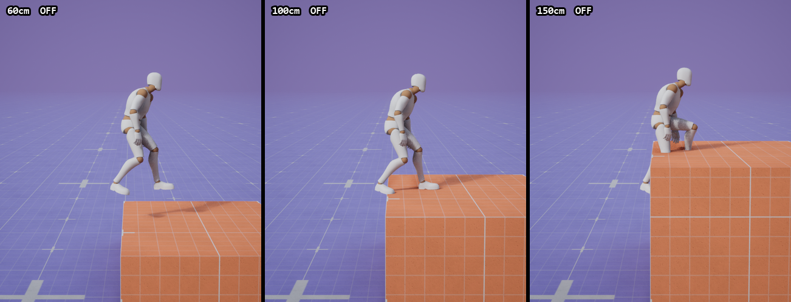

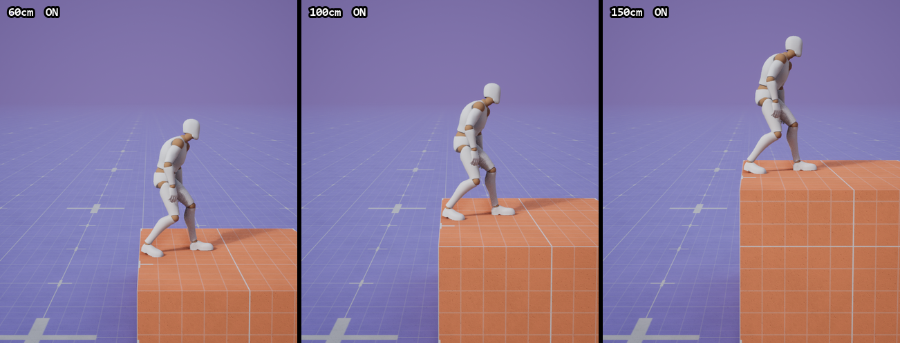

끈 쪽은 블록 높이와 상관없이 캐릭터가 화면에서 늘 같은 높이에 있다. 60cm 블록에서는 떠 있고, 150cm 블록에서는 다리가 블록 안에 묻혀 있다. 켜면 세 블록 모두 윗면에 발이 닿는다.

파쿠르만 그런 게 아니다. 전투에서 공격 버튼을 누르면 적 쪽으로 몸을 틀면서 딱 맞는 거리까지 들어가 때리는 것도 같은 원리다. 이건 [9절](#combat)에서 따로 테스트했다.

---

<a id="setup"></a>

## 2. 준비 - 플러그인과 컴포넌트

`MotionWarping` 플러그인을 켜고 캐릭터에 `MotionWarping` 컴포넌트를 붙이면 된다. GASP에는 이미 둘 다 되어 있다.

```json
{
    "Name": "MotionWarping",
    "Enabled": true
}
```

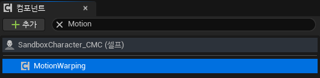

`ACharacter` 기반이면 이 컴포넌트가 `CharacterMovementComponent` 의 `ProcessRootMotionPreConvertToWorld` 에 연결된다. Root Motion이 월드 이동으로 바뀌기 직전에 끼어들어서 값을 고치는 방식이다.

```text
몽타주 재생 -> Root Motion 추출 -> [MotionWarping이 수정] -> CharacterMovement가 이동
```

그래서 Root Motion으로 움직이지 않는 캐릭터라면 컴포넌트를 붙여도 아무 일도 일어나지 않는다. 처음 붙여 볼 때는 몽타주의 Root Motion이 실제 이동에 쓰이고 있는지부터 확인하는 게 좋다.

---

<a id="terms"></a>

## 3. 설정은 세 가지만 보면 된다

처음 설정 화면을 봤을 때는 항목이 많아서 막막했는데, 정리해 보니 결국 세 가지를 맞추는 일이었다.

> 어디에 맞출지, 언제 맞출지, 애니메이션의 어느 점을 맞출지

| 무엇을 | 어디에 적는가 | GASP Mantle |
| --- | --- | --- |
| 어디에 맞출지 | Warp Target. 게임 코드에서 이름과 Transform을 등록한다 | `FrontLedge` = 블록 앞 모서리 |
| 언제 맞출지 | 몽타주의 `MotionWarping` Notify State 구간(Window) | 0.141 ~ 0.699초 |
| 어느 점을 맞출지 | Notify 안의 Root Motion Modifier 설정 | `attach` 본 |

이 셋을 이어 주는 건 이름이다. 블루프린트에서 `FrontLedge` 라는 이름으로 목표를 등록하고, 몽타주 Notify에도 같은 이름을 적어야 연결된다. 이름이 다르면 에러도 없이 그냥 보정이 안 된다.

시간도 같이 봐야 한다. 보정은 Window 안에서만 일어나고, Window가 끝나는 순간에 기준점이 목표에 오도록 계산된다. Window가 끝난 뒤의 Root Motion은 원래 애니메이션대로 흘러간다.

---

<a id="montage"></a>

## 4. GASP의 Mantle 몽타주

60·100·150cm 블록 모두 같은 몽타주가 선택됐다.

```text
/Game/Characters/UEFN_Mannequin/Animations/Traversal/Mantle/
    AM_M_Neutral_Traversal_Mantle_1_0_stand_F_Lfoot   (길이 2.0초)
```

노티파이 트랙을 보면 `MotionWarping` 이 두 개 붙어 있다.

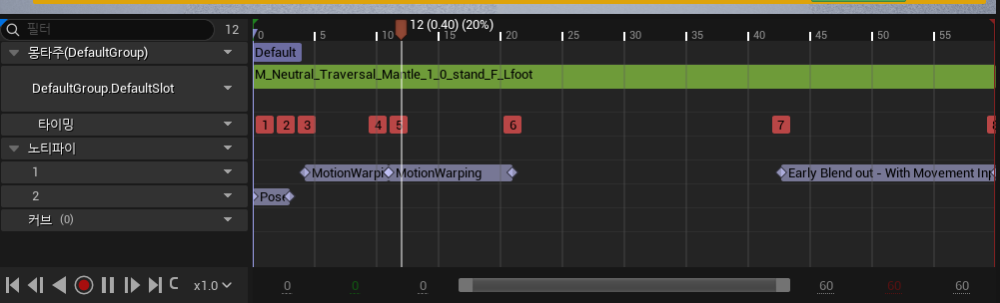

| Window | Warp Target | 기준점 | 위치 / 회전 |
| --- | --- | --- | --- |
| 0.141 ~ 0.365초 | `FrontLedge` | Bone `attach` | 둘 다 |
| 0.365 ~ 0.699초 | `FrontLedge` | Bone `attach` | 둘 다 |

손을 모서리에 얹는 구간과 몸을 끌어올리는 구간을 나눠서, 같은 `FrontLedge` 에 두 번 맞추는 구조다. 0.699초 이후에는 Window가 없어서 블록 위에서 일어서는 동작은 보정 없이 애니메이션 그대로 재생된다.

Notify를 열어 보면 안에 Modifier가 들어 있다. 한국어 에디터에서는 Skew Warp가 "왜곡 워프"로 나와서 처음에 조금 헷갈렸다.

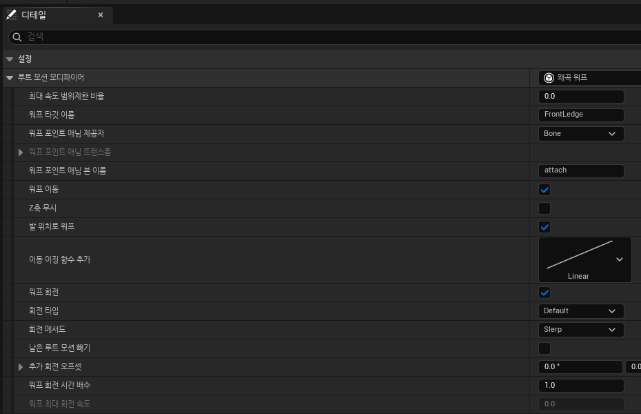

자주 보게 될 값만 정리하면 이렇다.

| 설정 | 값 | 의미 |
| --- | --- | --- |
| 워프 타깃 이름 | `FrontLedge` | 이 이름으로 등록된 목표를 찾는다 |
| 워프 포인트 애님 제공자 | `Bone` | 루트 대신 지정한 본을 목표에 맞춘다 |
| 워프 포인트 애님 본 이름 | `attach` | 맞출 본 |
| 워프 이동 | 켬 | 위치를 보정한다 |
| Z축 무시 | 끔 | 높이도 보정한다. 엔진 기본값은 켬 |
| 발 위치로 워프 | 켬 | 캡슐 중심 대신 발 위치를 기준으로 계산한다 |
| 워프 회전 | 켬 | 목표 방향으로 몸을 돌린다 |

개인적으로 여기서 제일 중요하다고 느낀 건 `Z축 무시` 다. 엔진 기본값은 켜져 있어서(`bIgnoreZAxis = true`) 그대로 두면 수평 위치만 맞추고 높이는 애니메이션 값을 쓴다. GASP의 Mantle은 이걸 꺼 두었기 때문에 높이가 다른 블록에도 올라설 수 있다.

`Bone` 제공자도 처음엔 잘 이해가 안 됐다. 소스를 보니 Window가 끝나는 시점의 애니메이션에서 `attach` 본과 루트 사이의 오프셋을 미리 구해 두고, 그 시점에 본이 목표에 오도록 루트가 가야 할 위치를 거꾸로 계산하고 있었다. 몽타주 에디터 미리보기에서도 이 위치가 `FrontLedge` 라벨로 표시된다.

---

<a id="targets"></a>

## 5. 목표는 어디서 넣는가

목표 등록은 `AC_TraversalLogic` 의 `SetWarpTargets` 함수에서 한다. 장애물 검사 결과에서 앞 모서리 정보를 꺼내 `FrontLedge` 로 넣는 부분이다.

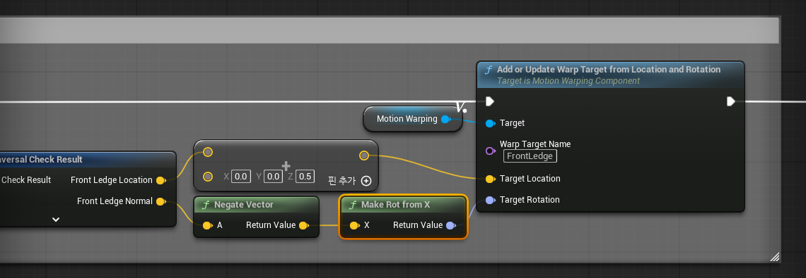

```text
위치 = Front Ledge Location + (0, 0, 0.5)
회전 = Make Rot from X( -Front Ledge Normal )
AddOrUpdateWarpTargetFromLocationAndRotation("FrontLedge", 위치, 회전)
```

위치는 모서리에서 0.5cm 위, 회전은 모서리 법선의 반대 방향이다. 캐릭터가 블록을 정면으로 바라보는 방향으로 목표를 잡는 셈이다.

같은 함수 뒤쪽에서는 `BackLedge`, `BackFloor` 도 처리한다. Hurdle이나 Vault처럼 장애물을 넘어가는 동작이고 선택된 애니메이션에 해당 Window가 있을 때만 등록하고, 아니면 `RemoveWarpTarget` 으로 지운다. Mantle은 위로 올라서는 동작이라 테스트 중에 등록된 목표는 `FrontLedge` 하나뿐이었다.

CMC 캐릭터 기준으로 흐름을 따라가 보면 이렇다.

```text
GetTraversalCheckInputs              캐릭터 앞쪽으로 검사할 거리와 방향
  -> TryTraversalAction              장애물 Trace, Ledge 찾기, 높이·깊이 계산
  -> Chooser                         동작 타입과 몽타주 선택 (여기서는 Mantle_1_0)
  -> PerformTraversalAction_CMC
       몽타주 재생
       -> SetWarpTargets             FrontLedge 등록
       -> IgnoreComponentWhenMoving  장애물과의 충돌 무시
       -> SetMovementMode_CMC        Flying으로 전환
     몽타주 Blend Out
       -> 충돌 복구, 이동 모드 복구
```

처음에는 목표를 몽타주 재생 전에 넣을 거라고 생각했는데, 실제로는 몽타주를 건 바로 다음에 넣는다. 첫 Window가 0.141초에 시작하니까 그보다 훨씬 먼저이고, Window가 시작되는 순간에 목표가 있기만 하면 문제없다.

이 흐름을 보면서 동작 선택과 보정이 역할을 나눠 갖고 있다는 게 눈에 들어왔다. Chooser가 어떤 애니메이션을 쓸지 고르고, Motion Warping은 고른 애니메이션을 지금 장애물에 맞게 고친다. 실제로 200cm 블록으로 해 보면 Chooser가 Mantle 대신 2.5m짜리 Climb 시작 몽타주를 고른다. 높이 차이를 전부 Warping으로 메우는 게 아니라, 비슷한 애니메이션을 먼저 고르고 남은 차이만 메우는 구조라고 이해했다.

---

<a id="experiment"></a>

## 6. 직접 껐다 켜 보기

설정만 봐서는 실제로 얼마나 차이가 나는지 감이 오지 않았다. 그래서 PIE에서 높이만 다른 `LevelBlock_Traversable` 블록을 만들고, 같은 자리에 `SandboxCharacter_CMC` 를 세워서 Mantle을 시켜 봤다. 레벨은 저장하지 않았다.

| 항목 | 값 |
| --- | --- |
| 블록 | 높이 60 / 100 / 150cm, 깊이 200cm, 폭 300cm |
| 시작 위치 | 블록 앞면에서 캡슐 중심까지 85cm, 정면을 봄 |
| 실행 | 샘플의 `GetTraversalCheckInputs` -> `TryTraversalAction` 을 그대로 호출 |
| 끄고 켜기 | `a.MotionWarping.Disable 1` / `0` |
| 카메라 | 여섯 번 모두 같은 위치 |
| 기록 | 매 틱 캡슐·`attach` 본·Warp Target 위치, 약 0.05초마다 화면 캡처 |

Motion Warping은 `a.MotionWarping.Disable` 로 껐다 켰다. 처음에는 이걸 켜면 Root Motion 자체가 꺼지는 줄 알았는데, 소스를 보면 컴포넌트가 받은 Root Motion을 손대지 않고 그대로 돌려줄 뿐이다. 그래서 꺼도 캐릭터는 애니메이션대로 올라가고 보정만 빠진다.

```cpp
FTransform UMotionWarpingComponent::ProcessRootMotionPreConvertToWorld(const FTransform& InRootMotion, ...)
{
#if !(UE_BUILD_SHIPPING || UE_BUILD_TEST)
    if (FMotionWarpingCVars::CVarMotionWarpingDisable.GetValueOnAnyThread() > 0)
    {
        return InRootMotion;
    }
#endif
    ...
}
```

여섯 번 모두 `TryTraversalAction` 이 성공했고 같은 몽타주가 선택됐다. 조건 중에 달라진 건 Motion Warping 하나뿐이다.

---

<a id="result"></a>

## 7. 결과 - 끄면 애니메이션 높이에서 멈춘다

GIF는 0.5배 속도이고, Traversal을 시작한 시점을 맞춰서 OFF와 ON을 나란히 붙였다.

### 150cm - 애니메이션보다 높은 블록

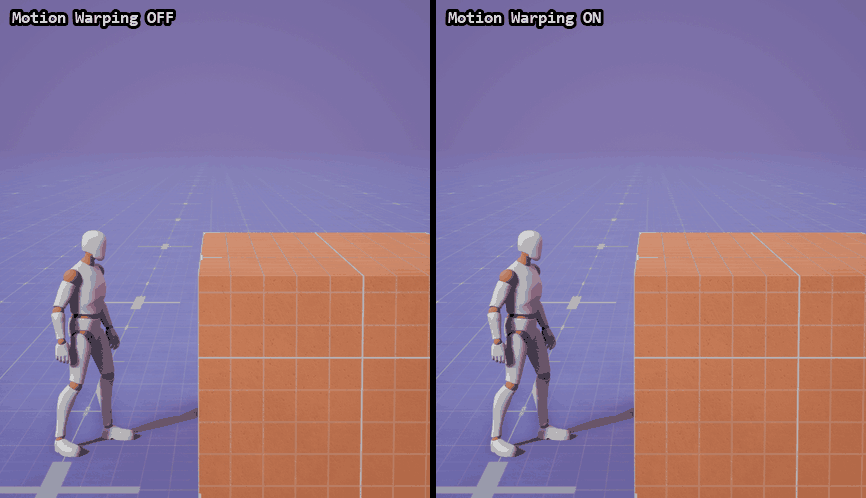

OFF는 손을 블록 앞면 중간쯤에 짚는다. 몸을 끌어올려도 애니메이션이 알고 있는 높이는 1m라서, 정강이가 블록 윗면 아래에 묻힌 채로 일어선다. 그러다 몽타주가 끝나는 프레임에 캡슐이 50cm 위로 한 번에 튀어 오른다.

ON은 첫 Window 동안 손이 모서리까지 올라가고, 두 번째 Window에서 발이 윗면에 정확히 올라선다.

### 60cm - 애니메이션보다 낮은 블록

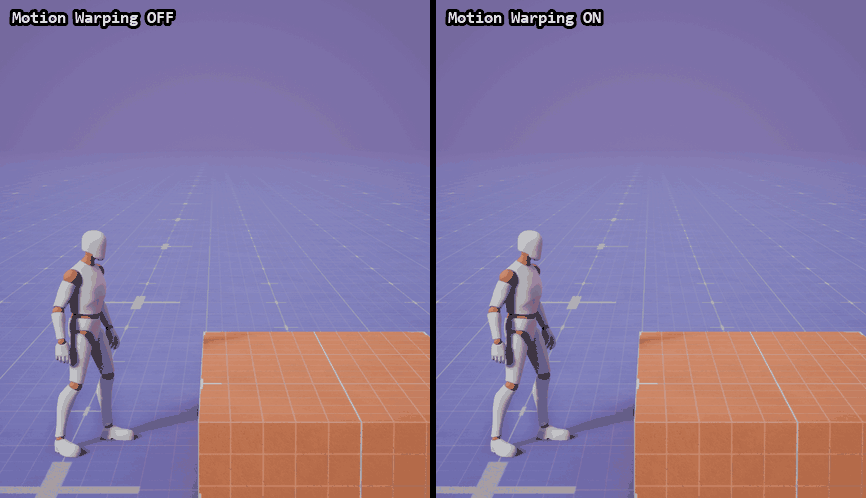

이번에는 반대로 OFF가 블록 위 40cm 허공을 짚고 올라가서 그대로 떠 있다. 그러다 몽타주가 끝나는 프레임에 40cm 아래로 툭 내려앉는다. ON은 처음부터 낮게 올라가서 윗면에 선다.

### 100cm - 애니메이션과 같은 높이

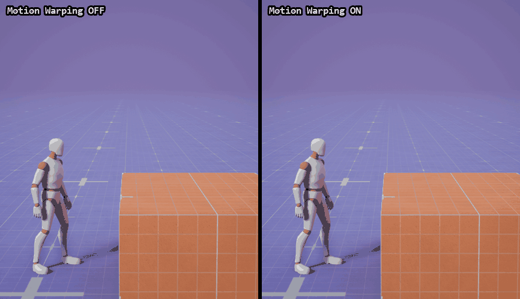

애니메이션과 높이가 같아서 OFF도 꽤 자연스럽다. 눈으로는 차이를 거의 못 느꼈는데, 기록을 보니 손 위치(`attach` 본)가 수평으로 17cm 어긋나 있었다. 애니메이션은 모서리가 실제보다 17cm 가까이 있다고 보고 만들어졌고, ON은 그만큼 캐릭터를 앞으로 더 보냈다. 높이가 맞아도 시작 거리가 다르면 손 위치는 결국 어긋난다.

### 숫자로 보면

| 블록 | 보정 | 올라선 뒤 캡슐 높이 (윗면 기준) | Window 끝 `attach` 오차 | 몽타주가 끝날 때 |
| --- | --- | --- | --- | --- |
| 60cm | OFF | +40.0cm | 43.3cm | 한 프레임에 40cm 내려앉음 |
| 60cm | ON | +0.2cm | 0.0cm | - |
| 100cm | OFF | 0.0cm | 17.0cm | - |
| 100cm | ON | +0.2cm | 0.0cm | - |
| 150cm | OFF | -50.0cm | 53.0cm | 한 프레임에 50cm 튀어 오름 |
| 150cm | ON | +0.2cm | 0.0cm | - |

```text
올라선 뒤 캡슐 높이   마지막 Window(0.699초)가 끝난 뒤부터 몽타주가 끝날 때까지의 평균.
                    평지에 서 있을 때의 캡슐 바닥 높이(2.3cm)를 뺐다.
attach 오차          0.699초에 가장 가까운 틱에서 attach 본과 FrontLedge 목표 사이 거리.
```

OFF는 블록 높이와 상관없이 세 번 모두 캡슐 바닥이 102.3cm에서 멈췄다. 블록이 아니라 애니메이션이 높이를 정하고 있었던 셈이다. ON은 세 블록 모두 윗면에서 0.2cm 안쪽이었고, `attach` 본은 Window 끝에서 목표와 0.001cm 이내로 겹쳤다.

150cm에서 캡슐이 블록 안으로 들어갈 수 있었던 것도 처음엔 이상했다. 찾아보니 [5절](#targets)의 흐름대로 Traversal 중에는 장애물과의 충돌을 무시하고 Flying으로 움직이고 있었다. 몽타주가 블렌드 아웃되면서 충돌과 Walking이 돌아오는 순간, 블록 안에 있던 캡슐이 밀려 올라간 게 마지막의 튀어 오름이다. 60cm에서 툭 내려앉는 것도 같은 순간에 Walking이 바닥을 다시 찾으면서 생긴다.

---

<a id="engine-debug"></a>

## 8. 엔진 디버그로 다시 보기

`a.MotionWarping.Debug 2` 를 켜면 엔진이 직접 점을 찍어 준다. 빨간 점은 원래 애니메이션의 Root Motion을 누적한 경로, 파란 점은 캐릭터의 실제 발 위치다. 보정된 경로를 뜻하는 초록 점도 찍히는데, 실제 발 위치와 거의 같은 자리라 나중에 그려지는 파란 점에 가려서 잘 안 보인다.

```text
a.MotionWarping.Debug 2
a.MotionWarping.DrawDebugLifeTime 10
```

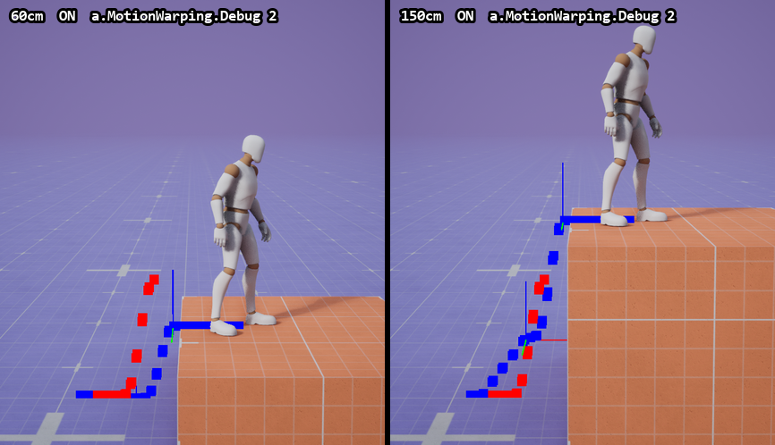

두 장 모두 켠 상태다. 빨간 점은 60cm, 150cm 블록 모두 똑같이 1m 근처에서 꺾이는데, 파란 점은 블록 윗면까지 간다. 빨간 점이 파란 점보다 살짝 왼쪽에 있는 건 앞에서 본 수평 17cm 차이다.

애니메이션이 원래 가려던 길과 실제로 간 길을 한 화면에서 비교할 수 있어서, 개인적으로는 GIF보다 이쪽이 더 이해가 잘 됐다.

참고로 `Disable 1` 일 때는 이 점들이 그려지지 않는다. 같은 함수 안에서 Disable 검사가 먼저 return 하기 때문이다.

---

<a id="combat"></a>

## 9. 전투에서 써 보기 - 적에게 붙어서 때리기

파쿠르를 보고 나니 전투에서는 어떻게 쓰는지 궁금해졌다. 근접 공격 애니메이션은 정해진 만큼만 앞으로 나가는데, 적은 매번 다른 거리와 방향에 서 있다. 공격할 때 적 쪽으로 몸을 돌리고 거리를 맞춰 주는 게 Motion Warping이 전투에서 많이 쓰이는 자리다.

GASP에는 공격 애니메이션이 없어서 이 부분은 저장소 프로젝트에서 따로 테스트했다. 엔진 Third Person 템플릿의 마네킹에 들어 있는 공격 애니메이션을 썼고, [Animation Budget 문서](AnimationBudget.md)에서처럼 템플릿 마네킹을 `Content/Characters/Mannequins` 로 복사해서 쓴다.

### 공격 애니메이션 살펴보기

고른 건 `MM_Attack_02` 다. 1초짜리 원투 콤보로, 0.40초에 오른손 잽, 0.467초에 왼손 훅이 들어간다. 루트 모션이 켜져 있고 0.25초부터 0.5초 사이에 앞으로 90cm 내딛는다.

이걸로 몽타주 `AM_Attack_MotionWarping` 을 만들고, 시작 직후부터 왼손 훅이 들어가는 0.467초까지 `MotionWarping` 구간을 하나 넣었다.

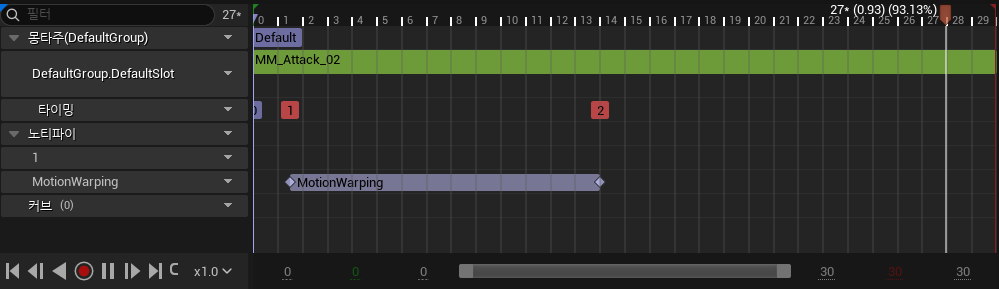

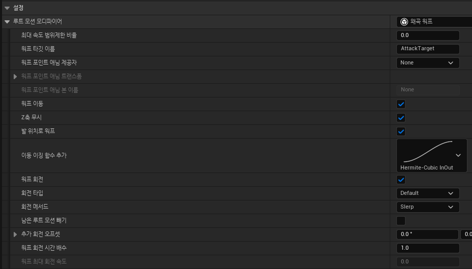

| 설정 | 값 | 이유 |
| --- | --- | --- |
| 워프 타깃 이름 | `AttackTarget` | 공격할 때 코드에서 같은 이름으로 목표를 넣는다 |
| 워프 포인트 애님 제공자 | None | 루트를 맞춘다. 손 본으로 해 봤다가 바꿨다([11절](#wrong-target)) |
| Z축 무시 | 켬 | 평지에서 때리는 거라 높이는 애니메이션 그대로 둔다 |
| 워프 회전 | 켬 | 적 쪽으로 몸을 돌린다 |

파쿠르와 비교하면 같은 Skew Warp인데 `Z축 무시` 만 반대로 켰다. 파쿠르는 높이를 맞추는 게 목적이었고, 전투는 바닥 위에서의 거리와 방향만 맞추면 된다.

### 목표는 적 앞에 둔다

왼손 훅이 들어가는 순간 주먹은 루트보다 99cm 앞에 있다. 적 몸 앞면이 중심에서 대략 25cm라서, 루트가 적 중심에서 124cm 떨어진 곳에 서면 주먹이 몸 앞에 닿는다.

그래서 공격할 때 적과 나를 잇는 선 위, 적에게서 124cm 떨어진 곳에 적을 바라보는 방향으로 목표를 넣고 몽타주를 재생했다. C++로 옮기면 이 정도다.

```cpp
const FVector ToMe = (GetActorLocation() - Enemy->GetActorLocation()).GetSafeNormal2D();
const FVector TargetLocation = Enemy->GetActorLocation() + ToMe * 124.f;

MotionWarping->AddOrUpdateWarpTargetFromLocationAndRotation(TEXT("AttackTarget"), TargetLocation, (-ToMe).Rotation());
PlayAnimMontage(AttackMontage);
```

적이 움직이는 경우를 위해 `AddOrUpdateWarpTargetFromComponent` 도 있다. `bFollowComponent` 를 켜면 Window 동안 목표가 적 컴포넌트를 따라가고, `VectorFromTargetToOwner` 방향으로 오프셋을 주면 위 코드처럼 적 앞에 목표를 둘 수 있다. 이번에는 서 있는 적으로만 테스트했다.

### 몸을 돌리고 거리까지 맞춘다

적을 두 군데에 세워 봤다. 공격하는 쪽은 처음에 늘 같은 방향을 보고 있고, 적은 그 방향에서 왼쪽으로 35°, 60° 떨어진 곳에 있다. GIF는 0.5배 속도다.

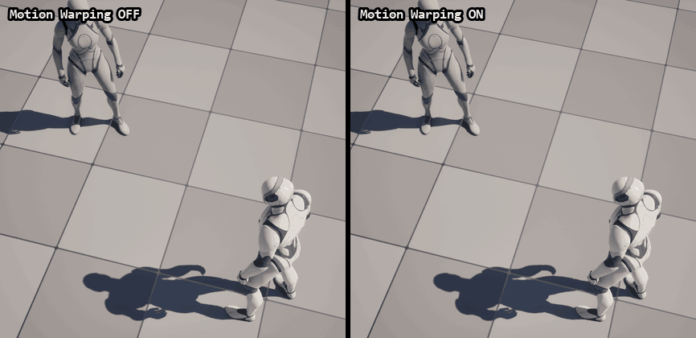

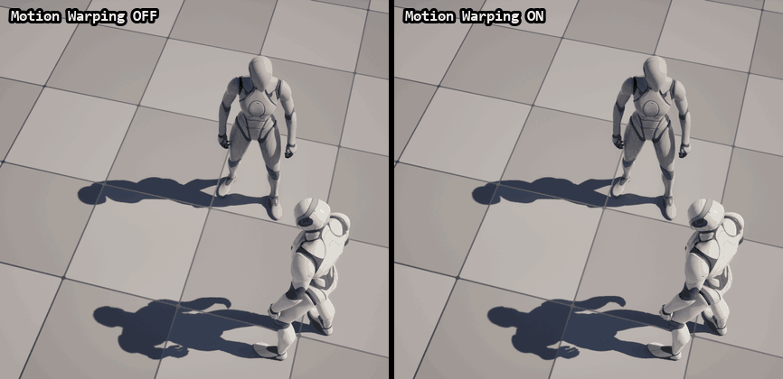

OFF는 두 경우 모두 애니메이션대로 정면으로 90cm 내딛고 허공에 훅을 날린다. ON은 260cm 떨어진 적에게는 35° 돌면서 애니메이션보다 더 멀리 들어가고, 140cm·60°에 있는 적에게는 60° 돌면서 오히려 거의 제자리에서 친다.

타격 순간(0.467초)만 모아 보면 차이가 더 잘 보인다.

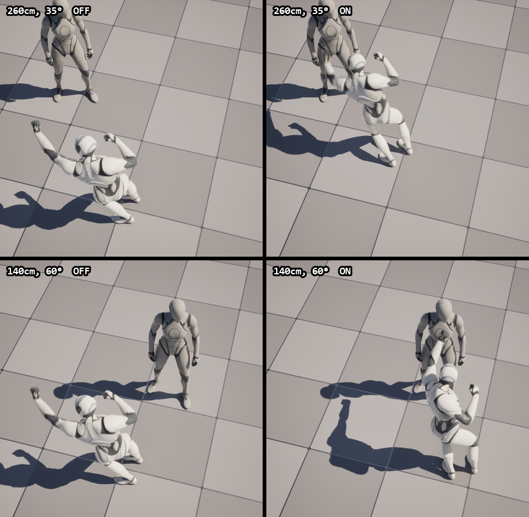

| 적 위치 | 보정 | 타격 순간 몸 방향 | 그때 적이 있는 방향 | 루트가 이동한 거리 | 주먹과 적 중심 거리 |
| --- | --- | --- | --- | --- | --- |
| 260cm, 35° | OFF | 0° | 48° | 80cm | 168cm |
| 260cm, 35° | ON | 34° | 35° | 132cm | 38cm |
| 140cm, 60° | OFF | 0° | 95° | 80cm | 172cm |
| 140cm, 60° | ON | 59° | 60° | 17cm | 33cm |

같은 애니메이션인데 ON에서는 내딛는 거리가 132cm로 늘어나기도 하고 17cm로 줄어들기도 했다. 파쿠르에서 높이를 맞췄던 것처럼, 여기서는 거리와 방향을 맞춘 셈이다.

---

<a id="skew"></a>

## 10. Skew Warp는 어떻게 맞추는가

GASP가 쓰는 `RootMotionModifier_SkewWarp` 소스를 보면 매 프레임 두 벡터를 비교한다.

```text
A = 지금부터 Window 끝까지 애니메이션이 움직일 남은 Root Motion
B = 지금 위치에서 목표까지 실제로 남은 거리

A를 B로 보내는 스케일 + 기울이기(shear) 행렬을 만들고,
이번 프레임의 Root Motion 조각에 그 행렬을 곱한다.
```

남은 경로 전체에 같은 행렬을 곱하니까 경로의 모양은 유지된다. 손을 뻗는 타이밍이나 몸이 올라가는 리듬은 애니메이션 그대로이고, 크기와 방향만 바뀐다. 1m 동작을 150cm 블록에 써도 어색하지 않았던 이유가 여기 있다고 생각한다.

그리고 보정이 한 번에 들어가는 게 아니라 Window 안의 프레임들에 나눠서 들어간다. 매 프레임 남은 것끼리 비교하니까 오차가 Window 끝으로 갈수록 줄어들고, 끝 프레임에서 0이 된다. GIF에서 OFF와 ON의 손 높이가 첫 Window 동안 조금씩 벌어지는 게 이 과정이다.

5.8 기준으로 Notify에서 고를 수 있는 Modifier는 아래와 같다. GASP의 Traversal은 Skew Warp만 쓰고 있었다.

| Modifier | 방식 |
| --- | --- |
| Skew Warp | 남은 Root Motion을 스케일·기울여서 목표로 보낸다 |
| Scale | Root Motion의 이동을 축별 고정 배율로 곱한다. 목표가 없다 |
| Precomputed Warp | 실험 기능. 첫 프레임에 목표까지의 경로를 한 번 계산해 두고 따라간다. 움직이지 않는 목표용 |

엔진 소스에는 Adjustment Blend Warp도 있는데, 아직 실험 기능이라 Notify 드롭다운에서는 숨겨져 있다.

---

<a id="wrong-target"></a>

## 11. 테스트하다 헤맨 부분

### 목표가 블록 옆으로 밀렸다

처음 찍었을 때 켠 쪽 캐릭터가 Mantle을 하면서 옆으로 60cm 정도 미끄러졌다. Warping 설정 문제인 줄 알고 Notify부터 다시 봤는데, 기록을 보니 `FrontLedge` 목표 자체가 캐릭터 정면이 아니라 블록 폭의 딱 20% 옆에 잡혀 있었다.

원인은 블록이었다. PIE에서 `LevelBlock_Traversable` 을 스폰하면 Construction Script가 Ledge 스플라인의 점은 제대로 찍는데, 스플라인 길이 정보는 템플릿 값(100cm)에 그대로 머물러 있었다.

| 블록 | 앞쪽 Ledge 실제 폭 | 스플라인이 알려 준 길이 |
| --- | --- | --- |
| 레벨에 배치된 블록 | 200cm | 200cm |
| PIE에서 스폰한 블록 | 300cm | 100cm |

블록의 `GetLedgeTransforms` 는 Ledge 위의 점을 이렇게 고른다.

```text
거리 = GetDistanceAlongSplineAtLocation( 장애물에 닿은 위치에서 가장 가까운 Ledge 위의 점 )
거리 = Clamp( 거리, MinLedgeWidth / 2, GetSplineLength() - MinLedgeWidth / 2 )
FrontLedge = GetTransformAtDistanceAlongSpline( 거리 )
```

모서리 끝에 손을 짚지 않도록 양 끝을 잘라 내는 처리인데, 길이가 100cm로 잘못 잡혀 있으니 폭 300cm 블록에서 70% 지점까지만 허용됐고 그게 중심에서 60cm 옆이었다. 스폰한 다음 `UpdateSpline()` 을 한 번 불러 주니 해결됐다.

이걸 겪으면서 느낀 건 Motion Warping은 목표가 틀려도 그 틀린 목표로 정확하게 간다는 점이다. 경고도 없다. 캐릭터가 이상한 곳으로 미끄러지면 Warping 설정보다 Warp Target에 들어간 값을 먼저 의심해 보는 게 빠를 것 같다.

### 손 본을 기준점으로 했더니 몸이 엉뚱하게 돌았다

전투 테스트에서 처음에는 파쿠르처럼 `Bone` 제공자로 왼손(`hand_l`)을 적 앞에 맞추려고 했다. 그런데 켜자마자 공격하는 쪽이 적과 전혀 다른 130° 방향으로 돌아갔다.

소스를 다시 보니 `Bone` 제공자는 Window 끝에서 본 기준의 루트 Transform을 구해 두고, 목표 Transform에 그대로 곱해서 루트가 갈 곳을 만든다.

```cpp
// RootMotionModifier.cpp
TargetTransform = CachedOffsetFromWarpPoint.GetValue() * WarpPointTransformGame;
```

그러니까 목표의 회전은 루트가 아니라 그 본이 가져야 할 회전으로 쓰인다. GASP의 `attach` 는 루트와 같은 방향을 보도록 만들어 둔 보조 본이라 문제가 없었지만, 손 본은 축 방향이 제각각이라 "적을 바라보는 회전"을 그대로 주면 몸이 엉뚱하게 돈다. 결국 루트를 기준으로 바꾸고, 주먹이 루트보다 얼마나 앞에 있는지 재서 목표 거리를 계산했다.

### 테스트용 캐릭터에서만 생긴 문제 두 가지

전투 테스트는 PIE에서 기본 `ACharacter` 를 스폰하고 메시와 AnimBP를 그 자리에서 붙였다. 이 방식 때문에 두 번 막혔다.

하나는 메시를 스폰한 다음에 -90° 돌린 것이다. `ACharacter` 는 초기화할 때 메시 오프셋을 캐시해 두고, Motion Warping은 그 캐시된 회전으로 Root Motion을 변환한다. 실제 메시와 캐시가 달라서 회전은 맞는데 이동만 90° 옆으로 가는 일이 생겼다. 메시를 바꾼 뒤 `CacheInitialMeshOffset()` 을 다시 불러 해결했다. 블루프린트에서 메시를 미리 설정해 둔 보통 캐릭터라면 겪을 일은 아니다.

다른 하나는 공격이 끝나면 캐릭터가 원래 방향으로 휙 돌아가는 것이었다. 기본 `ACharacter` 는 `bUseControllerRotationYaw` 가 켜져 있어서, 몽타주가 끝나면 컨트롤러 방향으로 몸을 되돌린다. Motion Warping으로 돌린 방향을 유지하려면 이걸 끄거나 컨트롤러 회전도 같이 맞춰 줘야 한다.

---

<a id="pitfalls"></a>

## 12. 막히기 쉬운 곳

### 보정이 아예 안 될 때

Window가 시작되는 순간 같은 이름의 목표가 없으면 그 Modifier는 `Disabled` 가 되고, 그 Window가 끝날 때까지 다시 켜지지 않는다. 이름이 틀렸을 때도, 목표를 Window 시작보다 늦게 넣었을 때도 결과가 같다.

에러가 아니라 Verbose 로그만 남기 때문에 `log LogMotionWarping Verbose` 로 로그를 켜야 이유가 보인다.

```text
MotionWarping: Marking RootMotionModifier as Disabled. Reason: Invalid Warp Target (FrontLedge) ...
```

Root Motion이 실제 이동에 쓰이고 있는지도 같이 본다. 몽타주의 Root Motion이 꺼져 있거나 캐릭터가 Root Motion으로 움직이지 않으면 Motion Warping이 끼어들 자리가 없다.

### 수평은 맞는데 높이가 안 맞을 때

`Z축 무시`(`bIgnoreZAxis`) 기본값이 켜져 있다. 높이까지 맞추려면 꺼야 한다.

이동 모드도 확인해야 한다. CharacterMovement는 Walking에서 속도의 수직 성분을 지우고(`MaintainHorizontalGroundVelocity`), Falling에서는 Z를 중력에 맡긴다. 위로 올라가는 Root Motion을 그대로 쓰려면 GASP처럼 Traversal 동안 Flying으로 바꿔 두는 게 맞다.

### 방향이 이상하게 돌 때

`Bone` 제공자를 쓰면 목표 회전이 그 본의 회전으로 쓰인다. 루트와 같은 방향을 보는 보조 본이 아니라면 기준점을 루트(None)로 두는 게 편하다.

몽타주가 끝난 뒤 방향이 되돌아간다면 `bUseControllerRotationYaw` 처럼 캐릭터 회전을 다른 곳에서 덮어쓰고 있는지 본다.

### 맞긴 맞는데 시점이 이상할 때

맞춰지는 순간은 Window의 끝이다. 손이 닿는 프레임에 맞추고 싶으면 Window를 그 프레임에서 끝내야 한다.

Window가 끝난 뒤의 Root Motion은 보정되지 않는다. 몽타주 마지막 위치만 봐서는 중간의 보정 결과를 놓치기 쉽다.

### OFF와 ON 비교가 이상할 때

`a.MotionWarping.Disable` 은 Shipping, Test 빌드에서는 컴파일되지 않는다. 패키지 빌드에서는 이 CVar로 껐다 켜 볼 수 없다.

장애물 크기나 시작 거리가 바뀌면 Chooser가 다른 몽타주를 고를 수 있다. 이번에도 200cm에서는 Climb 몽타주가 선택됐다. 비교할 때는 선택된 몽타주가 같은지부터 확인하는 게 좋다.

---

<a id="summary"></a>

## 13. 정리 - 내가 이해한 Motion Warping

```text
Warp Target     어디에 맞출지. 게임 코드에서 이름 + Transform으로 넣는다.
Window          언제 맞출지. 몽타주의 MotionWarping Notify State 구간.
Modifier        어떻게 맞출지. Skew Warp는 남은 Root Motion을 늘이고 기울인다.
기준점           애니메이션의 어느 점을 맞출지. Bone이면 Window 끝의 본 위치.
```

Motion Warping은

> 애니메이션의 동작은 그대로 두고, Root Motion 경로만 목표에 맞게 늘이고 기울이는 기능

정도로 이해하고 있다.

이번 테스트에서 1m짜리 Mantle 애니메이션 하나가 60cm와 150cm 블록에 그대로 맞았다. 끄면 캐릭터는 블록이 아니라 애니메이션이 정한 높이로 가고, 켜면 블록 높이로 간다. 동작 자체는 그대로이고 바뀌는 건 이동 경로뿐이었다.

전투에서도 똑같았다. 90cm 내딛는 원투 콤보 하나가 260cm 떨어진 적에게는 더 길게, 옆에 붙어 있는 적에게는 짧게 들어가면서 몸을 적 쪽으로 돌렸다. 파쿠르는 높이, 전투는 거리와 방향을 맞췄을 뿐 설정은 거의 같았다.

GASP를 보면서 같이 느낀 건 Motion Warping만으로 모든 차이를 메우려고 하면 안 된다는 점이다. 비슷한 애니메이션은 Chooser가 먼저 고르고, Motion Warping은 남은 차이만 메운다. 차이가 너무 크면 동작이 과하게 늘어나서 어색해질 테니, 그럴 때는 애니메이션을 하나 더 두는 쪽이 맞다고 생각한다.

---

<a id="reproduce"></a>

## 14. 부록 - 다시 테스트하기

테스트에 쓴 스크립트는 [Scripts/MotionWarping](../../Scripts/MotionWarping/README.md)에 있다. 파쿠르는 GASP에서, 전투는 이 저장소 프로젝트에서 돌린다. PIE에서 블록·캐릭터를 만들고, 동작을 실행하면서 위치를 기록하고, 찍은 프레임으로 GIF를 만드는 것까지 들어 있다. 에디터 조작은 Unreal MCP로 자동화했다.

전투 테스트에 쓴 몽타주와 맵은 `Content/MotionWarpingLab/` 에 있다. 템플릿 마네킹을 참조하기 때문에 `Content/Characters/Mannequins` 를 먼저 복사해 둬야 열린다.

측정 요약은 [파쿠르](Evidence/MotionWarping/summary.json), [전투](Evidence/MotionWarping/combat_summary.json)로 나눠 남겨 두었다. 몽타주 Window 설정은 [Mantle](Evidence/MotionWarping/montages.json), [공격](Evidence/MotionWarping/combat_montage.json)에 있다. GASP의 원본 맵, 블루프린트, 애니메이션은 수정하거나 저장하지 않았다.

### 참고

- [Motion Warping in Unreal Engine](https://dev.epicgames.com/documentation/en-us/unreal-engine/motion-warping-in-unreal-engine) - 공식 문서
- [Root Motion in Unreal Engine](https://dev.epicgames.com/documentation/en-us/unreal-engine/root-motion-in-unreal-engine) - 공식 문서
- [Game Animation Sample Project](https://dev.epicgames.com/documentation/en-us/unreal-engine/game-animation-sample-project-in-unreal-engine) - 공식 문서
- 엔진 소스 `Engine/Plugins/Animation/MotionWarping/Source/MotionWarping/`
  - `Private/MotionWarpingComponent.cpp` - Disable / Debug CVar, Root Motion 처리 진입점
  - `Private/MotionWarpingCharacterAdapter.cpp` - CharacterMovement 연결
  - `Private/RootMotionModifier.cpp` - Bone 기준점 오프셋 계산
  - `Private/RootMotionModifier_SkewWarp.cpp` - 스케일·기울이기 계산

---

[목차로 돌아가기](#contents) · [메인 README의 Unreal Engine 목차로 돌아가기](../../README.md#unreal-engine)
