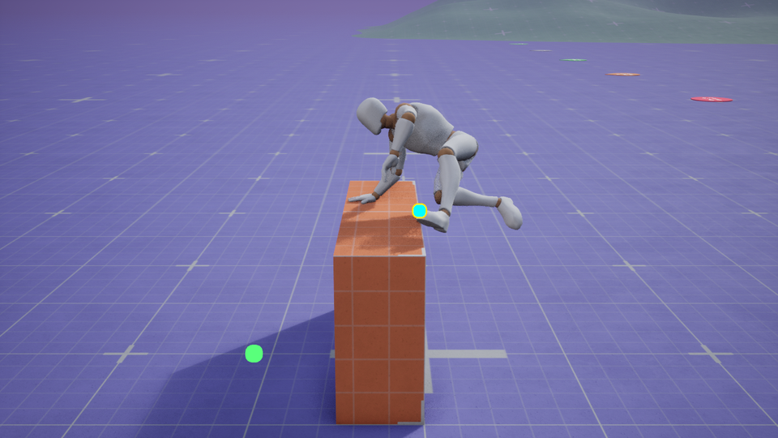
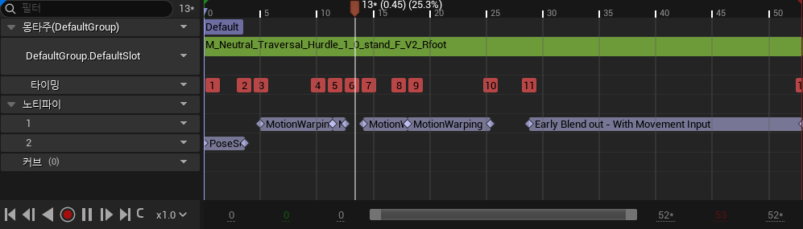
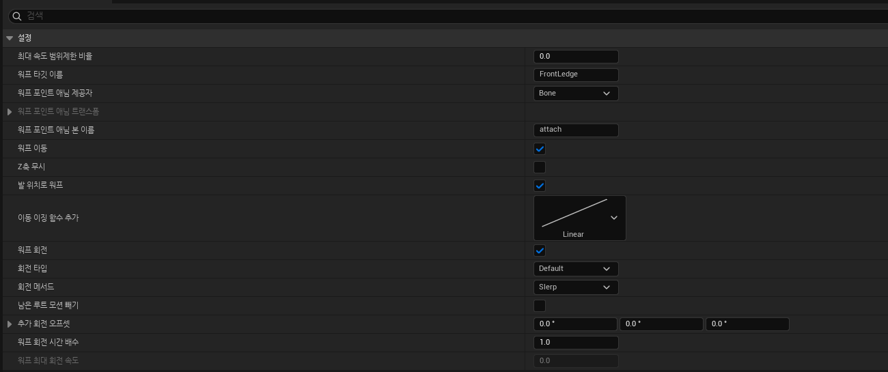
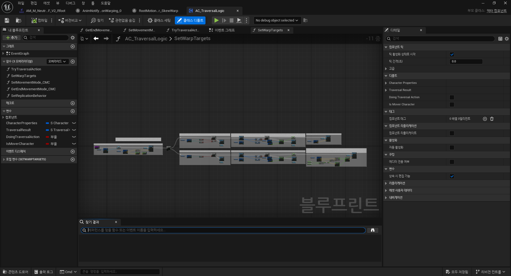
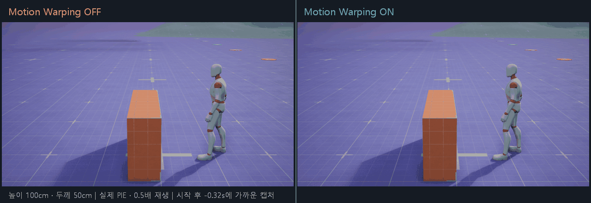
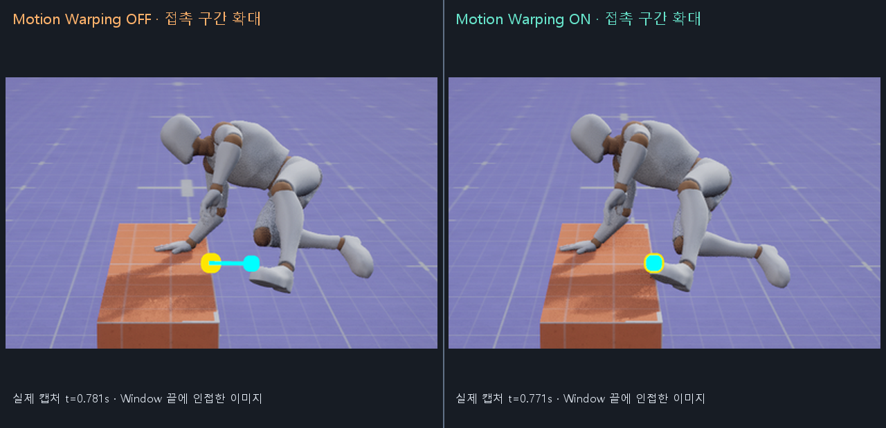
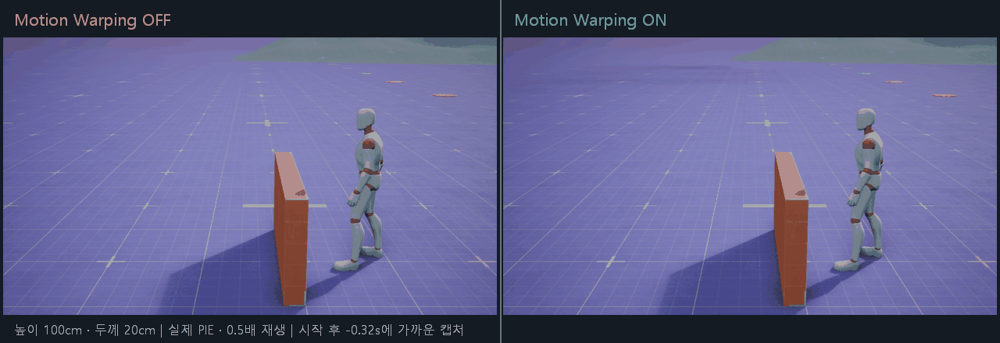

# Motion Warping 이해하기 — Game Animation Sample에서 직접 비교해 보기

장애물 넘기 애니메이션에는 원래 이동 경로가 들어 있다. 그런데 게임 속 캐릭터가 서 있는 위치와 장애물까지의 거리는 매번 같지 않다. 같은 애니메이션을 재생하면서 실제 장애물의 위치에도 맞추려면 어떻게 해야 할까?

**Motion Warping은 애니메이션의 Root Motion을 목표에 맞게 보정하는 기능이다.** 보정을 적용할 구간과 목표 위치·방향을 정해 두면, 그 구간에서 캐릭터의 루트 이동과 회전이 조정된다.

이 설명을 Game Animation Sample의 장애물 넘기 동작으로 확인해 봤다. 먼저 몽타주와 블루프린트의 설정을 살펴보고, 같은 조건에서 Motion Warping만 껐다 켜며 무엇이 달라지는지 비교했다. 본문의 사진과 GIF는 실제 Unreal 에디터와 PIE 화면이다.

<a id="contents"></a>

## 목차

1. [왜 애니메이션의 이동을 보정해야 할까?](#why)
2. [목표 위치와 보정 구간을 연결한다](#concept)
3. [Game Animation Sample의 설정 따라가기](#sample)
4. [직접 껐다 켜며 차이 확인하기](#comparison)
5. [테스트하면서 이해한 점](#learned)
6. [부록 A. 사용한 환경과 파일](#environment)
7. [부록 B. 촬영 조건과 측정 기준](#capture)
8. [부록 C. 테스트 다시 실행하기](#reproduce)
9. [부록 D. 참고 자료](#references)

---

<a id="why"></a>

## 1. 왜 애니메이션의 이동을 보정해야 할까?

먼저 **Root Motion**부터 알아야 한다. 애니메이션의 루트 본에는 위치와 회전의 변화가 들어갈 수 있다. 이 데이터를 추출해 캐릭터의 실제 이동에 사용하는 방식이 Root Motion이다. 장애물을 향해 몸을 밀어 올리고 앞으로 넘어가는 움직임도 애니메이션 데이터로 이동시킬 수 있다. [공식 Root Motion 문서](https://dev.epicgames.com/documentation/en-us/unreal-engine/root-motion-in-unreal-engine)

다만 애니메이션에 들어 있는 이동 경로와 지금 게임에서 필요한 이동 경로가 항상 일치하지는 않는다. 캐릭터가 장애물에서 조금 더 멀리 서 있거나, 장애물의 두께가 달라지면 같은 동작의 접촉·도착 위치가 어긋날 수 있다.

Motion Warping은 이때 **기존 Root Motion을 현재 목표에 맞춰 조정**한다. 장애물 넘기라면 앞 모서리나 뒤쪽 바닥을 목표로 삼고, 필요한 구간에서 루트 이동을 보정하는 식이다. [공식 Motion Warping 문서](https://dev.epicgames.com/documentation/en-us/unreal-engine/motion-warping-in-unreal-engine)



*주황색 블록은 실제 충돌 장애물이다. 이 동작에서 애니메이션의 어느 기준을 어디에 맞추는지 살펴봤다.*

---

<a id="concept"></a>

## 2. 목표 위치와 보정 구간을 연결한다

설정을 볼 때는 **어디에, 언제, 어떤 기준을 맞출지**를 나누어 생각하면 이해하기 쉽다.

| 구성 | 맡는 역할 | 이번 샘플에서 볼 것 |
| --- | --- | --- |
| Motion Warping Component | 목표를 보관하고 Root Motion 보정에 연결 | 캐릭터의 Motion Warping 컴포넌트 |
| Warp Target | 게임 월드에서 맞추려는 목표 위치·방향 | 장애물 앞 모서리인 `FrontLedge` 등 |
| Motion Warping Window | 애니메이션에서 보정을 적용할 시간 구간 | 몽타주 Notify 트랙의 Motion Warping Notify State |
| Root Motion Modifier | 구간 안에서 적용할 보정 방식과 옵션 | 샘플의 `Skew Warp` |

예를 들어 블루프린트에서 `FrontLedge`라는 이름으로 장애물 앞 모서리의 위치·방향을 등록한다. 몽타주의 Motion Warping Notify에도 같은 이름을 지정하면, 해당 구간에서 그 목표를 찾아 보정에 사용한다.

여기에는 이름뿐 아니라 시간도 중요하다. 샘플의 Skew Warp는 **Window가 끝나는 시점**에 기준이 목표에 맞도록 루트 이동을 보정한다. 손을 짚는 순간을 맞추고 싶다면 그 순간과 Window의 끝이 어떻게 연결되는지 확인해야 한다.

새 캐릭터에 연결할 때는 Motion Warping 플러그인과 컴포넌트, Root Motion 추출·적용 설정을 먼저 준비해야 한다. 이번에는 이 구성이 이미 들어 있는 Game Animation Sample을 사용해 실제 설정과 결과를 읽었다.

---

<a id="sample"></a>

## 3. Game Animation Sample의 설정 따라가기

샘플의 `SandboxCharacter_CMC`로 높이 1m 장애물을 넘는 Hurdle 동작을 확인했다. 이 캐릭터는 CharacterMovement를 사용하는 샘플 캐릭터이며, 애니메이션과 Traversal 블루프린트는 샘플에 포함된 것을 사용했다.

설정은 **몽타주에서 보정 구간 확인 → 해당 구간의 옵션 확인 → 블루프린트에서 목표 등록 확인** 순서로 살펴봤다.

<a id="windows"></a>

### 몽타주에서는 언제 보정하는가?

아래는 두께 50cm 장애물에서 선택된 오른발 몽타주의 실제 Notify 트랙이다.



*실제 에디터 캡처에서 Notify 트랙을 확대했다. [전체 몽타주 화면](Images/motionwarping-gas-montage-editor.png)도 함께 둔다.*

한 번의 넘기 동작 안에 Motion Warping 구간이 네 개 들어 있다. 앞 모서리, 뒤 모서리, 뒤쪽 바닥을 구분해 보정한다.

| 몽타주 시간 | Warp Target Name | 애니메이션 쪽 기준 | 위치 / 회전 보정 |
| --- | --- | --- | --- |
| 0.166 ~ 0.379초 | `FrontLedge` | Bone: `attach` | 둘 다 |
| 0.379 ~ 0.417초 | `FrontLedge` | Bone: `attach` | 둘 다 |
| 0.470 ~ 0.600초 | `BackLedge` | Provider: None | 위치 |
| 0.601 ~ 0.845초 | `BackFloor` | Provider: None | 위치 |

시간과 설정은 실제 몽타주에서 읽었다. 여기서 확인할 것은 **넘기 동작의 여러 순간이 서로 다른 목표와 구간에 연결되어 있다**는 점이다. 몽타주 마지막 위치 하나만 확인해서는 앞 모서리에서의 보정까지 알기 어렵다.

<a id="settings"></a>

### 앞 모서리에서는 어떤 기준을 맞추는가?

첫 `FrontLedge` Notify의 `RootMotionModifier_SkewWarp` 설정을 열어 봤다.



*실제 프로퍼티 에디터의 설정 화면이다. [원본 전체 캡처](Images/motionwarping-gas-skew-settings.png)에서 필요한 영역을 잘랐다.*

| 설정 | 샘플의 값 | 읽을 때 확인한 의미 |
| --- | --- | --- |
| Warp Target Name | `FrontLedge` | 게임에서 같은 이름으로 등록한 목표 사용 |
| Warp Point Anim Provider | Bone | 애니메이션 쪽 기준을 본으로 지정 |
| Warp Point Anim Bone Name | `attach` | 이 본과 루트의 관계를 보정에 사용 |
| Warp Translation | 켜짐 | 위치 보정 사용 |
| Ignore Z Axis | 꺼짐 | 높이 보정도 포함 |
| Warp To Feet Location | 켜짐 | 발 쪽 기준 사용 |
| Warp Rotation | 켜짐 | 회전 보정 사용 |
| Rotation Type / Method | Default / Slerp | 목표 방향을 기준으로 회전 보정 |

여기서 헷갈리기 쉬운 것은 **게임 월드의 목표와 애니메이션 쪽 기준이 따로 있다는 점**이다. `FrontLedge`는 월드에서 찾은 장애물 앞 모서리다. `attach`는 애니메이션 안에서 맞추려는 기준 본이다. Bone Provider는 지정한 시점의 본과 루트 사이 관계를 고려해 루트 이동을 보정한다.

이 샘플의 `attach`를 손바닥이나 손가락 끝 자체로 해석하면 안 된다. 뒤의 비교에서도 이 본이 목표에 맞았는지를 확인한다.

<a id="blueprint"></a>

### 블루프린트에서는 어디를 목표로 등록하는가?

목표 등록은 `AC_TraversalLogic`의 `SetWarpTargets` 함수에서 확인했다.



*함수의 전체 구조를 찍은 에디터 화면이다. 세부 노드 연결은 Unreal MCP로 별도 검사했다.*

이 함수는 `AddOrUpdateWarpTargetFromLocationAndRotation`으로 `FrontLedge`, `BackLedge`, `BackFloor` 목표를 등록한다. 앞에서 본 몽타주의 이름들과 연결된다.

| 목표 이름 | 가리키는 위치 |
| --- | --- |
| `FrontLedge` | 장애물 앞 모서리 |
| `BackLedge` | 장애물 뒤 모서리 |
| `BackFloor` | 장애물 뒤쪽 바닥 |

함수 안에는 선택된 애니메이션에 해당 목표의 Window가 있는지 조회하는 노드와 `Distance_From_Ledge` 커브를 읽는 노드도 있다. 샘플은 **선택한 동작에 맞춰 목표와 거리를 준비**한다. 해당 동작에 필요하지 않은 목표를 정리하는 `RemoveWarpTarget`도 확인했다.

이제 전체 흐름을 연결할 수 있다. 장애물을 검사하고 넘기 동작을 선택한 다음, 그 동작에서 사용할 목표를 등록한다. 몽타주가 재생되면 설정한 Window에서 목표에 맞춰 Root Motion을 보정한다.

---

<a id="comparison"></a>

## 4. 직접 껐다 켜며 차이 확인하기

설정만 읽어서는 실제 차이를 판단하기 어려워 Motion Warping을 끈 경우와 켠 경우를 비교했다. 각 비교 쌍은 시작 위치와 카메라를 같게 두고, **실제로 선택된 몽타주도 같은지 확인**했다.

```text
a.MotionWarping.Disable 1    // Motion Warping 보정 끄기
a.MotionWarping.Disable 0    // Motion Warping 보정 켜기
```

OFF에서도 원래 애니메이션의 Root Motion은 이동에 사용된다. 따라서 여기서 확인할 것은 **애니메이션의 기준점이 목표 위치에 맞춰지는가**다.

눈으로 확인할 수 있도록 실제 월드 좌표에 Unreal 디버그 구체와 선을 그렸다.

| 표시 | 뜻 | 볼 부분 |
| --- | --- | --- |
| 노란 구체 | `FrontLedge` 목표 | 장애물 앞 모서리의 목표 위치 |
| 하늘색 구체·연결선 | `attach` 본과 목표 사이 | FrontLedge Window 끝 부근에 노란 목표와 겹치는지 |
| 초록 구체 | `BackFloor` 목표 | 장애물 뒤쪽 바닥의 목표 위치 |

### 두께 50cm 장애물



*왼쪽 OFF / 오른쪽 ON. 실제 주황색 장애물을 화면 오른쪽에서 왼쪽으로 넘는다. 비교 GIF는 0.5배 속도이며 접촉·착지 부근에서 잠시 멈춘다.*

장애물 높이는 100cm이고, 장애물 앞면에서 초기 캐릭터 중심까지 100cm 떨어진 곳에서 시작했다. OFF와 ON 모두 같은 오른발 Hurdle 몽타주가 선택됐다.

FrontLedge 구간 끝 부근을 확대하면 두 점 사이의 차이를 읽을 수 있다.



OFF에서는 하늘색 기준점과 노란 목표 사이에 간격이 남는다. ON에서는 두 점이 겹친다. Window 끝에 가까운 좌표 기록에서도 이 기준의 거리가 약 **20cm에서 0.01cm 미만**으로 줄었다.

이 장면으로 확인한 것은 `attach` 기준의 정렬이다. 손바닥이나 손가락 끝의 접촉 오차를 측정한 결과는 아니다.

[OFF 원본 속도 GIF](Images/motionwarping-gas-depth50-off.gif) · [ON 원본 속도 GIF](Images/motionwarping-gas-depth50-on.gif)

### 두께 20cm 장애물



이번에는 두께 20cm, 높이 100cm 장애물에서 확인했다. 앞면에서 초기 캐릭터 중심까지의 거리는 70cm다. 이 쌍에서는 OFF와 ON 모두 같은 왼발 Hurdle 몽타주가 선택됐다.

이 조건에서도 ON은 FrontLedge 구간 끝 부근에 기준점을 목표에 맞췄다. OFF의 같은 기준 오차는 약 5cm였다.

50cm 조건과는 시작 거리와 선택된 동작이 다르다. 따라서 각 조건의 **OFF/ON 쌍 안에서 보정 효과를 비교**했다. 두 조건의 숫자 차이를 장애물 두께만의 영향으로 해석하지 않았다.

[OFF 원본 속도 GIF](Images/motionwarping-gas-depth20-off.gif) · [ON 원본 속도 GIF](Images/motionwarping-gas-depth20-on.gif) · [접촉 구간 확대](Images/motionwarping-gas-depth20-contact-comparison.png)

<a id="measurements"></a>

### 좌표 기록에서도 같은 차이가 나타나는가?

각 Window 끝에 가장 가까운 기록에서 앞 모서리와 뒤쪽 바닥 목표의 오차를 확인했다.

<!-- MEASUREMENTS_START -->

| 장애물 두께 | 보정 | FrontLedge 3D 오차 | BackFloor XY 오차 |
| --- | --- | --- | --- |
| 50cm | OFF | 20.00cm | 15.21cm |
| 50cm | ON | < 0.01cm | 0.32cm |
| 20cm | OFF | 5.01cm | 19.59cm |
| 20cm | ON | < 0.01cm | 0.83cm |

<!-- MEASUREMENTS_END -->

FrontLedge는 `attach` 본과 앞 모서리 목표 사이의 3D 거리다. BackFloor는 캐릭터 발 기준 위치와 뒤쪽 바닥 목표 사이의 XY 거리이며, 높이 오차는 이 열에 포함하지 않았다.

표의 값은 이번 고정 조건에서 얻은 관측치다. Window가 끝나는 정확한 프레임을 강제로 촬영한 것은 아니며, 선택한 좌표 샘플과 Window 끝의 시간 차이는 최대 약 4.1ms였다. [측정 요약](Evidence/MotionWarping/summary.json)에 실제 시점과 좌표를 남겼다.

---

<a id="learned"></a>

## 5. 테스트하면서 이해한 점

### 보정을 꺼도 애니메이션은 앞으로 이동한다

OFF에서도 캐릭터가 장애물을 넘어갔다. 애니메이션에 들어 있는 Root Motion이 계속 적용되기 때문이다. 기본 동작의 이동 경로가 장애물과 어느 정도 맞으면 겉으로는 자연스러워 보일 수 있다.

이번에는 목표와 기준 본을 함께 표시하니 차이를 확인하기 쉬웠다. Motion Warping을 확인할 때는 넘기 동작의 성공 여부와 함께 **정해 둔 기준이 목표에 맞는지**를 살펴봐야 한다.

### 확인할 시점은 각 Window의 끝이다

샘플은 앞 모서리, 뒤 모서리, 뒤쪽 바닥에 서로 다른 구간을 사용했다. FrontLedge 보정은 그 Window가 끝날 때 확인해야 한다. 이후에도 Root Motion이나 충돌 처리가 이어질 수 있으므로 몽타주 마지막 위치만 보면 중간의 보정 결과를 놓칠 수 있다.

### 루트 정렬과 최종 손 접촉은 따로 살펴봐야 한다

Bone Provider를 쓰면 애니메이션의 특정 본과 루트 사이 관계를 보정에 반영할 수 있다. 다만 이번 기준 본은 `attach`다. 이 기준이 맞았다는 결과를 손가락까지 표면에 고정됐다는 뜻으로 넓힐 수는 없다. 최종 접촉 품질은 애니메이션, 리타기팅, IK도 함께 확인해야 한다.

### 동작 선택과 목표 보정이 이어져 있다

샘플에서는 Chooser / Pose Search로 동작을 고르고, 선택된 동작에서 사용할 Warp Target을 준비했다. Motion Matching은 어떤 동작을 사용할지 고르는 단계에 관계하고, Motion Warping은 그 동작의 루트 이동·회전을 목표에 맞추는 단계에 관계한다.

이 때문에 OFF/ON을 비교할 때 선택된 몽타주 확인도 필요했다. 다른 동작이 재생됐다면 차이를 보정 하나의 영향으로 설명하기 어렵다.

<a id="pitfalls"></a>

다음에 직접 연결할 때도 **Root Motion이 실제 이동에 적용되는지 → 목표 이름과 위치가 맞는지 → Notify 구간과 기준 본이 맞는지 → 해당 시점의 결과가 맞는지** 순서로 확인하려고 한다. 높이가 맞지 않으면 Ignore Z 설정과 이동 모드도 함께 보고, 실제 이동은 충돌 조건의 영향도 받는다는 점을 기억해야 한다.

---

<a id="environment"></a>

## 부록 A. 사용한 환경과 파일

실험 프로젝트는 `D:\Unreal Projects\GameAnimationSample`, 엔진은 **UE 5.8.3 / CL 58210709**다. 샘플의 기본 플레이어는 Mover이며, 이번 비교에서는 `SandboxCharacter_CMC`를 PIE 월드에 생성해 빙의했다. 원본 맵·블루프린트·애니메이션 파일은 저장하지 않았다.

| 항목 | 실제 사용한 것 |
| --- | --- |
| 프로젝트 / 맵 | `GameAnimationSample.uproject` / `/Game/Levels/DefaultLevel` |
| 캐릭터 / AnimBP | `/Game/Blueprints/SandboxCharacter_CMC` / `SandboxCharacter_CMC_ABP` |
| Traversal 컴포넌트 | `/Game/Blueprints/AC_TraversalLogic` |
| 50cm 장애물 | `LevelBlock_Traversable_C_4` |
| 20cm 장애물 | `LevelBlock_Traversable_C_7` |
| 50cm 조건의 몽타주 | `AM_M_Neutral_Traversal_Hurdle_1_0_stand_F_V2_Rfoot` |
| 20cm 조건의 몽타주 | `AM_M_Neutral_Traversal_Hurdle_1_0_stand_F_V2_Lfoot` |

실행은 샘플의 기존 경로를 사용했다.

```text
SandboxCharacter_CMC.GetTraversalCheckInputs
  → AC_TraversalLogic.TryTraversalAction
  → 장애물 Trace와 Traversal 가능 여부 확인
  → Chooser / Pose Search로 몽타주와 시작 시점 선택
  → 기존 PerformTraversalAction 경로 실행
  → SetWarpTargets로 목표 등록
  → Montage의 Window에서 Root Motion 보정
  → 샘플의 이동·충돌·동작 종료 처리
```

스크립트는 캐릭터·카메라를 준비하고 기존 Traversal을 호출한 뒤 좌표와 화면을 기록했다. 매 프레임 캐릭터 위치를 목표로 덮어쓰는 코드는 넣지 않았다. 비교에 사용한 네 기록에서 `TryTraversalAction`의 두 실패 출력은 모두 `(False, False)`였다.

확인한 범위는 고정 장애물 두 조건의 PIE 실행과 실제 샘플 설정이다. 이동 목표 추적, 회전만 켠 비교, 다른 이동 모드·프레임률, 패키지 실행은 별도로 확인해야 한다.

---

<a id="capture"></a>

## 부록 B. 촬영 조건과 측정 기준

| 조건 | 설정 |
| --- | --- |
| 초기 스폰 위치 | 50cm: `(2300, -2400, 90)`, 20cm: `(2330, -2600, 90)` |
| 초기 방향 / 초기화 | Yaw `0°`. 매번 새 PIE에서 생성·빙의하고 기존 CharacterMovement로 지면에 정착 |
| 카메라 | 시작점 기준 X `+120`, Y `-530`, 월드 Z `230`에서 X `+120`, 같은 Y, 월드 Z `95`를 봄. FOV `50°` |
| 촬영 대상 확인 | 에셋 미리보기 창을 닫고 PIE 월드와 CameraActor를 확인한 뒤 엔진 `Shot`으로 PNG 저장 |
| 장애물 표시 | 대상 장애물과 바닥을 남기고 다른 LevelBlock의 렌더링만 PIE에서 숨김. 충돌·Trace 설정 유지 |
| 좌표 표시 | Unreal `DrawDebug`로 실제 목표·기준 본 위치 표시. 구체·선은 Foreground로 그려 가려지지 않게 함. 이동에는 관여하지 않음 |
| 기록 간격 | 게임 시간 약 `0.08초`마다 이미지 요청. 좌표는 매 Tick 기록 |
| 촬영 중 시간 배율 | `0.25`. 개별 GIF는 기록한 게임 시간 간격으로 환산 |
| 비교 GIF | Traversal 호출 이후 같은 게임 시간에 가장 가까운 캡처를 나란히 배치. 0.5배 속도와 구간별 정지 |
| 이미지 가공 | 레터박스 제거·축소·배치·문구 추가. 확대 스틸은 양쪽의 같은 영역을 자름. 중간 포즈나 장애물 형상은 생성하지 않음 |

비교 이미지의 두 실행은 렌더링 프레임이 정확히 일치하지는 않는다. 접촉 확대 이미지도 Window 끝에 인접한 실제 캡처다. 이번 기록은 보정 결과를 확인하는 실험이며 프레임 성능 측정은 아니다.

왼발 몽타주의 Window 시간은 오른발과 다르다. 마지막 FrontLedge 구간은 약 `0.399초`, BackFloor 구간은 약 `0.831초`에 끝난다. 측정에서는 각 몽타주의 실제 시간을 따로 사용했다. `GetMotionWarpingWindowsFromAnimation`으로 읽은 값은 [몽타주 설정 기록](Evidence/MotionWarping/montages.json)에 있다.

| 자료 | 내용 |
| --- | --- |
| [측정 요약](Evidence/MotionWarping/summary.json) | 각 Window 끝, 선택한 샘플 시점, 실제 좌표·오차 |
| [50cm ON](Evidence/MotionWarping/depth50_on.json) / [50cm OFF](Evidence/MotionWarping/depth50_off.json) | 원본 좌표·몽타주 시간·목표·캡처 정보 |
| [20cm ON](Evidence/MotionWarping/depth20_on.json) / [20cm OFF](Evidence/MotionWarping/depth20_off.json) | 원본 좌표·몽타주 시간·목표·캡처 정보 |
| [50cm 비교 프레임](Evidence/MotionWarping/depth50_comparison_frames.json) / [20cm 비교 프레임](Evidence/MotionWarping/depth20_comparison_frames.json) | 나란히 배치한 원본 이미지와 선택 시점 |

---

<a id="reproduce"></a>

## 부록 C. 테스트 다시 실행하기

실행 스크립트와 에디터 시작 명령은 [Scripts/MotionWarping](../../Scripts/MotionWarping/README.md)에 있다. Game Animation Sample 설치본과 Python 3, GIF 인코딩용 Pillow가 필요하다.

1. UE 5.8.3으로 샘플을 열고 실험용 `ModelContextProtocol`, `EditorToolset`, `SlateInspectorToolset`, `PythonScriptPlugin`, `EditorScriptingUtilities` 플러그인을 활성화한다.
2. `inspect_sample.py`를 에디터 Python에서 실행해 조사 결과와 실험용 MCP Toolset을 준비한다. 이 실험의 GameAnimationSample MCP 포트는 `8001`이다.
3. `run_sample_tests.py`로 네 조건을 실행한다. 기존 생성 결과는 `Saved/` 안에 보관한 뒤 새로 기록한다.
4. `export_captures.py`로 실제 PNG를 GIF로 인코딩하고 수치 기록을 문서 폴더에 내보낸다.

```text
python Scripts/MotionWarping/run_sample_tests.py
python Scripts/MotionWarping/export_captures.py
```

원본 PNG와 실행 로그는 Git에서 제외된 `Saved/MotionWarpingLab/`에 둔다. 문서에는 캡처·GIF·수치 JSON을 포함한다. 내보낼 때 OFF/ON 쌍의 몽타주가 같은지 검사한다.

엔진의 Motion Warping 디버그 명령도 참고할 수 있다. 본문에 보이는 구체·선은 아래 명령의 자동 표시와 별개로, 실제 목표와 본 좌표를 `DrawDebug`로 그린 것이다.

```text
a.MotionWarping.Debug 3
a.MotionWarping.DrawDebugLifeTime 0.1
a.MotionWarping.Debug.Target 2
show collision
```

---

<a id="references"></a>

## 부록 D. 참고 자료

### 공식 문서

- [Motion Warping](https://dev.epicgames.com/documentation/en-us/unreal-engine/motion-warping-in-unreal-engine)
- [Root Motion](https://dev.epicgames.com/documentation/en-us/unreal-engine/root-motion-in-unreal-engine)
- [Motion Matching](https://dev.epicgames.com/documentation/en-us/unreal-engine/motion-matching-in-unreal-engine)
- [UMotionWarpingComponent](https://dev.epicgames.com/documentation/en-us/unreal-engine/API/Plugins/MotionWarping/UMotionWarpingComponent)
- [URootMotionModifier_Warp](https://dev.epicgames.com/documentation/en-us/unreal-engine/API/Plugins/MotionWarping/URootMotionModifier_Warp)
- [URootMotionModifier_SkewWarp](https://dev.epicgames.com/documentation/en-us/unreal-engine/API/Plugins/MotionWarping/URootMotionModifier_SkewWarp)

### 함께 대조한 엔진 소스

공통 경로는 `Engine/Plugins/Animation/MotionWarping/Source/MotionWarping/`다.

| 파일 | 확인한 부분 |
| --- | --- |
| `Public/MotionWarpingComponent.h` | 목표 등록 API, Window 조회 API |
| `Public/RootMotionModifier.h` | 위치·회전·발 기준·Provider 옵션 |
| `Private/MotionWarpingCharacterAdapter.cpp` | CharacterMovement 연결과 발 기준 위치 |
| `Private/MotionWarpingComponent.cpp` | Window 검색, 활성 Modifier 적용, 디버그 CVar |
| `Private/RootMotionModifier.cpp` | 목표 부재 처리, 본과 루트의 오프셋, 회전 보정 |
| `Private/RootMotionModifier_SkewWarp.cpp` | Root Motion 보정 계산 |

샘플의 모델·애니메이션·맵은 Epic Games의 Game Animation Sample 자산이다. 원본 샘플 에셋은 이 저장소에 복사하지 않았다.

[Unreal Engine 문서 목록](README.md) · [저장소 소개](../../README.md) · [목차로](#contents)
