# Motion Matching·Motion Warping·Control Rig로 파쿠르 타임어택 만들기

<a id="contents"></a>

## 목차

1. [무엇을 만들었나](#what)
2. [세 기능이 일하는 곳](#roles)
3. [한 바퀴 달려 보기](#run)
4. [떨어지면 체크포인트에서 다시](#fall)
5. [만들면서 헤맨 부분](#stuck)
6. [정리](#summary)
7. [부록](#reproduce)

---

<a id="what"></a>

## 1. 무엇을 만들었나

출발 문을 지나면 타이머가 돌고, 체크포인트를 순서대로 지나 결승 문에 들어가면 멈춘다. 최고 기록은 저장해 둔다.

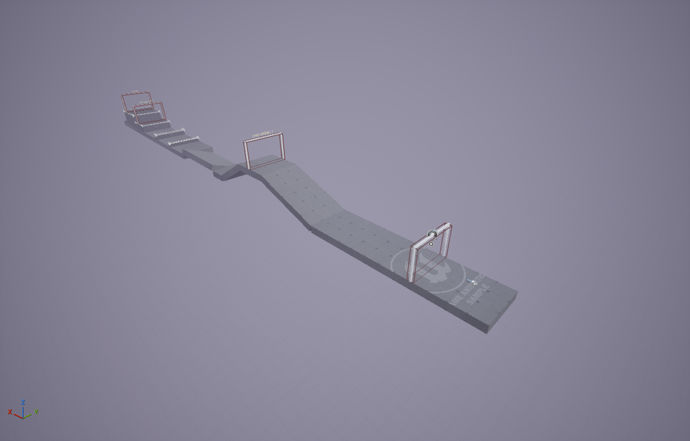

| 구간 | 내용 |
| --- | --- |
| 출발 | 평지 23m. START 문을 지나면 시작 |
| 경사로 | 20° 오르막 11m → 높이 3.76m 고원(체크포인트 1) → 30° 내리막 7.5m. 공중에 떠 있어서 옆으로 떨어질 수 있다 |
| 옆 경사 | 진행 방향과 직각으로 20° 기운 길 12m. 왼발이 오른발보다 높다 |
| 장애물 | 70cm 허들 → 100cm 벽 → 150cm 단상(체크포인트 2) → 300cm 단상 위 FINISH |

결승에 들어오면 이렇게 나온다. 시간, 지난 체크포인트 수, 최고 기록은 왼쪽 위에 계속 떠 있다.

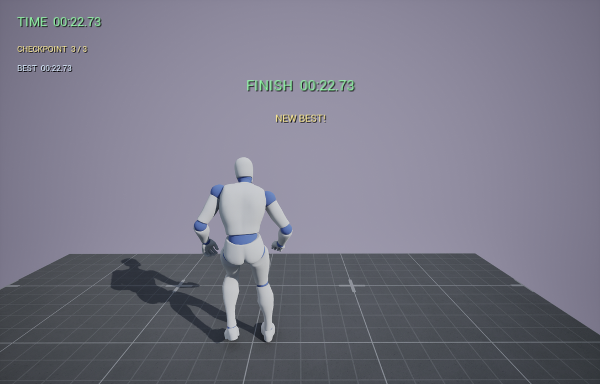

---

<a id="roles"></a>

## 2. 세 기능이 일하는 곳

캐릭터는 Epic의 Game Animation Sample(이하 GASP)에 있는 `SandboxCharacter_Mover` 를 그대로 가져와 썼다. 세 기능은 이미 이 캐릭터의 AnimBP(`SandboxCharacter_Mover_ABP`)에 다 들어 있어서 새로 만든 건 거의 없다. 대신 코스를 짤 때 각 기능이 일하는 장면이 나오게 했다. 경사로는 Control Rig, 장애물은 Motion Warping, 그 사이를 달리는 건 Motion Matching 몫이다.

한 프레임은 이 순서로 돈다.

```text
입력 (IA_Move, IA_Jump)
  -> Mover            캡슐을 움직인다. 이동 모드는 지면 / 공중 / Traversal
  -> AnimBP
       Motion Matching 노드     지면·공중일 때 DB에서 다음 포즈를 고른다
       Slot                     Traversal 몽타주가 재생 중이면 그 포즈로 덮는다
       Procedural_Feet 레이어   Control Rig가 발과 골반을 바닥에 맞춘다
  -> Motion Warping   Traversal 몽타주의 Root Motion을 장애물에 맞게 고쳐서 캡슐을 옮긴다
```

느낌만으로 쓰고 싶지 않아서, 코스를 달리는 동안 매 틱 값을 뽑아 두고 그걸 보면서 정리했다. 아래 숫자는 전부 그 기록이다.

### 2-1. Motion Matching - 어떤 애니메이션을 틀지 고른다

Motion Matching은 매 프레임 지금 포즈와 앞으로 1초 동안 갈 궤적을 DB에 든 애니메이션의 모든 프레임과 비교해서, 가장 가까운 프레임으로 넘어간다. 비교 방식은 [Motion Matching 문서](MotionMatching.md)에 정리했다. 그런데 그냥 달리는 화면만 봐서는 이게 일하는지 알 수가 없다.

그래서 Motion Matching 노드의 디버그를 켰다. 콘솔에서 `a.AnimNode.MotionMatching.DebugDrawInfo 1` 을 넣으면 캐릭터 옆에 노드가 지금 쓰는 DB와 애니메이션이 노란 글자로 뜬다. 이 글자는 디버그 캔버스에 그려져서 그냥 `Shot` 으로는 안 찍히고, `Shot showui` 로 찍어야 나왔다.

달리기 시작한 직후를 멈춰 놓고 보면 이렇다.

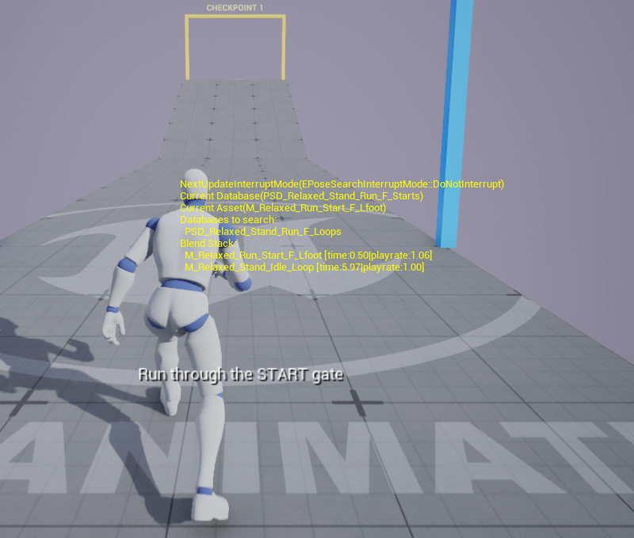

```text
Current Database     지금 애니메이션을 고른 DB          PSD_Relaxed_Stand_Run_F_Starts
Current Asset        지금 재생 중인 애니메이션          M_Relaxed_Run_Start_F_Lfoot
Databases to search  다음 검색 대상 (Chooser가 고른 DB)  PSD_Relaxed_Stand_Run_F_Loops
Blend Stack          섞이고 있는 애니메이션과 재생 위치  Run_Start_F_Lfoot 0.50초, Stand_Idle_Loop 5.97초
```

서 있던 대기 애니메이션에서 출발 애니메이션으로 0.5초째 넘어가는 중이다. 검색 대상은 벌써 루프 DB로 바뀌어 있는데, 지금 재생 중인 애니메이션의 다음 프레임도 늘 후보라서 출발 동작이 더 잘 맞는 동안은 그대로 이어 간다.

같은 디버그를 켜고 출발과 허들 구간을 달린 GIF다.

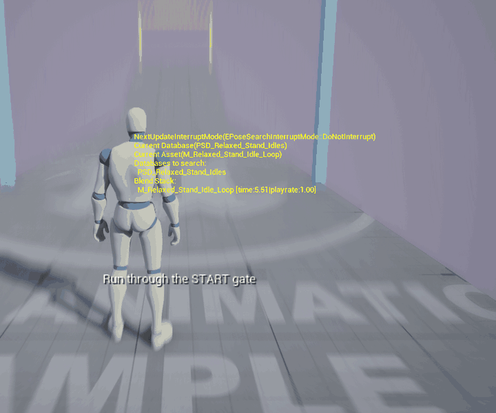

앞부분이 출발이다. Current Database가 `Idles` 에서 `Run_F_Starts` 로, 출발 동작을 2.7초가량 이어 간 뒤 `Run_F_Loops` 로 바뀌고, 애니메이션도 대기 → 출발 → 달리기 루프로 따라 바뀐다. 상태 머신에 출발 상태가 있어서가 아니라 Motion Matching이 고른 결과다.

뒷부분이 허들이다. 허들을 넘는 동안(0.9초쯤)은 넘기 몽타주가 포즈를 덮고 있어서 노드가 쉬고 글자도 사라진다. 착지하면 검색 대상에 `Run_FromTraversal` DB가 들어오고, 넘기 애니메이션의 뒷부분이 골라져서 달리기로 이어진다. 이 녹화에서는 허들 뒤에 `M_Relaxed_Traversal_Mantle_1_0_run_F_Lfoot` 가 골라졌는데, 아래 표를 뽑은 주행에서는 같은 자리에서 `Traversal_Hurdle_1_0_run_F_V2_Lfoot` 가 골라졌다. 같은 코스라도 착지 순간의 포즈가 조금씩 달라서, 가장 가까운 프레임도 그때마다 달라진다.

AnimBP의 AnimGraph를 열면 Motion Matching 노드가 있고, On Update에 `Update_MotionMatching` 함수가 걸려 있다.

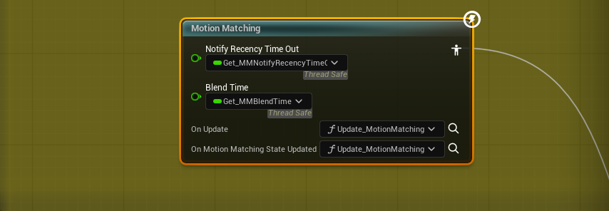

`Update_MotionMatching` 안에서는 Chooser(`CHT_PoseSearchDatabases_Relaxed`)가 지금 이동 상태에 맞는 DB 목록을 뽑고, `Set Databases to Search` 로 그 목록을 Motion Matching 노드에 넘긴다. 걷고 있으면 걷기 DB만, 달리고 있으면 달리기 DB만 검색하도록 미리 거르는 단계다.

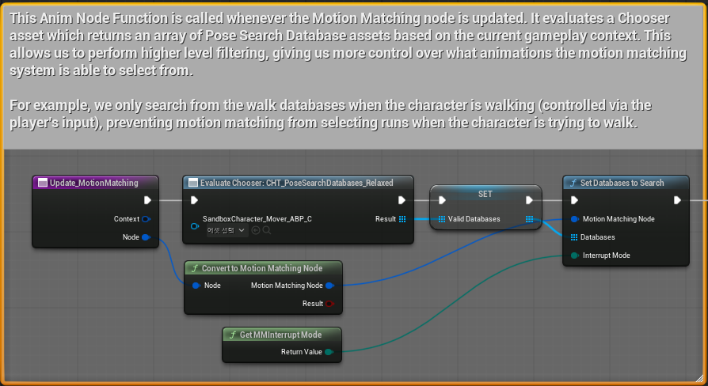

노드와 DB는 GASP 그대로 두고 설정 하나만 바꿨다. 프로젝트 세팅의 데이터 기반 CVar에서 `DDCvar.LocomotionSetupMover` 기본값을 1에서 0으로 내렸다.

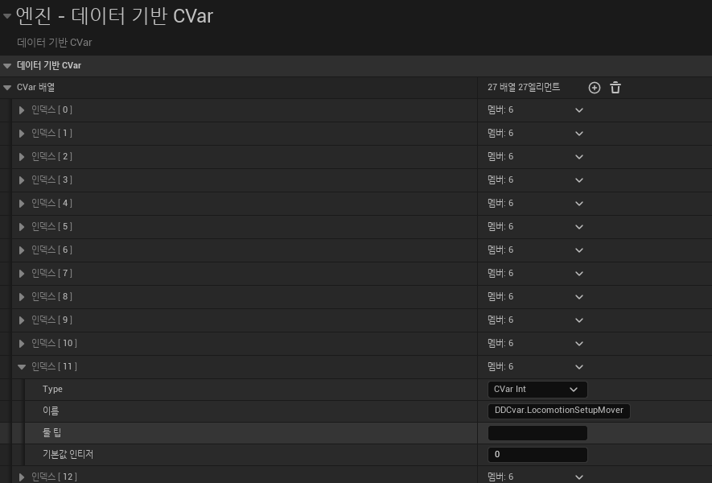

GASP의 Mover 캐릭터는 이 값이 1이다. 1은 [Motion Matching 문서](MotionMatching.md#state-machine)에서 본 "상태 머신 + Chooser" 방식이라, 상태에 들어갈 때만 검색하고 위의 Motion Matching 노드는 거치지 않는다. 처음엔 이걸 몰랐다. Motion Matching 노드가 고른 DB(`CurrentSelectedDatabase`)를 기록했는데 캐릭터는 멀쩡히 달리는데도 값이 계속 비어 있었고, 0으로 바꾸고 나서야 채워졌다. 완주 시간은 1일 때 22.66~22.69초, 0일 때 22.62~22.81초라 바꿔도 손해 보는 건 없었다.

한 번 달리는 동안 고른 DB나 애니메이션이 바뀐 순간만 순서대로 뽑아 보면 이렇다. DB 이름 앞의 `PSD_Relaxed_Stand_`, 애니메이션 이름 앞의 `M_Relaxed_` 는 뺐다.

| 어디서 | 고른 DB | 애니메이션 |
| --- | --- | --- |
| 출발 문 앞 (서 있음) | `Idles` | `Stand_Idle_Loop` |
| 출발 | `Run_F_Starts` | `Run_Start_F_Lfoot` |
| 출발 평지 | `Run_F_Loops` | `Run_Loop_F` |
| 오르막 → 고원 → 내리막 → 옆 경사 | 그대로 | 그대로 |
| 허들 | 검색 안 함 | 몽타주 `AM_M_Relaxed_Traversal_Hurdle_1_0_run_F_V2_Lfoot` |
| 허들 뒤 | `Run_FromTraversal` | `Traversal_Hurdle_1_0_run_F_V2_Lfoot` |
| 100cm 벽 | 검색 안 함 | 몽타주 `AM_M_Relaxed_Traversal_Mantle_1_0_run_F_Rfoot` |
| 벽 위 | `Run_FromTraversal` | `Traversal_Hurdle_1_0_run_F_Rfoot` |
| 벽에서 내려옴 (공중) | `WalkAndRun_Jump` | `Jump_F_Off_Run_Lfoot` |
| 착지 | `Run_Lands_Light` | `Jump_F_Land_Run_Light_Lfoot` |
| 결승 뒤에 멈춤 | `Run_Stops` | `Run_Stop_F_Rfoot` |

오르막부터 옆 경사까지 15초 가까이 애니메이션은 평지와 같은 `Run_Loop_F` 하나였다. 경사용 애니메이션을 따로 고르지 않고, 기울기는 다음 단계의 Control Rig가 맞춘다. 100cm 벽에 올라선 뒤에도 방금 재생한 Mantle이 아니라 Hurdle 시퀀스가 골라졌다. 재생하던 애니메이션을 이어 붙이는 게 아니라 그 순간 포즈와 궤적이 가장 가까운 프레임을 찾는다는 게 여기서도 보인다.

### 2-2. Control Rig - 고른 포즈를 바닥에 맞춘다

플레이어 카메라는 뒤에서 내려다보니까 발밑이 잘 안 보인다. 그래서 30° 내리막에서 캐릭터 옆에 카메라를 붙이고, 리그를 끈 채로 한 번, 켠 채로 한 번 달렸다. 왼쪽이 끔, 오른쪽이 켬이고 같은 게임 시간의 프레임끼리 붙였다.

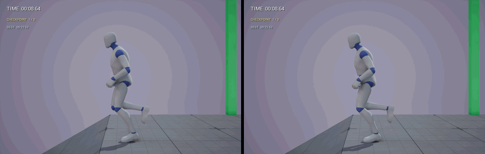

리그를 끄면 Motion Matching이 고른 평지 달리기 포즈가 그대로 나온다. 평지에서 뛰는 동작을 30° 내리막에 그대로 얹은 셈이라, 디딘 발이 경사면 속으로 들어갔다 나왔다 한다. 켜면 발이 매번 경사면 위에 놓이고 발목도 경사를 따라 꺾인다.

끈 쪽에서 발이 가장 깊이 박힌 순간을 멈춰 보면 차이가 확실하다.

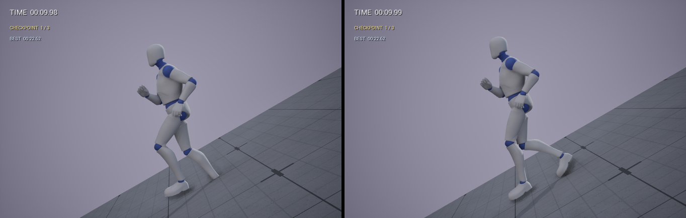

왼쪽은 뒤에 디딘 오른발 앞쪽이 경사면에 묻혀 있다. 이때 오른발 발볼 본이 바닥 아래 16.4cm였다. 오른쪽은 같은 순간에 같은 발이 바닥 위 6.2cm에 걸쳐 있다. 이 내리막 구간만 따로 세어 보면, 끈 쪽은 지면에 있는 틱의 68%에서 디딘 발이 바닥 아래에 있었고(가장 깊게 17.9cm), 켠 쪽은 한 번도 없었다(가장 낮을 때도 바닥 위 4.1cm).

리그가 무엇을 고치는지는 디버그를 켜면 보인다.

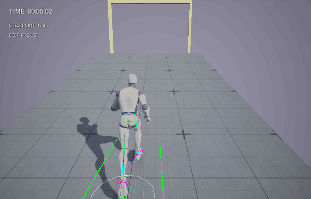

앞은 20° 오르막, 뒤는 옆으로 20° 기운 길이다. 다리를 따라 그려진 하늘색 선이 Motion Matching이 고른 그대로의 다리고, 초록색 선이 Control Rig가 고친 다리다. 발밑의 큰 초록 사각형은 애니메이션이 가정한 바닥, 흰 원은 발을 고정해 두는 범위다. 평지 달리기를 그대로 틀고 있는데도 발이 경사면에 붙는 건 이 리그 덕분이다. 디버그는 `ControlRig.EnableDrawInterfaceInGame 1`, `a.AnimNode.ControlRig.Debug 1`, `a.AnimNode.FootPlacement.Debug 1` 로 켰다.

리그는 AnimBP 맨 끝의 `Procedural_Feet` 애님 레이어에 있다. Motion Matching과 몽타주까지 끝난 포즈(`PreProceduralPose`)를 받아서 `CR_Biped_FootPlacement` 를 돌린다.

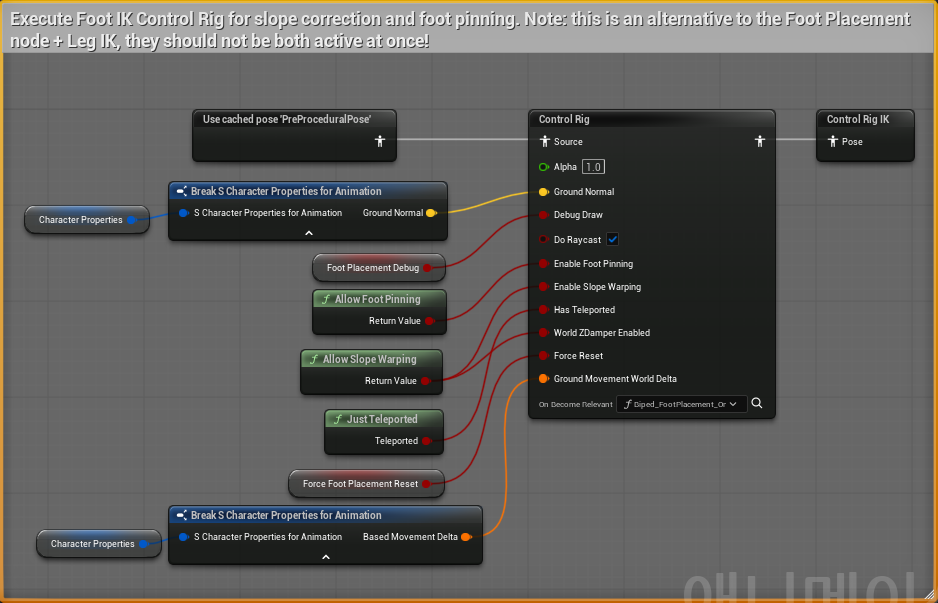

리그는 매 프레임 발밑으로 트레이스해서 실제 바닥의 높이와 기울기를 찾고, 발이 그 면에 닿게 목표를 잡은 다음, 두 발이 다 닿을 만큼 골반을 내리고, 다리마다 IK로 무릎을 굽힌다. 노드에 꽂힌 `Enable Foot Pinning`, `Enable Slope Warping` 이 발 고정과 경사 맞추기를 켜는 입력이다. 리그 안쪽은 [Control Rig 문서](ControlRig.md#solve)에서 단계별로 뜯어 봤다.

같은 레이어 뒤쪽에서는 `Foot Placement Enable` 값으로 이 결과(`Control Rig IK`)와 Leg IK만 거친 결과(`BasicIK`) 중 하나를 고른다. 이 값은 AnimBP가 매 프레임 `a.AnimNode.FootPlacement.Enable` CVar에서 읽어 온다. 그래서 콘솔에서 이 CVar 하나만 0으로 바꾸면 리그를 뺀 채로 달려 볼 수 있다.

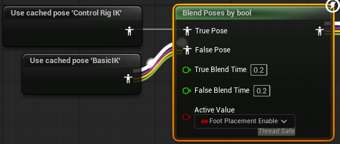

리그 설정은 건드리지 않았다. 한 일은 리그가 일할 바닥을 만든 것이다. 코스에 20° 오르막, 30° 내리막, 옆으로 20° 기운 길을 넣었다. 옆 경사는 GASP의 `LevelBlock` 을 12 x 6 x 1로 늘리고 X축(Roll)으로 20° 돌린 블록이다.

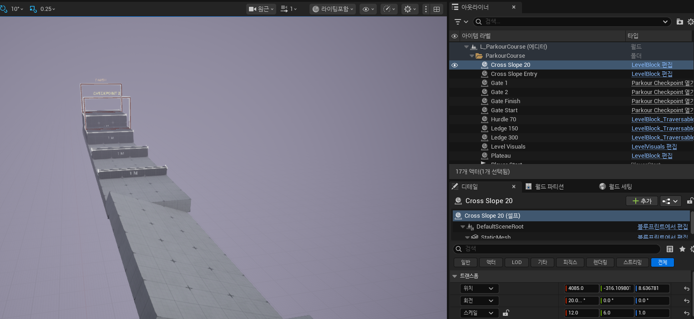

내리막 말고 다른 경사에서는 어떤지 보려고, 콘솔에서 리그를 끄고(`a.AnimNode.FootPlacement.Enable 0`) 코스 전체를 한 번 더 달렸다. 달리기는 두 발이 다 뜨는 순간이 있어서, 지면에 있는 틱마다 두 발 중 낮은 쪽(디딘 발)의 발볼(`ball_l`, `ball_r`) 본 높이를 바닥 기준으로 모았다. 발볼 본은 신발 바닥보다 3cm쯤 위에 있어서 평지에서도 2cm 안팎이 나온다.

| 구간 | 디딘 발 하위 10% (끔 / 켬) | 바닥 아래로 들어간 틱 (끔 / 켬) | 골반 높이 (끔 / 켬) |
| --- | --- | --- | --- |
| 출발 평지 | 2.3 / 2.0cm | 0% / 0% | -0.9 / -1.6cm |
| 20° 오르막 | 1.1 / 2.1cm | 6% / 0% | +0.6 / -8.5cm |
| 30° 내리막 | -15.6 / 4.7cm | 66% / 0% | +0.6 / +2.1cm |
| 20° 옆 경사 | 5.0 / 2.1cm | 0% / 0% | +0.6 / -2.4cm |

하위 10%는 디딘 발 높이를 낮은 순으로 세웠을 때 10% 지점이라, 발이 가장 깊이 닿는 순간들을 본다. 골반 높이는 캡슐 중심에서 잰 `pelvis` 본 높이의 평균이다.

30° 내리막은 옆에서 찍은 것과 거의 같은 숫자가 나왔다(66%, 깊게는 18cm). 오르막은 발보다 골반에서 차이가 났다. 켜면 골반을 8.5cm 내린 채로 달리고, 끄면 평지와 같은 높이로 달린다. 옆 경사에서는 끄면 디딘 발이 5cm쯤 떠 있었다. 완주 시간은 끄고도 22.67초로 같았다. 리그는 보이는 것만 고치고 이동에는 손대지 않는다.

### 2-3. Motion Warping - 넘기 동작을 장애물 크기에 맞춘다

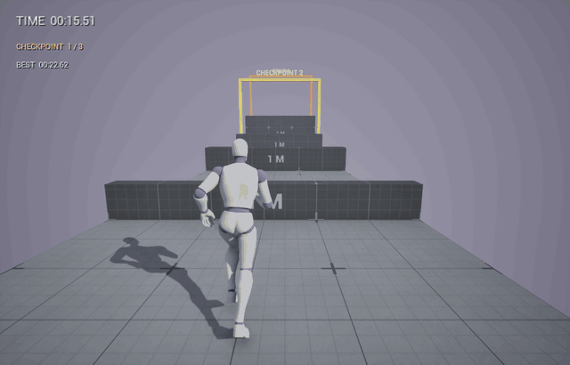

앞은 70cm 허들, 뒤는 150cm 단상이다. 모서리 위에 잠깐 뜨는 작은 좌표축이 Warp Target이고, 발밑에서 이어지는 빨강·초록·파랑 점이 원래 Root Motion 경로, 고친 경로, 실제 발 위치다. `a.MotionWarping.Debug 2` 와 `a.MotionWarping.Debug.Target 2` 로 켰다.

점프를 누르면 GASP의 `AC_TraversalLogic` 이 앞쪽 장애물을 `Traversable` 충돌 채널로 트레이스해서 높이와 깊이를 잰다. 그 값으로 Chooser가 넘기 몽타주를 고르고, 장애물 모서리를 Warp Target으로 등록한다. 앞 모서리가 `FrontLedge`, 넘어가는 동작이면 뒤 모서리 `BackLedge` 와 내려설 바닥 `BackFloor` 까지 잡는다.

그래서 넘을 장애물에는 모서리 정보가 있어야 한다. 장애물은 GASP의 `LevelBlock_Traversable` 로 놓았다. 보통 블록과 같은 큐브인데 윗면 네 모서리에 `Ledge_1` ~ `Ledge_4` 스플라인이 들어 있어서, Traversal 로직이 여기서 모서리 위치를 꺼낸다. 아래는 150cm 단상을 고른 화면이고, 윗면 테두리의 흰 선과 점이 Ledge 스플라인이다. 높이는 Z 스케일 1.5로 맞췄다.

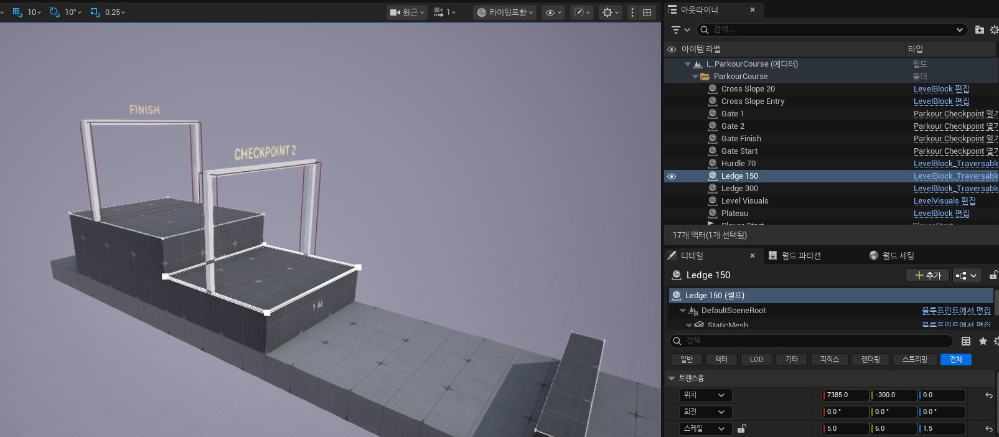

블록은 에디터 Python으로 한 번에 놓았는데, 놓고 나서 스플라인을 한 번 다시 계산해 줘야 했다. 처음엔 이걸 몰라서 넘을 때마다 옆으로 1.2m씩 밀렸다([5장](#stuck)).

```python
# Scripts/ParkourCourse/pk_lab_runtime.py - place_actor
splines = actor.get_components_by_class(unreal.SplineComponent)
for spline in splines:
    spline.update_spline()
```

몽타주는 GASP 것을 그대로 썼다. 아래는 150cm와 300cm 단상에서 골라진 `AM_M_Relaxed_Traversal_Mantle_1_0_run_F_Lfoot` 다. 노티파이 트랙의 `MotionWarping` 두 구간이 Warp 구간이고, 둘 다 Skew Warp에 Warp Target Name이 `FrontLedge`, 애니메이션 쪽 기준점은 `attach` 본이다. 이 구간 동안 남은 Root Motion을 늘이고 기울여서 구간이 끝날 때 기준점이 목표에 오게 한다. 뷰포트에 보이는 `FrontLedge` 표시가 몽타주가 기대하는 모서리 위치다. 허들 몽타주에는 이런 구간이 `FrontLedge`, `BackLedge`, `BackFloor` 세 개 있다.

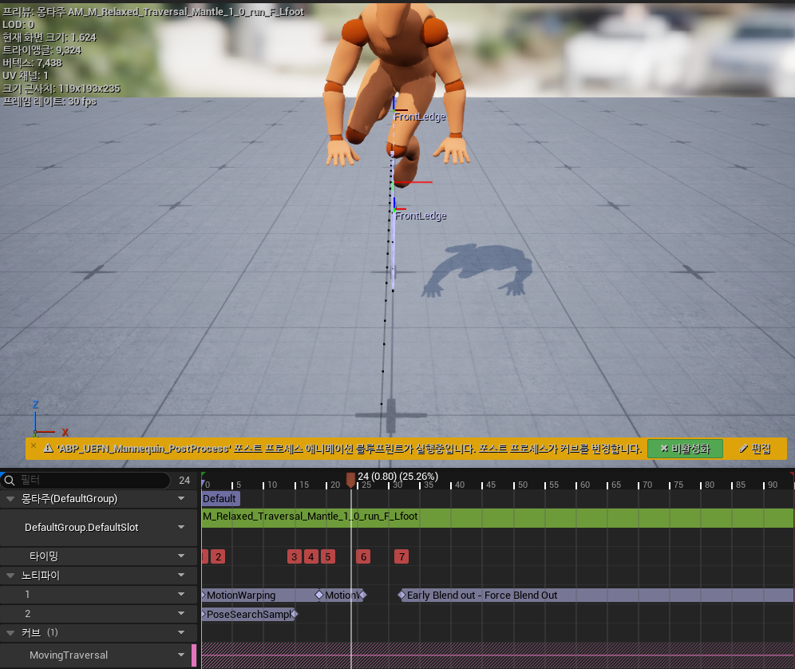

달리면서 Motion Warping 컴포넌트에 등록된 목표와, 몽타주가 끝났을 때 캡슐 위치를 기록했다.

| 장애물 | 몽타주 | 등록된 Warp Target (x, z) | 몽타주가 끝났을 때 캡슐 (x, z) |
| --- | --- | --- | --- |
| 허들 70cm | `AM_M_Relaxed_Traversal_Hurdle_1_0_run_F_V2_Lfoot` | FrontLedge (5885, 70), BackLedge (5925, 70), BackFloor (6006, 0) | (6028, 86) |
| 벽 100cm | `AM_M_Relaxed_Traversal_Mantle_1_0_run_F_Rfoot` | FrontLedge (6585, 100) | (6664, 188) |
| 단상 150cm | `AM_M_Relaxed_Traversal_Mantle_1_0_run_F_Lfoot` | FrontLedge (7385, 150) | (7451, 238) |
| 단상 300cm | `AM_M_Relaxed_Traversal_Mantle_1_0_run_F_Lfoot` | FrontLedge (7885, 300) | (7951, 388) |

목표는 네 번 모두 모서리 정중앙(y = 0)에 정확한 높이로 잡혔다. 캡슐 중심은 발에서 88cm 위라서, 끝났을 때 캡슐 높이가 윗면 + 88cm면 윗면에 제대로 올라선 것이다. 허들은 넘어가서 바닥(0 + 86)에, 나머지는 각각 윗면에 섰다. 골라진 몽타주는 전부 이름에 `1_0` 이 붙은 1m 기준 애니메이션이다. 300cm 단상도 150cm 단상 위에서 150cm 더 오르는 것이라, 실제로 메운 높이는 70cm, 100cm, 150cm다. 그 차이를 Motion Warping이 경로만 늘여서 맞췄다.

---

<a id="run"></a>

## 3. 한 바퀴 달려 보기

PIE에서 코스를 처음부터 끝까지 달려 봤다. 앞으로 쭉 달리다가 장애물 2m쯤 앞에서 점프만 눌렀다. 화면은 플레이어 카메라 그대로다.

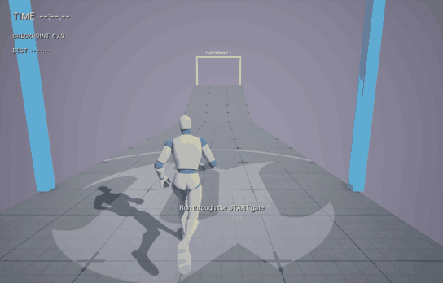

| 구간 | 평균 수평 속도 | 경사면을 따라 환산 |
| --- | --- | --- |
| 출발 평지 | 375cm/s | 375cm/s |
| 20° 오르막 | 353cm/s | 353 / cos20° = 376cm/s |
| 30° 내리막 | 332cm/s (최저 325) | 325 / cos30° = 375cm/s |
| 20° 옆 경사 | 375cm/s | 375cm/s |

처음엔 오르막에서 느려지는 줄 알았는데, 경사면을 따라서는 똑같이 375cm/s로 달리고 수평 성분만 cos만큼 줄어든 것이었다. 속도는 그대로고 포즈만 경사에 맞춘다.

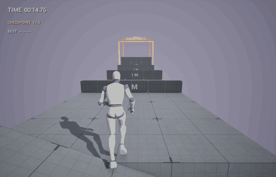

허들은 넘어가고, 100cm 벽은 깊이가 80cm라 올라섰다가 앞으로 내려오고, 두 단상은 차례로 올라선다. 점프는 장애물마다 한 번씩만 눌렀다.

| 위치 | HUD 시간 |
| --- | --- |
| START 문 | 00:00.00 |
| 체크포인트 1 (고원) | 00:07.73 |
| 체크포인트 2 (150cm 단상) | 00:20.81 |
| FINISH (300cm 단상) | 00:22.73 |

다섯 번 달려 봤는데 22.62~22.81초 사이에서 나왔다. 평지 속도로 출발 문에서 결승 문까지 수평 83m를 쉬지 않고 달리면 22초 남짓인데, 장애물에서 멈칫하고도 거의 그만큼 나왔다. 몽타주가 끝나자마자 Motion Matching이 달리기를 골라 이어 주기 때문이다.

---

<a id="fall"></a>

## 4. 떨어지면 체크포인트에서 다시

체크포인트 1을 지난 뒤 일부러 고원 옆으로 걸어가게 했다.

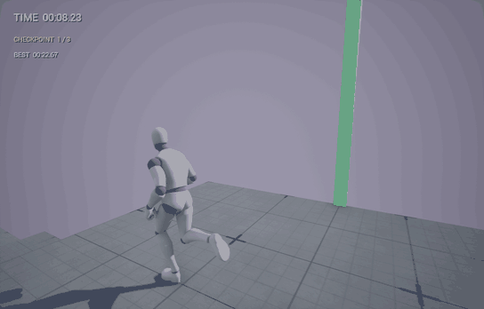

고원 옆으로 걸어가다 떨어졌다. 캡슐이 -300cm 아래로 내려가자 게임 모드가 체크포인트 1 문 뒤 1.5m(2984, 0, 고원 위)에 캐릭터를 새로 만들었고, HUD에 FALLS 1이 떴다. 타이머는 멈추지 않아서 떨어진 만큼 기록이 늦어진다. 다시 선 뒤에도 같은 쪽으로 계속 걸어서 2.5초쯤 뒤 한 번 더 떨어졌고 FALLS 2가 됐다.

캐릭터를 옮기지 않고 새로 만드는 건 [Control Rig 문서](ControlRig.md#stuck)에서 겪은 일 때문이다. Mover 캐릭터는 위치를 자기 시뮬레이션 상태로 들고 있어서 `TeleportTo` 가 한 번만 먹혔다. `RestartPlayerAtTransform` 으로 새로 만들면 Motion Matching이 고르던 애니메이션도, Control Rig가 기억하던 바닥과 골반 위치도 처음부터 시작한다. [Control Rig 문서](ControlRig.md#pitfalls)에서 본 "텔레포트 직후 다리가 튀는" 문제도 따로 신경 쓸 필요가 없었다.

---

<a id="stuck"></a>

## 5. 만들면서 헤맨 부분

### 장애물을 넘을 때마다 옆으로 1.2m 밀렸다

처음 녹화에서는 허들, 벽, 단상을 넘을 때마다 캐릭터가 오른쪽으로 120cm씩 밀려났다. 120cm는 장애물 폭 600cm의 딱 20%다. [Motion Warping 문서](MotionWarping.md#wrong-target)에서 겪은 것과 같은 문제였다.

Python으로 놓은 `LevelBlock_Traversable` 은 Construction Script가 Ledge 스플라인의 점은 찍지만, 스플라인 길이 값은 템플릿의 100cm에 머문다. 넘기 목표를 고를 때 이 길이로 양 끝을 잘라 내니까 목표가 한쪽으로 쏠렸다. 블록을 놓은 뒤 스플라인마다 `UpdateSpline()` 을 불러서 해결했다. Motion Warping 문서에서는 PIE에서 스폰한 블록이었는데, 에디터에서 Python으로 놓은 블록도 똑같았다.

### Motion Warping 디버그가 안 보였다

`a.MotionWarping.Debug 1` 을 켰는데 게임 화면에 아무것도 안 나왔다. 엔진 소스를 보니 1은 로그만 남기고, 화면에 그리는 건 2였다. Warp Target 표시는 `a.MotionWarping.Debug.Target 2` 로 따로 켜야 한다.

### 결승 뒤에 떨어진 것도 셌다

결승선을 지나고도 앞으로 계속 달리다가 코스 끝에서 떨어졌는데 HUD에 FALLS 1이 떴다. 기록 중이 아닐 때 떨어진 건 셀 이유가 없어서, 달리는 중일 때만 세게 고쳤다. 다시 세우는 건 그대로 한다.

---

<a id="summary"></a>

## 6. 정리

세 문서를 쓸 때는 기능을 하나씩 떼어서 봤는데, 게임으로 묶어 보니 한 캐릭터 안에서 순서대로 일하고 있었다. 장애물 앞까지는 Motion Matching이 달리기를 고르고, 점프를 누르면 Motion Warping이 1m짜리 넘기 동작을 장애물 높이에 맞추고, 그동안 내내 Control Rig가 발을 바닥에 붙인다. 경사에서는 Motion Matching이 평지 달리기를 그대로 틀고 Control Rig가 그걸 경사에 맞춘다.

직접 손댄 건 생각보다 적었다. CVar 하나를 바꾸고, 경사와 넘을 수 있는 블록을 놓고, 블록의 스플라인을 다시 계산한 정도다. 애니메이션은 GASP가 이미 다 만들어 둔 것이고, 여기서 한 일은 그 캐릭터가 달릴 코스와 잴 기록을 만든 것이다.

---

<a id="reproduce"></a>

## 7. 부록

코스 배치와 기록에 쓴 스크립트는 [Scripts/ParkourCourse](../../Scripts/ParkourCourse/README.md)에 있다. GASP 에셋과 코스 맵(`Content/ParkourCourse/Maps/L_ParkourCourse.umap`)이 저장소에 들어 있어서, 클론한 뒤 C++만 빌드하면 맵을 열어 바로 플레이할 수 있다. 조작은 GASP와 같다.

| 입력 | 키보드 | 게임패드 |
| --- | --- | --- |
| 이동 | WASD | 왼쪽 스틱 |
| 카메라 돌리기 | 마우스 | 오른쪽 스틱 |
| 점프 / 장애물 넘기 | Space | A |
| 전력질주 | 왼쪽 Shift | LB |
| 걷기 | 왼쪽 Ctrl | RB |
| 웅크리기 | C | B |

`IMC_Sandbox` 에서 읽은 값이다. 캐릭터 바꾸기(N)와 외형 바꾸기(M)는 GASP의 `GM_Sandbox` 와 외형 에셋이 있어야 하는 기능이라 여기서는 안 된다.

주행 기록 요약은 [summary.json](Evidence/ParkourCourse/summary.json), 기능별 기록(Motion Matching이 고른 DB, 발 디딤 켬/끔 발 높이, Warp Target)은 [systems.json](Evidence/ParkourCourse/systems.json)에 남겨 두었다.

`Content/Blueprints`, `Content/Characters/UEFN_Mannequin`, `Content/Levels/LevelPrototyping`, `Content/Input`, `Content/Audio` 등은 Epic Games의 Game Animation Sample(UE 5.8)에서 가져온 에셋이다. 경로는 샘플과 같고 수정하지 않았다.

### 참고

- [Game Animation Sample Project](https://dev.epicgames.com/documentation/en-us/unreal-engine/game-animation-sample-project-in-unreal-engine) - 공식 문서
- [Mover](https://dev.epicgames.com/documentation/en-us/unreal-engine/mover-in-unreal-engine) - 공식 문서
- 이 저장소의 [Motion Matching](MotionMatching.md), [Motion Warping](MotionWarping.md), [Control Rig](ControlRig.md) 문서

---

[목차로 돌아가기](#contents) · [메인 README의 Unreal Engine 목차로 돌아가기](../../README.md#unreal-engine)
