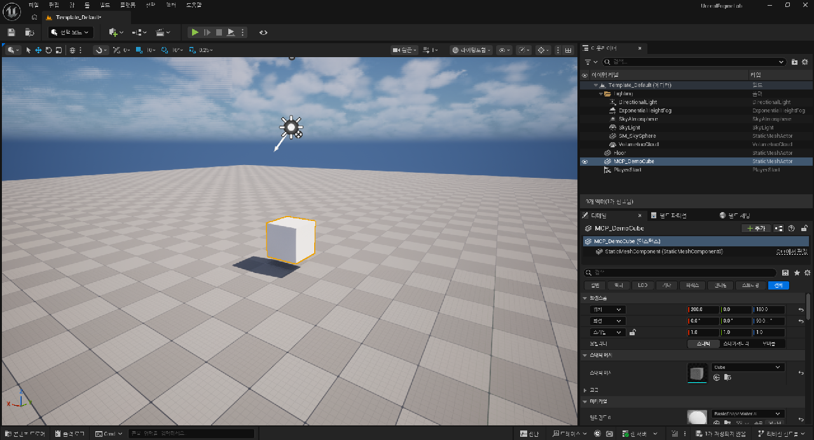
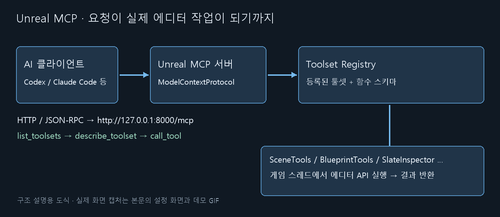
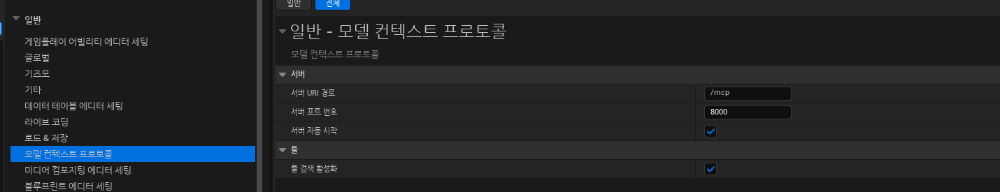
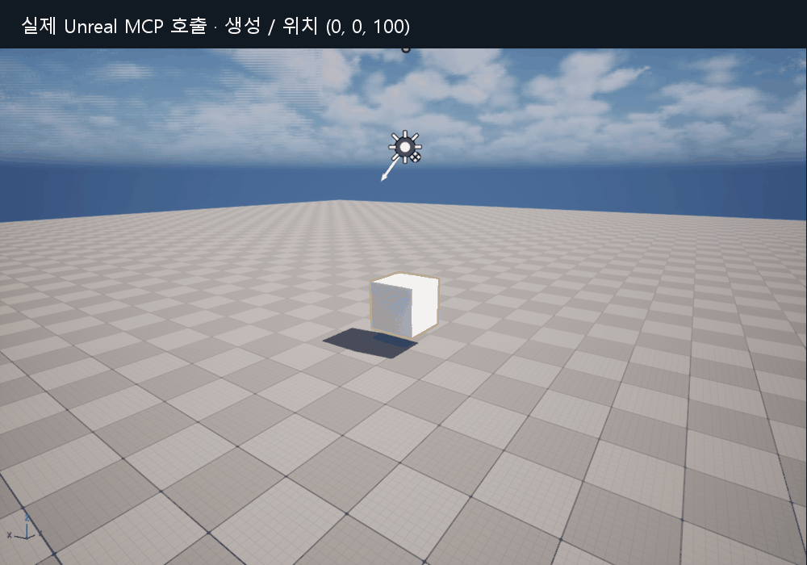

# Unreal MCP 연결하기 — 구조와 작업별 툴셋 사용법

언리얼 기능을 공부하면서 에디터 상태를 읽고, 블루프린트 설정을 확인하고, 같은 실험을 반복하는 데 MCP를 썼다. 연결 주소 하나만 알면 끝날 줄 알았는데 **서버 플러그인, 실제 작업을 하는 툴셋, AI 클라이언트의 설정**을 각각 맞춰야 했다. 이 문서는 그 세 부분을 직접 확인하며 정리한 기록이다.

UE **5.8.3 / CL 58210709**, Windows, 이 저장소의 UnrealEngineLab 기준이다. 2026-10-23 실행한 에디터에서 **53개 툴셋, 836개 도구 스키마**를 조회했다. 설치 버전·활성 플러그인·프로젝트 확장에 따라 목록은 달라진다. 모든 도구를 실행한 것은 아니며, 실제 실행 범위는 [검증 기록](#evidence)에 따로 적었다.



위 큐브는 `SceneTools`로 만들고 `ActorTools`로 옮겼다. 오른쪽 Details의 위치 `(200, 0, 180)`, Z 회전 `90°`까지 실제 호출 결과와 확인했다.

## 목차

1. [MCP가 해 주는 일](#what)
2. [전체 구조 — 누가 누구를 호출하나](#architecture)
3. [플러그인과 서버 준비](#setup)
4. [Codex 등 AI 클라이언트 연결](#client)
5. [연결 확인과 도구 검색](#discovery)
6. [작업별 툴셋 선택](#toolsets)
7. [직접 해 보기 — 생성 → 이동 → 확인 → 정리](#demo)
8. [프로젝트 전용 도구 추가](#custom)
9. [막혔던 부분과 확인 순서](#troubleshooting)
10. [검증 기록·전체 목록·참고 자료](#evidence)

<a id="what"></a>

## 1. MCP가 해 주는 일

MCP(Model Context Protocol)는 AI 클라이언트가 외부 프로그램의 도구 목록과 입력 형식을 알아보고 함수를 호출하는 통신 규약이다. Unreal MCP는 에디터 프로세스 안에 HTTP 서버를 띄워 그 요청을 언리얼 기능으로 연결한다. 플러그인 브라우저의 이름은 **Unreal MCP**, `.uproject`와 콘솔에서 사용하는 식별자는 **`ModelContextProtocol`**이다. [Epic 공식 안내](https://dev.epicgames.com/documentation/en-us/unreal-engine/unreal-mcp-in-unreal-editor)

예를 들어 “선택한 액터의 위치를 알려 줘”라는 요청은 다음처럼 처리된다.

| 단계 | 하는 일 |
| --- | --- |
| AI 클라이언트 | 요청을 해석하고 필요한 도구와 인수를 선택한다 |
| MCP 서버 | JSON-RPC 요청을 받아 도구 호출로 연결한다 |
| 툴셋 | 에디터 API를 사용해 선택 액터와 Transform을 읽는다 |
| 결과 | 객체 참조와 값이 클라이언트로 돌아오고, AI가 설명한다 |

프로젝트의 C++ 텍스트를 읽는 것과, 현재 열린 맵에서 실제 액터를 조회하는 것은 얻는 정보가 다르다. MCP는 후자까지 연결한다. 다만 도구 호출 성공이 게임 동작 전체의 성공을 뜻하지는 않는다. 블루프린트를 고쳤다면 컴파일, 실행 결과, 로그와 화면을 이어서 확인해야 한다.

<a id="architecture"></a>

## 2. 전체 구조 — 누가 누구를 호출하나



| 구성 | 역할 | 혼동하기 쉬운 점 |
| --- | --- | --- |
| AI 클라이언트 | Codex, Claude Code 등. 도구를 고르고 호출한다 | 엔진 자체에 모델이 설치되는 것은 아니다 |
| `ModelContextProtocol` | HTTP 서버, MCP 요청과 응답, 도구 검색·호출 연결 | 이것만 켜도 모든 편집 기능이 생기지는 않는다 |
| `ToolsetRegistry` | 등록된 `UToolsetDefinition`과 호출 가능한 함수를 모은다 | MCP 외의 엔진 기능도 같은 레지스트리를 사용할 수 있다 |
| `EditorToolset` 등 | 액터·에셋·그래프·PIE 같은 실제 작업 API | 하나의 플러그인이 여러 툴셋 클래스를 제공한다 |
| `AllToolsets` | 여러 기본 툴셋 플러그인을 한꺼번에 활성화하는 묶음 | 이 설치본의 모든 툴셋 플러그인이 종속성에 들어 있지는 않다 |
| 프로젝트 전용 툴셋 | 게임 규칙에 맞춘 실험·조회 함수를 제공한다 | 이 저장소의 `AIWidgetInspector`도 여기에 해당한다 |

**플러그인 이름, 툴셋 이름, 도구 이름은 서로 다르다.** 예를 들어 `EditorToolset` 플러그인 안에 `editor_toolset.toolsets.scene.SceneTools`가 있고, 그 안에 `find_actors`가 있다. 대소문자와 전체 이름은 현재 서버 응답을 기준으로 쓴다.

`MCPClientToolset`은 방향이 다르다. 언리얼에서 다른 외부 MCP 서버를 사용하기 위한 쪽이며, 외부 AI가 언리얼에 연결할 때 켜는 서버는 `ModelContextProtocol`이다.

툴 실행은 게임 스레드와 동기화된다. 하나의 에디터에 편집 호출을 겹쳐 보내지 않고, **호출 → 결과 확인 → 다음 호출** 순서로 진행하는 편이 상태를 추적하기 쉽다. [Epic 실행 구조 설명](https://dev.epicgames.com/documentation/en-us/unreal-engine/unreal-mcp-in-unreal-editor)

<a id="setup"></a>

## 3. 플러그인과 서버 준비

### 3.1 플러그인 켜기

1. **편집(Edit) → 플러그인(Plugins)**에서 `Unreal MCP`를 찾아 켠다.
2. 기본 기능을 넓게 사용하려면 `All Toolsets`를 켠다. 필요한 도구만 사용할 때는 개별 툴셋 플러그인을 선택한다.
3. 의존하는 `Toolset Registry`가 함께 켜졌는지 확인하고, 안내에 따라 에디터를 재시작한다.

현재 프로젝트의 `.uproject`에는 다음 항목이 들어 있다. 이름을 검색할 때 UI 표시 이름과 내부 식별자가 다를 수 있다.

```json
{"Name": "ModelContextProtocol", "Enabled": true},
{"Name": "EditorToolset", "Enabled": true},
{"Name": "AllToolsets", "Enabled": true}
```

위는 `Plugins` 배열의 항목을 발췌한 것이다. 파일 전체를 이 내용으로 덮어쓰지 않는다. `Terminal`은 에디터 안에서 CLI를 쓸 때의 선택 사항이다.

### 3.2 서버 주소와 자동 시작

**편집 → 에디터 개인설정(Editor Preferences) → 일반 → 모델 컨텍스트 프로토콜**을 연다.



*실제 한국어 UI 캡처. 이 환경은 서버 자동 시작과 툴 검색이 체크되어 있다. 엔진 소스에 선언된 자동 시작 기본값은 false다.*

| 설정 | 소스 기본값 | 의미 |
| --- | --- | --- |
| Server URI Path | `/mcp` | HTTP 요청을 받을 경로 |
| Server Port Number | `8000` | 현재 에디터 서버의 포트 |
| Auto Start Server | `false` | 에디터를 열 때 자동으로 서버를 시작할지 |
| Enable Tool Search | `true` | 도구를 툴셋 단위로 찾아 호출할지 |

수동으로 시작할 때는 에디터 하단 콘솔에 입력한다.

```text
ModelContextProtocol.StartServer
```

다른 에디터가 8000을 쓰고 있다면 **두 번째 에디터에서** 명시적으로 다른 포트를 준다.

```text
ModelContextProtocol.StartServer 8001
```

이 경우 클라이언트도 `http://127.0.0.1:8001/mcp`로 바꿔야 한다. 서버가 어느 프로젝트인지 확인하기 전에는 편집 도구를 호출하지 않는다.

에디터 실행 옵션으로 지정하는 방법도 있다. 아래 경로는 이 PC의 예시다.

```powershell
& 'D:\Epic Games\UE_5.8\Engine\Binaries\Win64\UnrealEditor.exe' `
  'D:\Unreal Projects\UnrealEngineLab\UnrealEngineLab.uproject' `
  -ModelContextProtocolStartServer -ModelContextProtocolPort=8000
```

Unreal MCP는 이 버전에서 Experimental 기능이며 로컬 사용을 전제로 한다. 기본 인증이 없으므로 외부 접속을 위해 포트를 공개하는 구성은 이 문서의 범위에 포함하지 않는다. [Epic 제한 사항](https://dev.epicgames.com/documentation/en-us/unreal-engine/unreal-mcp-in-unreal-editor)

<a id="client"></a>

## 4. Codex 등 AI 클라이언트 연결

### 4.1 Codex 설정

실행 중인 에디터 주소를 Codex에 등록한다. 아래 명령은 **독자가 설정할 때 실행하는 예시**이며, 이 문서 작성 과정에서 사용자 Codex 설정을 변경하지 않았다.

```powershell
codex mcp add unreal-mcp --url http://127.0.0.1:8000/mcp
codex mcp list
```

직접 설정한다면 사용자 `~/.codex/config.toml` 또는 신뢰한 프로젝트의 `.codex/config.toml`에 다음 테이블을 추가한다. 기존 같은 이름의 테이블이 있으면 중복 추가하지 않고 주소를 확인한다.

```toml
[mcp_servers.unreal-mcp]
url = "http://127.0.0.1:8000/mcp"
```

에디터를 먼저 열고 서버를 시작한 뒤, 클라이언트에서 MCP를 다시 연결하거나 재시작한다. Codex의 Streamable HTTP 및 설정 파일 위치는 [OpenAI 공식 MCP 안내](https://learn.chatgpt.com/docs/extend/mcp)에 정리되어 있다. `codex mcp list`는 설정 등록 확인이며 실제 서버 응답 확인은 다음 장에서 진행한다.

### 4.2 엔진의 설정 생성 명령

에디터 콘솔의 `ModelContextProtocol.GenerateClientConfig`는 클라이언트에 맞는 파일을 생성한다.

```text
ModelContextProtocol.GenerateClientConfig Codex
ModelContextProtocol.GenerateClientConfig ClaudeCode
```

클라이언트마다 설정 파일이 다르다. 이 저장소의 `.mcp.json`은 다음 JSON 형태지만, Codex는 위 TOML 형식을 사용한다.

```json
{
  "mcpServers": {
    "unreal-mcp": {
      "type": "http",
      "url": "http://127.0.0.1:8000/mcp"
    }
  }
}
```

엔진 생성기는 JSON 설정을 병합하지만, Codex용 TOML이 이미 있으면 덮어쓰지 않는다. 기존 설정을 삭제하기보다 내용을 확인해 필요한 서버 항목만 갱신한다. 지원 클라이언트와 생성 동작은 [Epic 설정 안내](https://dev.epicgames.com/documentation/en-us/unreal-engine/unreal-mcp-in-unreal-editor)를 참고한다.

<a id="discovery"></a>

## 5. 연결 확인과 도구 검색

### 5.1 세 단계로 나누어 확인하기

| 확인 | 성공 기준 | 아직 알 수 없는 것 |
| --- | --- | --- |
| 클라이언트 설정 | 서버 이름과 URL이 등록되어 있다 | 에디터가 실행 중인지 |
| 프로토콜 연결 | `initialize`와 `tools/list` 응답을 받는다 | 원하는 툴셋이 있는지 |
| 실제 조회 | 현재 레벨·선택 액터를 읽어 기대 프로젝트와 일치한다 | 편집이나 게임 실행까지 정상인지 |

브라우저 주소창에서 `/mcp`를 여는 것은 GET 요청이다. 이 설치본은 GET에 405를 반환하므로 이를 연결 실패로 판단하면 안 된다. 예제 클라이언트는 POST `initialize → notifications/initialized → tools/list`를 사용한다.

### 5.2 도구가 세 개만 보이는 이유

`Enable Tool Search`가 켜진 현재 환경의 `tools/list`에는 다음 세 개만 있다.

| 메타 도구 | 하는 일 |
| --- | --- |
| `list_toolsets` | 현재 에디터의 툴셋 이름과 설명을 나열한다 |
| `describe_toolset` | 특정 툴셋의 도구 이름·인수·반환 스키마를 읽는다 |
| `call_tool` | 툴셋 이름과 도구 이름, 실제 인수를 전달한다 |

836개 도구 스키마를 처음부터 전부 읽기보다 작업에 필요한 툴셋을 고르는 구조다. 도구 검색을 끈 경우에는 노출 형태가 달라진다. **“세 개만 보임”과 “SceneTools가 목록에도 없음”은 다른 상황**이다.

```json
{"name":"describe_toolset","arguments":{
  "toolset_name":"editor_toolset.toolsets.scene.SceneTools"
}}
```

스키마를 읽은 후 현재 레벨을 조회한다. 아래는 `tools/call`의 파라미터 부분이다.

```json
{"name":"call_tool","arguments":{
  "toolset_name":"editor_toolset.toolsets.scene.SceneTools",
  "tool_name":"get_current_level",
  "arguments":{}
}}
```

이 문서를 촬영한 세션은 `/Engine/Maps/Templates/Template_Default`를 열었다. 프로젝트 이름만 믿지 않고 실제 레벨 응답까지 확인하는 것이 좋다. 객체 인수는 단순 표시 이름 대신 서버가 돌려준 `{"refPath":"..."}` 참조를 그대로 전달한다.

<a id="toolsets"></a>

## 6. 작업별 툴셋 선택

아래는 실제 조회 목록과 각 스키마를 읽고 묶은 선택표다. 함수명이 있다고 모든 프로젝트에서 곧바로 실행할 수 있는 것은 아니다. 대상 에셋, 플러그인, PIE 여부를 먼저 확인한다. 전체 식별자와 함수 목록은 [부록 카탈로그](UnrealMCPToolsets.md)에 있다.

| 하고 싶은 일 | 먼저 볼 툴셋 | 대표 기능과 사용 순서 |
| --- | --- | --- |
| 레벨의 액터 찾기 | `SceneTools` | `get_current_level`, `find_actors`; 생성·제거는 `add_to_scene_from_asset`, `remove_from_scene` |
| 위치·태그·컴포넌트 | `ActorTools`, `ObjectTools` | Transform·컴포넌트를 읽고 변경; 일반 프로퍼티는 `get_properties`, `set_properties` |
| 에셋 경로와 의존성 | `AssetTools` | 검색, 참조·의존성, dirty 상태, 저장; 파일 읽기·쓰기 기능도 있어 호출 범위를 확인한다 |
| 블루프린트 그래프 | `BlueprintTools` | 노드·핀·연결 조회, 변수·함수 편집, 그래프 DSL 읽기·쓰기; DSL 문법을 먼저 조회한다 |
| PIE·카메라·캡처 | `EditorAppToolset` | `GetSelectedActors`, `SetCameraTransform`, `StartPIE`, `StopPIE`, 이미지 캡처 |
| 화면에서만 접근 가능한 UI | `SlateInspectorToolset` | `Observe → Snapshot → Click/Type → Screenshot`; 좌표 추측보다 현재 ref 사용 |
| 로그와 설정 | `LogsToolset`, `ConfigSettingsToolset` | 로그 범위·카테고리 조회, 설정 스키마와 값 조회, 변경·저장 |
| 데이터 관리 | `DataTableTools`, `CurveTableTools`, `StringTableTools`, `DataAssetTools`, `DataRegistryTools` | 행·키·스키마·레지스트리 읽기와 각 도구가 지원하는 생성·편집 |
| 머티리얼·메시 | `MaterialTools`, `MaterialInstanceTools`, `StaticMeshTools`, `SkeletalMeshTools`, `TextureTools` | 파라미터, 그래프, LOD·콜리전·소켓·텍스처 정보 |
| 애니메이션 제작 | `ControlRigTools`, `Sequencer*Tools` | 릭 노드·핀, 바인딩·트랙·키·컨트롤·애니메이션 입출력 |
| 게임플레이 시스템 | `StateTreeTools`, `BehaviorTreeTools`, `GameplayTagsToolset`, `GASToolsets` | 트리·태그·어빌리티 상태 확인. BehaviorTree는 이 목록에서 검사 기능 중심 |
| UI 에셋 | `UMGToolSet` | 위젯 구성·이름·래핑 등; 실행 중 Slate UI 검사와 구분한다 |
| FX·절차 생성 | `NiagaraToolset_*`, `PCGToolset`, `PCGSpatialToolset`, `DataflowAgentToolset` | 시스템·노드·파라미터 편집과 생성 작업 |
| 피직스 에셋 | `PhysicsAssetToolset` | 바디·셰이프·질량·제약 설정 |
| 플러그인·기능 상태 | `PluginToolset`, `GameFeaturesToolset` | 활성 플러그인과 Game Feature 상태 조회·변경 |
| 자동화 테스트 | `AutomationTestToolset` | `DiscoverTests → ListTests → RunTests → GetTestStatus/GetTestResults` |
| 의미 검색·조건·대화 | `SemanticSearchToolset`, `WorldConditionTools`, `ConversationTools` | 유사 대상 검색, 조건 설명, 대화 그래프 검사 |
| 반복 호출 묶기 | `ProgrammaticToolset` | `get_execution_environment`를 먼저 읽고 `execute_tool_script`; 허용된 도구 API 조합용 환경 |
| 작업 지침 | `AgentSkillToolset` | 스킬 목록과 내용 조회·작성; 에디터 작업 API와 역할이 다르다 |

`AIWidgetInspector.AIWidgetInspectorToolset`은 이 프로젝트의 별도 플러그인이다. 위젯 트리 조회, 변경 미리보기·되돌리기·적용·저장을 제공한다. 다른 프로젝트에서도 기본 제공된다고 가정하면 안 된다.

### 조회와 수정, 저장을 구분하기

| 종류 | 예 | 확인할 것 |
| --- | --- | --- |
| 조회 | `find_actors`, `get_actor_transform`, `GetLogEntries` | 현재 월드·대상·반환 값 |
| 에디터 상태 변경 | 액터 선택, 카메라 이동, UI 클릭, PIE 시작 | 바뀐 화면과 실행 상태 |
| 콘텐츠 변경 | Transform 변경, 그래프 편집, 위젯 추가 | 변경 전후 값, 컴파일, 실행 결과 |
| 디스크 기록 | `save_assets`, `SaveSection`, 파일 쓰기 | 저장할 경로와 변경 목록 |

`set_*`가 성공했다고 파일에 저장된 것으로 보지 않는다. 반대로 일부 도구는 자체적으로 파일을 쓰므로, 저장 버튼을 누르지 않았다는 이유만으로 디스크가 안 바뀌었다고 판단하지 않는다. 선택한 함수의 설명을 읽는다.

<a id="demo"></a>

## 7. 직접 해 보기 — 생성 → 이동 → 확인 → 정리



*실제 에디터 뷰포트 캡처를 호출 단계별로 묶었다. 연속 게임 녹화가 아닌 단계별 GIF이며, 프레임 사이의 이동을 보간하지 않았다.*

이번 예제는 빈 템플릿 맵에서 큐브 하나를 만들어 MCP가 실제 상태를 바꾸는지 확인한다.

1. `SceneTools.add_to_scene_from_asset`로 `/Engine/BasicShapes/Cube.Cube`를 생성한다.
2. 반환된 액터 참조를 `SelectActors`에 넘긴다.
3. `ActorTools.set_actor_transform`으로 이동·회전한다.
4. 매번 `get_actor_transform`으로 실제 값을 다시 읽는다.
5. `CaptureViewport`와 에디터 전체 화면으로 기록한다.
6. 생성한 액터를 제거하고 카메라를 복원한다. 맵은 저장하지 않는다.

위치 변경 호출은 다음 형태다. `actor`에는 생성 응답에서 받은 참조를 사용한다.

```python
client.call("editor_toolset.toolsets.actor.ActorTools", "set_actor_transform", {
    "actor": actor,
    "xform": {
        "location": {"x": 200, "y": 0, "z": 180},
        "rotation": {"pitch": 0, "yaw": 90, "roll": 0}
    }
})
```

스크립트는 [record_demo.py](../../Scripts/UnrealMCP/record_demo.py), 실제 인수·반환 값은 [demo.json](Evidence/UnrealMCP/demo.json)에 있다. 조회용 [collect_inventory.py](../../Scripts/UnrealMCP/collect_inventory.py)도 함께 둔다. 에디터에서 쓸 전용 Python 패키지를 별도로 설치하지 않고, 외부 Python 표준 라이브러리로 HTTP를 호출했다.

### 요청을 구체적으로 쓰기

> 현재 레벨과 선택 액터를 먼저 조회해 줘. 선택 액터의 Transform과 컴포넌트를 정리하고, 아직 수정하거나 저장하지 마.

> 이 블루프린트에서 입력 이벤트부터 모션 워핑 타깃 설정까지 연결된 노드만 찾아 설명해 줘. 필요한 툴셋 스키마를 먼저 확인해 줘.

> 테스트 맵에서 큐브 하나를 생성해 X 방향으로 200cm 이동하고 Z 회전을 90도로 바꿔 줘. 실제 값을 다시 조회하고 화면을 캡처한 후 생성한 큐브를 정리해 줘. 맵은 저장하지 마.

대상, 허용할 변경, 확인 방법을 함께 적으면 작업 결과를 비교하기 쉽다.

<a id="custom"></a>

## 8. 프로젝트 전용 도구 추가

범용 도구를 수십 번 조합해야 하는 실험은 프로젝트 전용 함수로 묶을 수 있다. 예를 들어 파쿠르 테스트에서 시작 위치 초기화, 같은 입력 재생, 타깃 오차 수집을 각각 명시적인 동작으로 제공하는 식이다.

등록의 중심은 `UToolsetDefinition`이다. Python은 `unreal.ToolsetDefinition`을 상속하고 `@unreal.uclass()`로 노출한다. 도구 함수는 레지스트리가 인식할 데코레이터를 사용한다. C++은 `UFUNCTION`의 `AICallable` 메타데이터를 사용하는 경로가 있다. [Epic 도구 작성 안내](https://dev.epicgames.com/documentation/en-us/unreal-engine/unreal-mcp-in-unreal-editor)

권장 모양은 **작업 의도가 드러나는 좁은 함수**다. `reset_trial`, `read_warp_error`처럼 인수와 결과를 제한하면 재현하기 쉽다. 커스텀 도구가 등록되면 `list_toolsets`로 실제 식별자를 다시 찾는다. Python 동적 클래스의 접미사는 세션에 따라 달라질 수 있다.

`ProgrammaticToolset`의 실행 환경은 일반 Python 콘솔과 다르다. `get_execution_environment`에서 허용 모듈과 `run()` 진입점 규칙을 읽고, 호출할 도구의 반환 스키마를 확인한 뒤 사용한다. 임의의 `import unreal`이나 파일 접근을 지원한다고 가정하지 않는다.

<a id="troubleshooting"></a>

## 9. 막혔던 부분과 확인 순서

| 증상 | 먼저 확인할 것 | 조치 |
| --- | --- | --- |
| 연결 거부 / 10061 | 에디터 실행과 서버 시작, URL·포트 | 서버를 시작하고 같은 URL로 POST 연결을 확인 |
| 주소창에 열면 405 | HTTP 메서드 | GET 대신 MCP 클라이언트로 초기화 |
| 도구가 세 개뿐 | Enable Tool Search | `list_toolsets`, `describe_toolset`, `call_tool` 사용 |
| 원하는 툴셋이 없음 | 개별 플러그인, 재시작, Python 모듈 로드 로그 | 활성화와 로딩 실패 원인을 확인하고 목록 재조회 |
| 다른 프로젝트가 바뀜 | 여러 에디터와 포트 매핑 | 프로젝트별 포트 분리, 현재 레벨 조회 후 작업 |
| 설정 파일을 만들었는데 안 연결됨 | 클라이언트가 읽는 형식·위치 | Codex TOML과 `.mcp.json` 구분, 기존 URL·재연결 확인 |
| 인수 기본값 오류 | 실제 스키마와 빌드의 인수 처리 | 이 실행의 `CaptureViewport`는 `captureTransform: null`, `annotations: null`을 명시해야 성공했다 |
| 그래프 DSL이 비어 있음 | 그래프 종류·노드 지원 범위 | 노드 검색·연결 조회로 교차 확인. 빈 결과로 그래프가 없다고 결론 내리지 않음 |
| 캡처에 게임이 안 보임 | 에디터·에셋 프리뷰·PIE 중 어느 뷰인지 | 게임 월드와 카메라를 확인하고 캡처 API 선택 |
| 오래 걸리거나 응답이 멎음 | 로딩·컴파일·모달 창·PIE 상태 | 상태·로그부터 확인하고 호출을 겹쳐 재시도하지 않음 |

### 캡처 도구도 용도가 다르다

| 도구 | 적합한 대상 |
| --- | --- |
| `CaptureEditorImage` | 에디터 전체 배치와 패널 |
| `CaptureViewport` | 에디터 3D 뷰포트와 공간 변화 |
| `CaptureAssetImage` | 특정 에셋의 미리보기 |
| Slate `Screenshot` | 설정 창, 에디터 UI, 지정 위젯 |
| 게임 뷰포트의 캡처 | 실제 PIE 게임 화면. 활성 월드·카메라 확인 필요 |

[Motion Warping 문서](MotionWarping.md)를 만들 때도 에셋 프리뷰와 게임 실행 화면을 구분하는 것이 중요했다. 사진 한 장으로 게임 로직을 검증했다고 말하기보다, **호출 결과·실제 값·로그·화면이 같은 대상을 가리키는지** 확인한다.

<a id="evidence"></a>

## 10. 검증 기록·전체 목록·참고 자료

### 이번에 확인한 범위

| 항목 | 결과 |
| --- | --- |
| 엔진 | 로컬 `Build.version`: UE 5.8.3 / CL 58210709 |
| 연결 | `http://127.0.0.1:8000/mcp`, initialize·initialized·tools/list 응답 |
| 검색 | 실제 53개 툴셋과 836개 도구 스키마 수집 |
| 상태 변경 | 큐브 생성·선택·위치·회전 변경 후 값 재조회 |
| 화면 | 실제 설정 창, 에디터, 단계별 뷰포트 캡처 |
| 정리 | 데모 액터 제거, 카메라 복원, 맵 저장 안 함 |
| 미실행 | 전체 836개 도구, 모든 클라이언트 연결, 자동화 테스트·패키징 |

현재 빌드의 `initialize.serverInfo`는 이름·버전이 빈 문자열로 응답했다. 따라서 문서의 엔진 버전은 이 필드에서 추정하지 않고 로컬 엔진 파일로 확인했다. 공식 문서의 일반 설명과 실제 응답이 다를 수 있어 원본도 함께 남겼다.

- [연결 응답](Evidence/UnrealMCP/connection.json), [툴셋 목록](Evidence/UnrealMCP/toolsets.json), [전체 카탈로그 JSON](Evidence/UnrealMCP/catalog.json)
- [전체 툴셋 기능표](UnrealMCPToolsets.md), [실제 데모 호출 기록](Evidence/UnrealMCP/demo.json)
- [재현 스크립트 안내](../../Scripts/UnrealMCP/README.md)

### 엔진 소스에서 확인한 위치

아래는 설치 엔진의 `Engine/Plugins/Experimental/` 기준 경로다. 엔진 소스는 이 저장소에 복사하지 않았다.

| 경로 | 확인한 내용 |
| --- | --- |
| `ModelContextProtocol/Source/ModelContextProtocolEngine/Public/ModelContextProtocolSettings.h` | URI·포트·자동 시작·도구 검색 기본값 |
| `ModelContextProtocol/Source/ModelContextProtocolEngine/Private/ModelContextProtocolSettings.cpp` | 실행 옵션에서 포트와 자동 시작을 읽는 동작 |
| `ModelContextProtocol/Source/ModelContextProtocol/Private/ModelContextProtocolModule.cpp` | StartServer 등 콘솔 명령 |
| `Toolsets/AllToolsets/AllToolsets.uplugin` | 기본 툴셋 플러그인 종속성 목록 |
| `Toolsets/EditorToolset/Content/Python/editor_toolset/toolsets/` | Scene·Actor·Blueprint·Programmatic 등 실제 구현 |
| `Toolsets/SlateInspectorToolset/Source/SlateInspectorToolset/Public/SlateInspectorToolset.h` | Observe·Snapshot·Screenshot·입력 도구 용도 |

### 참고 자료

- [Epic: Unreal MCP in Unreal Editor](https://dev.epicgames.com/documentation/en-us/unreal-engine/unreal-mcp-in-unreal-editor) — 설치·구조·도구 작성·제약
- [OpenAI: MCP 연결 설정](https://learn.chatgpt.com/docs/extend/mcp) — Codex의 Streamable HTTP와 TOML 설정
- [MCP 공식 사양](https://modelcontextprotocol.io/specification/2025-03-26/basic/transports) — HTTP 전송과 초기화의 배경. 이번 테스트에서 협상된 프로토콜은 응답에 기록된 `2024-11-05`

[Unreal Engine 문서 목록](README.md) · [저장소 소개](../../README.md)
